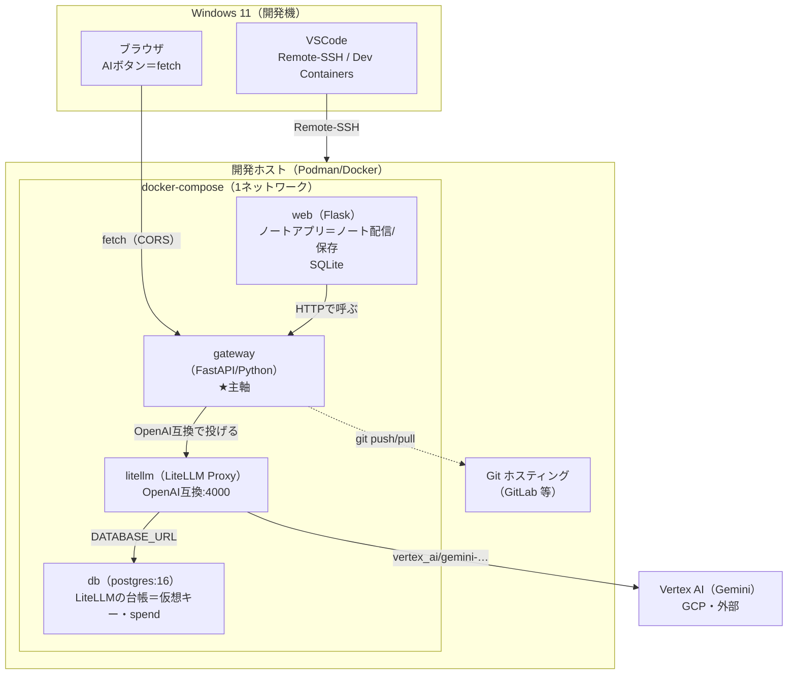

# 開発環境構築 ── コンテナ構成（4サービス）

*個人検討ノートの一般化版（2026-11-16 同期・正は個人 Vault）*

> [!NOTE]
> **このドキュメントの位置づけ**
> このプロジェクトの開発環境を立ち上げる手順ハブ。まずは最小の素の Python 環境（uv でプロジェクトを1つ作り `uv run` で起こす形）で素早く試し、要所で**ゲートウェイ・Webクライアント・LiteLLM・LiteLLM 台帳用 Postgres の4サービスを docker-compose で束ねるコンテナ構成**へ段を上げる道筋を示す。本ドキュメントは**4サービス構成の組み方**と**秘密の扱い**を厚く書く。学習・自己判断用のまとめである。

---

## 1. ねらい ── なぜコンテナ化するのか

このプロジェクトのゴールは、ブラウザのボタンから **既存システム → ゲートウェイ → LiteLLM → LLM** の鎖を端から端まで一本動かし、その途中で Web の仕組みを目で見ることだった。学び始めは、素の Python 環境に uv でプロジェクトを1つ作り、FastAPI を `uv run` で起こすのが最短で、壊しても戻せる。この「軽い第一歩」は捨てずに、ずっと素早い実験場として残す。

いっぽう、実務で待っているのはコンテナで束ねられた複数サービスの構成である。ゲートウェイ単体なら uv でも困らないが、LiteLLM Proxy を別プロセスとして横に立て、Web クライアントも別サービスとして同時に動かす、という「複数サービスが同時に起動して互いに通信する」状況は、uv の単発起動では再現しにくい。そこで、学びが進んだ段階で **docker-compose で4サービスをまとめて立ち上げる**コンテナ構成へ移り、実務の構成をそのまま手元に写し取る。

コンテナで束ねる値打ちは2つある。ひとつは**再現性**で、OS・Python・uv・依存・LiteLLM のバージョンをコンテナの定義ファイルに固定すれば、「私の環境では動く」という食い違いが消える。もうひとつは**本番との近さ**で、The Twelve-Factor App が「開発/本番一致（dev/prod parity）」と呼ぶように、開発に使う道具を本番にできるだけそろえておくと、移すときの事故が減る[^12f-parity]。だから本プロジェクトは、素の Python 環境で素早く回しつつ、要所でコンテナ構成に上げて実務の形に寄せる――この**二段構え**を最初の前提に据える。

---

## 2. 全体像（どこで何が動くか）

コンテナ構成では、ゲートウェイ・Webクライアント・LiteLLM・db（LiteLLM 台帳用 Postgres）の4つを docker-compose が1つのネットワークにまとめて起動し、git は Git ホスティング（GitLab 等）へ外向きに push する。右端の実モデル（Vertex AI）は LiteLLM の先にいる外部サービスである。



図の `web` はブラウザへ画面（ノート）を返し、保存を受け取る Flask アプリで、AI ボタン（要約／関連ノート）だけはブラウザから **FastAPI ゲートウェイを直接 fetch** する（STEP1 の CORS 学習＝[歩く骨格](../04_詳細設計/00_Phase0_歩く骨格.md) がここで効く）。`gateway` は封筒を検査して LiteLLM へ渡す主軸、`litellm` は OpenAI 互換の窓口として実モデルへの差し替えを引き受ける別コンテナである。`db` は LiteLLM が仮想キー・spend（支出の台帳）を保存する Postgres で、**構築の時点から箱として並べ、機能の有効化は利用管理のスライスで行う**（§5.1.3・2026-11-16 筆者判断）。`redis` を本番寄せで足す余地は将来に残す（§8）。

---

## 4. ディレクトリ構成（compose・Dockerfile・.devcontainer・各サービス）

コンテナ構成に上げるときは、コードを Git ホスティング経由で `~/work/ai-gateway/`（パスは例。以下同じ）に clone し、そこをリポジトリのルート＝ビルドコンテキスト＝`/workspace` マウント元にする。DevContainer の資材（compose・Dockerfile）は `.devcontainer/` にまとめ、ルートを散らかさない（compose から見た `context: ..` でルートを指す[^compose-build]）。

```
~/work/ai-gateway/                 リポジトリのルート（パスは例）＝ビルドコンテキスト＝/workspace マウント元
├─ .git/                           clone で既存
├─ .devcontainer/
│  ├─ devcontainer.json            dockerComposeFile: compose.yaml ／ service: gateway
│  ├─ compose.yaml                 4サービス（gateway / web / litellm / db）を束ねる（§5）
│  └─ Dockerfile                   gateway/web 用（Python3.12＋uv）
├─ .vscode/                        settings.json・launch.json 等
├─ .dockerignore                   ビルドコンテキストのルートで読まれる[^docker-ignore]
├─ .gitignore                      .env を必ず含める（§6）
├─ .env.example                    名前だけの雛形（コミットする・§6）
├─ .env                            値入り（各自が作る・コミットしない・gitignore＋dockerignore）
├─ litellm_config.yaml             LiteLLM の設定（vertex_ai/gemini を定義・§5.3）
├─ pyproject.toml / .python-version  足場（手で用意→commit）
├─ src/
│  └─ ai_gateway/__init__.py       gateway 本体（import 名＝「-」を「_」に）
├─ web/                            Flask クライアント（ノート配信/保存・SQLite）
└─ software_test/ {unit, integration}/
```

骨組み（ディレクトリと空ファイル）は `mkdir -p`／`touch` で先に作る。本プロジェクトはパッケージ名が `ai_gateway` なので `src/ai_gateway/__init__.py` を置き、この構成に固有の `web/`（Flask クライアント）と `litellm_config.yaml` も足す（`mkdir -p web && touch web/__init__.py litellm_config.yaml`）。CI を使うなら `.gitlab-ci.yml` も置く（§7）。

- 足場（`pyproject.toml`・`.python-version`・`src/…/__init__.py`）を先にコミットし、初回 Reopen の `postCreateCommand: uv sync` が `.venv`・`uv.lock` を生成する[^uv-project]。
- LiteLLM は**自分でビルドしない**。公式イメージ `ghcr.io/berriai/litellm` をそのまま使い、設定だけ `litellm_config.yaml` をマウントして渡す[^litellm-start]（§5.3）。だから Dockerfile は gateway／web の分だけでよい。

---

## 5. 手順（compose up の流れ・各サービス起動・疎通）

構築の順路は、Remote-SSH で開発ホストに入る → Git ホスティングから clone → 設定資材を配置して commit → `up --build`、という流れである。ここでは**4サービスを束ねる compose の勘所**と、起動後の**疎通の確かめ方**を示す。

### 5.1 4サービスを1つの compose にまとめる（確定版）

docker-compose は「どのイメージを、どんな条件で1つのサービスとして起動するか」をサービスごとに宣言するファイルで、`up` 一発でビルド→起動→マウント→環境変数まで決まる[^compose-ref]。本プロジェクトは `gateway`・`web`・`litellm`・`db` の4サービスを並べ、同じ compose ネットワーク内では**サービス名がホスト名**になるので、gateway からは `http://litellm:4000` で LiteLLM を、litellm からは `db:5432` で Postgres を呼べる。起動順は `depends_on` でそろえる——litellm は db が接続を受けられるようになる（healthy になる）まで、gateway は litellm のヘルスチェックが通るまで起動を待ち[^compose-dep]、web は gateway の起動を待つ。`condition: service_healthy` は**依存先に healthcheck の定義があること**が前提なので、litellm 側に §5.1.2、db 側に §5.1.3 の healthcheck を書いて対にしてある。以下が compose の確定版である（gateway・web・litellm＝2026-11-16 実装済み／**db サービスと litellm の `depends_on` は 2026-11-16 追補の設計（筆者・未実施）**）。

```yaml
services:
  gateway:                         # ★主軸（FastAPI/Python）
    build:
      context: ..
      dockerfile: .devcontainer/Dockerfile
    init: true
    env_file:
      - ../.env                    # 秘密は .env から（§6）
    ports:
      - "8000:8000"
    volumes:
      - ..:/workspace:Z
    working_dir: /workspace
    environment:
      - TZ=Asia/Tokyo
      - LANG=ja_JP.UTF-8
      - LC_ALL=ja_JP.UTF-8
      - PYTHONDONTWRITEBYTECODE=1
      - PYTHONUNBUFFERED=1
      - UV_LINK_MODE=copy
    tty: true
    stdin_open: true
    depends_on:
      litellm:
        condition: service_healthy

  web:                             # Flask＝ノートアプリ（ノート配信/保存・SQLite）
    build:
      context: ..
      dockerfile: .devcontainer/Dockerfile
    working_dir: /workspace/web
    tty: true
    init: true
    stdin_open: true
    volumes:
      - ..:/workspace:Z
    env_file:
      - ../.env
    ports: ["5000:5000"]
    depends_on:
      - gateway

  litellm:                         # LiteLLM Proxy＝OpenAI互換の窓口（別コンテナ・公式イメージ）
    image: ghcr.io/berriai/litellm:main-latest
    command: ["--config", "/app/config.yaml"]       # 設定の渡し方[^litellm-start]
    volumes: ["../litellm_config.yaml:/app/config.yaml:Z"]
    env_file:
      - ../.env                    # DATABASE_URL・LITELLM_SALT_KEY もここから渡る（§5.1.3・§6）
    ports: ["4000:4000"]           # LiteLLM の既定ポート[^litellm-start]
    healthcheck:
      test: ["CMD", "python3", "-c", "import urllib.request; urllib.request.urlopen('http://localhost:4000/health/liveliness')"]
      interval: 30s
      timeout: 10s
      retries: 3
      start_period: 30s
    depends_on:                    # ↓ここから 2026-11-16 追補（筆者・未実施）
      db:
        condition: service_healthy # db の pg_isready が通ってから起動（§5.1.3）

  db:                              # LiteLLM の台帳（仮想キー・spend）用 Postgres（2026-11-16 追補・筆者・未実施）
    image: postgres:16             # 公式クイックスタートと同じ[^litellm-compose-db]
    environment:
      - POSTGRES_USER=litellm
      - POSTGRES_DB=litellm        # パスワードだけ ../.env の POSTGRES_PASSWORD から渡す（§6）
    env_file:
      - ../.env
    healthcheck:
      test: ["CMD-SHELL", "pg_isready -U litellm"]
      interval: 5s
      timeout: 5s
      retries: 10
    volumes:
      - postgres_data:/var/lib/postgresql/data

volumes:
  postgres_data:                   # 台帳の永続化（消えると鍵の発行からやり直し・§5.1.3）
```

#### 5.1.1 gateway・web の常駐（CMD の無いイメージを tty で生かす）

この Dockerfile は自分で `CMD` を書いていないので、既定コマンドは土台イメージの `python3` になる。標準入力が空だとインタプリタは空のスクリプトを読み終えて即終了し、PID 1 が終わるとコンテナごと止まる。そこで gateway・web の両方に `init: true`・`tty: true`・`stdin_open: true` を付けて常駐させ、中へ `exec` で入って手でアプリを起こす形にしている。アプリの起動コマンドが固まったら、tty 頼みをやめて `command:` に置き換える。そのとき gateway・web にも各自の healthcheck を足す意味が出る（いまはアプリが動いていないので測る対象がない）。なお `environment` は gateway にだけ明示した。同じ値がイメージの `ENV` に焼いてあるため web でも実効値は変わらず、compose 側で上書きしたくなったら gateway と同様に足せばよい。

#### 5.1.2 litellm の healthcheck（/health/liveliness を python3 で叩く）

`service_healthy` を待つ側（gateway）に対し、待たれる側の litellm には healthy の判定基準そのもの＝healthcheck を定義する。LiteLLM Proxy は認証不要の生存確認エンドポイント `/health/liveliness` を持ち、プロセスが起動していれば "I'm alive!" を 200 で返す[^litellm-health]。`test` のコマンドはコンテナの**中**で実行されるので、プローブには公式イメージに確実に入っている `python3` の標準ライブラリを使った。`urllib.request.urlopen` は接続失敗でも HTTP エラー（4xx/5xx）でも例外で落ちて終了コードが非0になるため、「200 が返れば healthy」という判定にそのまま使える（wget/curl がイメージに同梱されているかは未確認のため避けた）。検査の刻みは4つのキーで決めている。`interval` は検査の間隔で、30秒ごとに叩く。`timeout` は1回の検査の打ち切りで、10秒応答が無ければ失敗と数える。`retries` は判定のしきい値で、3連続で失敗したら unhealthy とみなす。`start_period` は起動直後の猶予期間で、この30秒間の失敗は失敗回数に数えない（LiteLLM の初期化時間を吸収する。足りなければ延ばす）。★初回 `up` で `docker-compose ps` の litellm が `healthy` になることを実機で確認する。

#### 5.1.3 db（Postgres）── LiteLLM の台帳の置き場（箱は先・機能は後）

`db` は、LiteLLM が仮想キーと spend（支出の台帳）を保存するための PostgreSQL である。仮想キー機能の前提条件として公式が Postgres を要求しており[^litellm-pg-req]、公式クイックスタートの compose 自体が litellm＋db の2コンテナを最初から並べる形なので[^litellm-compose-db]、本プロジェクトも**構築の時点で4つ目のサービスとして最初から置く**（2026-11-16 筆者判断＝「箱は先・機能は後」。仕組みと選択肢の背景は [論点解説01 利用管理](../05_論点解説/01_利用管理（使用制限・記録DB・仮想キー）.md)）。箱が先にあっても素通しの邪魔にはならず、仮想キーの発行・予算設定は利用管理のスライスで初めて行う。

書き方の勘所は4つある。

1. **接続は `.env` 経由**。`DATABASE_URL`（パスワード入りの接続文字列。形は `postgresql://litellm:<パスワード>@db:5432/litellm`[^litellm-compose-db]）は compose に書かず、`.env` に置いて `env_file` で litellm コンテナへ渡す（§6）。compose ファイルの変数展開に頼らないので、`.env` の置き場所（リポジトリルート）と compose の実行ディレクトリ（`.devcontainer/`）が違っていても食い違わない。
2. **起動順**。litellm は `condition: service_healthy` で db を待ち、db 側の healthy 判定は `pg_isready`（PostgreSQL が接続を受けられる状態かを確かめる公式クライアントの確認コマンド）で測る。公式クイックスタートと同じ対である[^litellm-compose-db]。
3. **永続化**。台帳（キー・spend）は named volume `postgres_data` に置く。コンテナは使い捨てでも台帳は消さない——消えると鍵の発行からやり直しになる。
4. **ポートは外に出さない**。db を使うのはコンテナ内の litellm だけなので `ports` は書かない。ホスト側のポート衝突（§8）もここでは起きない。

> [!WARNING]
> **`LITELLM_SALT_KEY` は一度生成したら変えない**
> DB を繋ぐ構成では、LiteLLM は資格情報を SALT キーで暗号化して保存する。公式 compose のヘッダ注記に「LITELLM_SALT_KEY を作り直すと、DB に保存済みの資格情報が読めなくなる」と明記されている[^litellm-compose-db]。`.env` に一度だけ生成して保持し、作り直さない（§6）。

なお公式クイックスタートは `STORE_MODEL_IN_DB: "True"`（モデル定義も DB に保存して UI から管理する方式）を併用するが[^litellm-compose-db]、本プロジェクトは**モデル定義の正を `litellm_config.yaml` に置く**（§5.3）ため、この変数は設定しない。UI 管理に寄せたくなったら、そのとき足す。

> [!NOTE]
> **compose 各キーの意味**
> ポート公開・`:Z`（SELinux 環境での bind mount 再ラベル）・`init`・`tty`/`stdin_open` といった各キーの意味と根拠は、本文（§5.1.1・§5.1.3）と Compose の公式リファレンス[^compose-ref]のとおり。`mem_limit` は現時点では付けていない（同居サービスとホストの搭載メモリ次第で、必要になったら各サービスに足す）。

### 5.2 起動と疎通の確かめ方

リポジトリのルートで compose を起動する（実際のパスは配置先に合わせる）。

```bash
cd ~/work/ai-gateway/.devcontainer && docker-compose up --build
```

`up` の間、litellm は db が、gateway は litellm が healthy になるまで待たされる（§5.1）。だから起動したらまず `docker-compose ps` で4サービスが Up（db と litellm は `healthy`）と表示されることを見る。そのうえで、端から端まで鎖がつながっているかを順に確かめる。

- **LiteLLM 単体**：LiteLLM は OpenAI 互換なので、OpenAI SDK をこの窓口へ向ければそのまま話せる[^litellm-start]。手元からは `curl http://localhost:4000/v1/models` でモデル一覧が返るか、`/health` が通るかを見る。
- **ゲートウェイ → LiteLLM**：gateway のコンテナ内から `curl http://litellm:4000/v1/models` を叩き、サービス名でひけることを確かめる（compose ネットワーク内の名前解決）。
- **ブラウザ → ゲートウェイ**：web（Flask）の画面を開き、AI ボタンを押すとブラウザが `http://localhost:8000` の FastAPI を直接 fetch する。ここで CORS（別オリジンへの fetch）に出会うので、STEP1 の学びがそのまま効く（[STEP1＝歩く骨格](../04_詳細設計/00_Phase0_歩く骨格.md)）。

### 5.3 litellm_config.yaml（Vertex AI を定義する）

LiteLLM の設定ファイルは `model_list` にモデルを並べ、各モデルの `litellm_params` で実体を指す。Vertex AI の Gemini を使うなら、`model` を `vertex_ai/gemini-…` の形にし、`vertex_project`（GCP プロジェクト ID）・`vertex_location`（リージョン）・`vertex_credentials`（サービスアカウント鍵 JSON のパス）を書く[^litellm-vertex]。鍵 JSON を使わず、`gcloud auth application-default login` で作る ADC（アプリケーションのデフォルト認証情報）や `GOOGLE_APPLICATION_CREDENTIALS` に任せる道もあり、その場合 `vertex_credentials` は省ける[^litellm-vertex]（学習の既定は鍵ファイルを作らない ADC ＝§6）。

```yaml
model_list:
  - model_name: gemini                      # ゲートウェイが呼ぶ論理名
    litellm_params:
      model: vertex_ai/gemini-3.8-flash     # 実モデル（2026-11-16 時点の現行。使用時に公式ドキュメントで再確認）
      vertex_project: os.environ/VERTEX_PROJECT
      vertex_location: global               # 現行世代の提供ロケーション（使用時に公式ドキュメントで再確認）
      # vertex_credentials: /secrets/sa.json  # 鍵JSON を使う場合のみ（ADC なら不要）
general_settings:
  master_key: os.environ/LITELLM_MASTER_KEY  # 秘密は env 参照（直書きしない・§6）
```

秘密（プロジェクト ID・master key など）は `os.environ/VARIABLE_NAME` の形で `.env` から参照し、`config.yaml` には値そのものを書かない[^litellm-start]。GCP/Vertex 側の具体的な準備（プロジェクト作成・API 有効化・サービスアカウント・ロール付与）は本ドキュメントの範囲外とし、Google Cloud の公式手順に従う。

### 5.4 構築後手順 ── コンテナが立ってから行うこと（2026-11-16 新設）

環境は `up` で終わりではなく、**初回だけ行う「つなぎ込み」**が残る。そうした作業はこの節に集める（今後増えたら兄弟の小見出しとして足す）。

#### 5.4.1 GCP 資格情報をコンテナへつなぐ

Vertex AI の認証は、サービスアカウント（SA）の鍵 JSON をコンテナへマウントして指す方法と、鍵ファイルを作らない ADC（アプリケーションのデフォルト認証情報）を使う方法の2通りがある[^litellm-vertex]。学習の既定は ADC（§6）。やることは「ホストで1回ログインして、できた ADC ファイルを litellm コンテナに読ませる」である。

まず gcloud CLI をホストに導入する（手順は公式のインストールページに従う＝[Install the gcloud CLI（Google Cloud 公式）](https://docs.cloud.google.com/sdk/docs/install-sdk)。コンテナ内には入れない＝gcloud はホスト側にだけあればよい）。次にホストでログインして ADC を作る。

```bash
gcloud auth application-default login
```

ブラウザが自動で開けない環境では `--no-launch-browser` を付けると、URL を手元のブラウザで開いて認可コードを貼り戻す方式になる。成功すると `~/.config/gcloud/application_default_credentials.json` ができる。

この ADC ファイルを読み取り専用でマウントし、`GOOGLE_APPLICATION_CREDENTIALS` でそのパスを指す[^litellm-vertex]。compose の litellm サービスへの追記例（★ホスト側パスの `~` 展開と、コンテナ内パスは実施時に実機で確認）：

```yaml
    volumes:
      - "../litellm_config.yaml:/app/config.yaml:Z"
      - "~/.config/gcloud/application_default_credentials.json:/app/adc.json:ro"
    environment:
      - GOOGLE_APPLICATION_CREDENTIALS=/app/adc.json
```

疎通は §5.2 の確かめに1段足す。LiteLLM の窓口へ論理名 `gemini` で1発投げ、200 と `usage` が返れば鎖の右端まで通っている（投げるのはダミー文のみにする）。

---

## 6. 秘密ハンドリング（.env に閉じ込める）

秘密は、API キーや鍵・トークンのように**漏れると他人があなたとして使えてしまう値**である。原則はひとつ――**秘密は `.env` に置き、`config.yaml`・コード・git・コンテナイメージには直書きも同梱もしない**。`.env` は `.gitignore` と `.dockerignore` の**両方**に入れ、名前だけの雛形 `.env.example` だけを git 管理する。これは The Twelve-Factor App の「設定（認証情報を含む）は環境変数に置く／認証情報を漏らさずに今すぐコードをオープンソースにできるか、が分離できているかのテスト」という原則そのままで[^12f-config]、`.env.example` をコミットしても秘密が漏れないのはこのテストに通る形だからである。秘密の値を画面・ファイル・チャット・ログに出さない／使うときだけ環境変数に読み込む、という運用の鉄則もこれと同じ考えである。

| 秘密 | 置き場所 | 参照方法 | git / image |
|---|---|---|---|
| Vertex SA鍵JSON（職場想定） | ホストの安全なパス（コンテナへマウント） | `GOOGLE_APPLICATION_CREDENTIALS=パス` ／ LiteLLM `vertex_credentials`[^litellm-vertex] | gitignore＋dockerignore・コンテナへはマウント/secrets |
| ADC（学習の既定・最安全） | `gcloud auth application-default login` で生成 | 自動（鍵ファイル不要）[^litellm-vertex] | 秘密ファイルを作らない |
| お試し用 API キー | `.env` の `VERTEX_API_KEY` | LiteLLM／直叩き | .env は gitignore |
| LiteLLM master key | `.env` の `LITELLM_MASTER_KEY` | config.yaml `os.environ/LITELLM_MASTER_KEY`[^litellm-start] | 同上 |
| GW→LiteLLM 仮想キー | `.env` の `LITELLM_VIRTUAL_KEY` | GW が起動時に env から読む | 同上 |
| db の接続パスワード | `.env` の `POSTGRES_PASSWORD` | db コンテナが env から読む（`DATABASE_URL` にも同じ値を埋める・§5.1.3） | 同上 |
| litellm→db の接続文字列 | `.env` の `DATABASE_URL`（パスワード入り） | litellm が env から読む（compose には書かない・§5.1.3） | 同上 |
| LiteLLM salt key | `.env` の `LITELLM_SALT_KEY`（★一度生成したら変えない・§5.1.3）[^litellm-compose-db] | litellm が env から読む（DB 内資格情報の暗号化キー） | 同上 |

- **ADC を学習の既定にする理由**：`gcloud auth application-default login` で作る ADC は鍵ファイルを作らずに済むため、うっかりコミットする事故そのものが起きない（LiteLLM もこの経路を正式に支えている[^litellm-vertex]）。職場想定の鍵 JSON 構成を予習したいときだけ、鍵をホストの安全なパスに置いてコンテナへマウントし、`.env` でパスを指す。
- **`.gitignore` の落とし穴**：`.gitignore` は、まだ Git が追跡していないファイルにしか効かない[^gitignore]。一度でも `.env` をコミットしてしまったら `.gitignore` に書き足すだけでは追跡が止まらないので、`git rm --cached .env` でインデックスから外し[^gitignore]、漏れた値は鍵の再発行で無効にする。
- **CI の秘密はファイルでなく変数へ**：CI で秘密が要る場合は `.env` を置かず、Git ホスティング側のプロジェクト CI/CD 変数に登録する（Masked・Protected を付ける）。

---

## 7. Git ホスティング連携（GitLab 等）

本リポジトリは社内の Git ホスティング（GitLab 等）に置き、MR（マージリクエスト）・CI の運用は職場の作法に従う。CI で秘密が要る場合は、`.env` を置かずホスティング側の CI/CD 変数に登録する（§6）。

---

## 8. つまずき・注意（さわり）

コンテナ構成特有の引っかかりを、要点だけ挙げる。

- **CORS（ブラウザ → ゲートウェイ）**：AI ボタンはブラウザから別オリジンの FastAPI を直接 fetch するため、ゲートウェイ側で許可オリジンを設定しないとブラウザがレスポンスを捨てる。概念と実装は STEP1（[Webの一往復を見る＝歩く骨格](../04_詳細設計/00_Phase0_歩く骨格.md)）で手を動かして掴む。
- **ポートの衝突**：gateway(8000)・web(5000)・litellm(4000) を同時に公開するので、ホスト側で既に使っているポートと重なると `up` が失敗する。衝突したら `ports` のホスト側を空いている番号へずらす。
- **サービス名で呼ぶ**：gateway からは `litellm` という**サービス名**で LiteLLM に届く（`localhost` ではない）。`localhost:4000` と書くとコンテナ自身を指してつながらないので、compose 内では必ずサービス名を使う。
- **rootless Podman の前提**：開発ホストが rootless Podman なら、bind mount の `:Z`（SELinux 再ラベル）やメモリ上限（`mem_limit`）は cgroup v2 が前提になる等の環境依存があるので、ランタイム側の公式ドキュメントで前提を確かめる。
- **db は前倒しで組み込み済み・redis は将来**：`db`（Postgres）は 2026-11-16 の筆者判断で §5.1.3 のとおり最初から並べる形にした（箱は先・機能は後）。`redis`（レート制限の状態共有＝本番寄せ）は引き続き将来項目で、YAGNI に従って必要になってから足す。web のノート保存は SQLite のままで十分。

---

## 9. 関連ドキュメント

- 詳細設計：[Phase 0 歩く骨格（STEP0・STEP1 の中身）](../04_詳細設計/00_Phase0_歩く骨格.md)
- 設計の背景：[構成図（版管理と差分の見方）](../02_構成図/00_版管理と差分の見方.md)／[論点台帳](../03_論点台帳.md)／[論点解説 概要](../05_論点解説/00_概要.md)

---

## 出典（一次・二次情報）

外部の仕様・既定値（LiteLLM のイメージ名・ポート・設定の渡し方・ヘルスチェック・Vertex の設定キー・compose の挙動・uv・12-Factor・gitignore）は下記の一次情報で裏づけた（URL は 2026-11-14 に生ページを確認。Health Checks[^litellm-health] と db まわり（Virtual Keys の Requirements・公式クイックスタート compose の実物）は 2026-11-16 に確認）。ホスト名・IP・パス・方針など環境固有の値には出典を付けていない。

**一次情報（公式）**

- LiteLLM：[Getting Started - LiteLLM Gateway (Quick Start)](https://docs.litellm.ai/docs/proxy/docker_quick_start)／[VertexAI [Gemini]](https://docs.litellm.ai/docs/providers/vertex)／[Health Checks](https://docs.litellm.ai/docs/proxy/health)／[Virtual Keys](https://docs.litellm.ai/docs/proxy/virtual_keys)
- Docker Compose：[Define services in Docker Compose（Compose file reference）](https://docs.docker.com/reference/compose-file/services/)／[Build（Compose file reference）](https://docs.docker.com/reference/compose-file/build/)／[Dockerfile reference — .dockerignore](https://docs.docker.com/reference/dockerfile/#dockerignore-file)
- uv：[uv — Projects（lockfile）](https://docs.astral.sh/uv/concepts/projects/)
- 原則：[The Twelve-Factor App III. 設定（日本語訳）](https://12factor.net/ja/config)／[同 X. 開発/本番一致（日本語訳）](https://12factor.net/ja/dev-prod-parity)
- Git：[gitignore（Git 公式・日本語訳）](https://git-scm.com/docs/gitignore/ja)

**二次情報（解説）**

- なし（本ドキュメントの脚注はすべて公式ドキュメント）。

## 脚注

[^12f-parity]: 原文「Keep development, staging, and production as similar as possible.」（開発・ステージング・本番をできるだけ似た状態に保つ）。Twelve-Factor App は dev/prod parity を「時間・人材・ツールのギャップを小さく保つこと」と定義し、とくにツールについては開発と本番をできるだけ一致させることを勧めている。 — [The Twelve-Factor App X. 開発/本番一致（日本語訳・公式サイト）](https://12factor.net/ja/dev-prod-parity)

[^12f-config]: アプリの設定（認証情報を含む）はデプロイごとに異なりうるので、コードから切り離して環境変数に格納する。設定を正しく分離できているかの簡単なテストは、認証情報を漏らさずに今すぐコードベースをオープンソースにできるかどうか。 — [The Twelve-Factor App III. 設定（日本語訳・公式サイト）](https://12factor.net/ja/config)

[^uv-project]: uv のプロジェクトは `pyproject.toml` で定義され、`uv.lock` は依存の正確な解決結果を記録するロックファイルで、マシンをまたいで同じ環境を再現できるようバージョン管理にコミットする。`.venv` はそこから作られる仮想環境。 — [uv — Projects（Astral 公式ドキュメント）](https://docs.astral.sh/uv/concepts/projects/)

[^litellm-start]: LiteLLM のゲートウェイは公式イメージ `ghcr.io/berriai/litellm` で動き、設定は YAML を `--config /app/config.yaml` で渡す。既定ポートは 4000 で、ゲートウェイは OpenAI 互換なので OpenAI SDK を `http://localhost:4000` へ向ければそのまま使える。`config.yaml` 内のプロバイダ資格情報は `os.environ/VARIABLE_NAME` の形で環境変数を参照し、管理 API の認可には `LITELLM_MASTER_KEY` を使う。 — [LiteLLM Gateway Quick Start（LiteLLM 公式）](https://docs.litellm.ai/docs/proxy/docker_quick_start)

[^litellm-vertex]: LiteLLM で Vertex AI の Gemini を使うとき、`config.yaml` の `model_list` に `model: vertex_ai/gemini-…`・`vertex_project`（GCP プロジェクト ID）・`vertex_location`（リージョン）・`vertex_credentials`（サービスアカウント JSON のパス）を書く。認証は、サービスアカウント鍵ファイルを指す方法と、`gcloud auth application-default login`（ADC）や `GOOGLE_APPLICATION_CREDENTIALS` を使う方法があり、ADC を使う場合 `vertex_credentials` は省ける。 — [VertexAI [Gemini]（LiteLLM 公式）](https://docs.litellm.ai/docs/providers/vertex)

[^litellm-health]: LiteLLM 公式の Health Checks ページの表（Endpoint／Auth／Returns／Meaning の列）を読み下した逐語＋和訳。原文「`GET /health/liveliness` — none — `"I'm alive!"` (200), or `{"status": "shutting_down"}` (503) during graceful shutdown — The process is up. No dependencies are checked. `GET /health/liveness` is an alias with the Kubernetes spelling; both are real routes.」（`/health/liveliness` は認証不要で、プロセスが起動していれば "I'm alive!" を 200 で返す。グレースフルシャットダウン中は 503。依存先の確認はしない。Kubernetes 綴りの `/health/liveness` という別名もあり、どちらも実在のルート）。より厳密な `/health/readiness`（トラフィックを受けられる準備ができたか）も認証不要で用意されている。 — [Health Checks（LiteLLM 公式）](https://docs.litellm.ai/docs/proxy/health)

[^litellm-pg-req]: 原文「Need a postgres database (e.g. Supabase, Neon, etc)」（PostgreSQL のデータベースが必要〔例：Supabase・Neon など〕）。仮想キー機能の Requirements（前提条件）として明記されている＝プロキシ本体の要件ではない。— [Virtual Keys（LiteLLM 公式）](https://docs.litellm.ai/docs/proxy/virtual_keys)

[^litellm-compose-db]: 公式リポジトリの `litellm/deploy/docker/docker-compose.quickstart.yml`（2026-11-16 取得・実物で照合）。`litellm` と `db`（原文「image: postgres:16」）の2サービス構成で、接続は原文「DATABASE_URL: postgresql://litellm:${POSTGRES_PASSWORD:-litellm}@db:5432/litellm」の形でサービス名 `db` を指す。`db` 側に `pg_isready -U litellm` の healthcheck と `postgres_data:/var/lib/postgresql/data` の named volume が定義され、`litellm` は `condition: service_healthy` で待つ。`STORE_MODEL_IN_DB: "True"` も同ファイルで設定されている。ヘッダ注記は原文「Keep it: regenerating LITELLM_SALT_KEY makes credentials already stored in the database unreadable.」（この .env を保持すること。LITELLM_SALT_KEY を作り直すと、データベースに保存済みの資格情報が読めなくなる）。— [Docker Quick Start（LiteLLM 公式）](https://docs.litellm.ai/docs/proxy/docker_quick_start)

[^compose-ref]: Compose は、アプリを構成するサービス群を1つの YAML で宣言的に定義し、`docker compose up` 一度でビルド・起動・ネットワーク・ボリューム・環境変数までまとめて立ち上げる。 — [Define services in Docker Compose（Docker 公式 Compose reference）](https://docs.docker.com/reference/compose-file/services/)

[^compose-dep]: Compose の `depends_on` は、長い構文で `condition: service_healthy` を指定すると、依存先のヘルスチェックが「healthy」になるまで、依存元のサービスの起動を待つ（`service_started` はコンテナの起動だけを待つ）。 — [Define services in Docker Compose — depends_on（Docker 公式 Compose reference）](https://docs.docker.com/reference/compose-file/services/#depends_on)

[^compose-build]: Compose の `build.context` に書いた相対パスは、プロジェクトディレクトリ（既定では最初に指定した Compose ファイルのあるフォルダ）を起点に解決される。`..` と書けば1つ上＝リポジトリのルートをビルドコンテキストにできる。 — [Compose Build Specification（Docker 公式 Compose reference）](https://docs.docker.com/reference/compose-file/build/)

[^docker-ignore]: ビルドクライアントはビルドコンテキストのルートで `.dockerignore` を探し、一致したファイルをビルダへ送る前に取り除く。だから `.dockerignore` はビルドコンテキストのルートに置く。 — [Dockerfile reference — .dockerignore file（Docker 公式）](https://docs.docker.com/reference/dockerfile/#dockerignore-file)

[^gitignore]: `gitignore` は Git が無視すべき意図的に追跡しないファイルを指定するが、すでに Git が追跡しているファイルには影響しない。追跡をやめるには `git rm --cached` でインデックスから削除する。 — [gitignore（Git 公式ドキュメント・日本語訳）](https://git-scm.com/docs/gitignore/ja)
