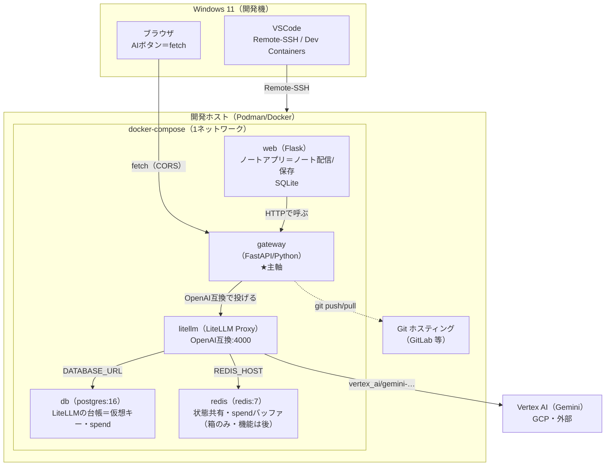

# 開発環境構築 ── コンテナ構成（5サービス）

*個人検討ノートの一般化版（2026-11-18 同期・正は個人 Vault）*

> [!NOTE]
> **このドキュメントの位置づけ**
> このプロジェクトの開発環境の組み立て方をまとめた設計ハブ。まずは最小の素の Python 環境（uv でプロジェクトを1つ作り `uv run` で起こす形）で素早く試し、要所で**ゲートウェイ・Webクライアント・LiteLLM・LiteLLM 台帳用 Postgres・Redis の5サービスを docker-compose で束ねるコンテナ構成**へ段を上げる道筋を示す。本ドキュメントは**5サービス構成の組み方**と**秘密の扱い**の「なぜ」を厚く書き、実際に打つコマンド列（起動・疎通の手順）は各キットの手順書.md（[環境構築キット](kit/README.md)）に一本化した。学習・自己判断用のまとめである。

---

## 1. ねらい ── なぜコンテナ化するのか

このプロジェクトのゴールは、ブラウザのボタンから **既存システム → ゲートウェイ → LiteLLM → LLM** の鎖を端から端まで一本動かし、その途中で Web の仕組みを目で見ることだった。学び始めは、素の Python 環境に uv でプロジェクトを1つ作り、FastAPI を `uv run` で起こすのが最短で、壊しても戻せる。この「軽い第一歩」は捨てずに、ずっと素早い実験場として残す。

いっぽう、実務で待っているのはコンテナで束ねられた複数サービスの構成である。ゲートウェイ単体なら uv でも困らないが、LiteLLM Proxy を別プロセスとして横に立て、Web クライアントも別サービスとして同時に動かす、という「複数サービスが同時に起動して互いに通信する」状況は、uv の単発起動では再現しにくい。そこで、学びが進んだ段階で **docker-compose で5サービスをまとめて立ち上げる**コンテナ構成へ移り、実務の構成をそのまま手元に写し取る。

コンテナで束ねる値打ちは2つある。ひとつは**再現性**で、OS・Python・uv・依存・LiteLLM のバージョンをコンテナの定義ファイルに固定すれば、「私の環境では動く」という食い違いが消える。もうひとつは**本番との近さ**で、The Twelve-Factor App が「開発/本番一致（dev/prod parity）」と呼ぶように、開発に使う道具を本番にできるだけそろえておくと、移すときの事故が減る[^12f-parity]。だから本プロジェクトは、素の Python 環境で素早く回しつつ、要所でコンテナ構成に上げて実務の形に寄せる――この**二段構え**を最初の前提に据える。

---

## 2. 全体像（どこで何が動くか）

コンテナ構成では、ゲートウェイ・Webクライアント・LiteLLM・db（LiteLLM 台帳用 Postgres）・redis（LiteLLM の状態共有・spend バッファ）の5つを docker-compose が1つのネットワークにまとめて起動し、git は Git ホスティング（GitLab 等）へ外向きに push する。右端の実モデル（Vertex AI）は LiteLLM の先にいる外部サービスである。



図の `web` はブラウザへ画面（ノート）を返し、保存を受け取る Flask アプリで、AI ボタン（要約／関連ノート）だけはブラウザから **FastAPI ゲートウェイを直接 fetch** する（STEP1 の CORS 学習＝[歩く骨格](../04_詳細設計/00_Phase0_歩く骨格.md) がここで効く）。`gateway` は封筒を検査して LiteLLM へ渡す主軸、`litellm` は OpenAI 互換の窓口として実モデルへの差し替えを引き受ける別コンテナである。`db` は LiteLLM が仮想キー・spend（支出の台帳）を保存する Postgres で、**構築の時点から箱として並べ、機能の有効化は利用管理のスライスで行う**（§5.1.3・2026-11-16 筆者判断）。`redis` も 2026-11-18 に**箱として前倒し**で並べた（§5.1.4。機能の有効化は性能規模の与件＝ピーク見積りの確認後）。

---

## 4. ディレクトリ構成（compose・Dockerfile・.devcontainer・各サービス）

コンテナ構成に上げるときは、コードを Git ホスティング経由で `~/work/ai-gateway/`（パスは例。以下同じ）に clone し、そこをリポジトリのルート＝ビルドコンテキスト＝`/workspace` マウント元にする。DevContainer の資材（compose・Dockerfile）は `.devcontainer/` にまとめ、ルートを散らかさない（compose から見た `context: ..` でルートを指す[^compose-build]）。

```
~/work/ai-gateway/                 リポジトリのルート（パスは例）＝ビルドコンテキスト＝/workspace マウント元
├─ .git/                           clone で既存
├─ .devcontainer/
│  ├─ devcontainer.json            dockerComposeFile: [compose.yaml, compose.dev.yaml] ／ service: gateway
│  ├─ compose.yaml                 本体＝5サービス（gateway / web / litellm / db / redis）・単体で up -d できる完成形（§5）
│  ├─ compose.dev.yaml             開発用の上書き（command を sleep に戻す・§5.1.1）
│  └─ Dockerfile                   gateway/web 用（Python3.12＋uv）
├─ .vscode/                        settings.json・launch.json 等
├─ .dockerignore                   ビルドコンテキストのルートで読まれる[^docker-ignore]
├─ .gitignore                      .env を必ず含める（§6）
├─ .env.example                    全キーにダミー初期値を入れた雛形（コミットする・§6）
├─ .env                            値入り（各自が作る・コミットしない・gitignore＋dockerignore）
├─ secrets/                        LLMプロバイダの認証ファイル置き場（中身はコミットしない・§5.4.1）
├─ litellm_config.yaml             LiteLLM の設定（vertex_ai/gemini を定義・§5.3）
├─ pyproject.toml / .python-version  足場（手で用意→commit）
├─ src/
│  └─ ai_gateway/__init__.py       gateway 本体（import 名＝「-」を「_」に）
├─ web/                            Flask クライアント（ノート配信/保存・SQLite）
└─ software_test/ {unit, integration}/
```

骨組み（ディレクトリと空ファイル）は `mkdir -p`／`touch` で先に作る。本プロジェクトはパッケージ名が `ai_gateway` なので `src/ai_gateway/__init__.py` を置き、この構成に固有の `web/`（Flask クライアント）と `litellm_config.yaml` も足す（`mkdir -p web && touch web/__init__.py litellm_config.yaml`）。CI を使うなら `.gitlab-ci.yml` も置く（§7）。

- 足場（`pyproject.toml`・`.python-version`・`src/…/__init__.py`）を先にコミットし、初回 Reopen の `postCreateCommand: uv sync` が `.venv`・`uv.lock` を生成する[^uv-project]。
- LiteLLM は**自分でビルドしない**。公式イメージ `ghcr.io/berriai/litellm` をそのまま使い、設定だけ `litellm_config.yaml` をマウントして渡す[^litellm-start]（§5.3）。だから Dockerfile は gateway／web の分だけでよい。
- **この構成の資材一式は同梱の [環境構築キット](kit/README.md) にある**（2026-11-18 再編）。キットは規模別のフォルダ単位で自己完結させた＝`kit/LiteLLM_x1/`（1台・Redisなし）・`kit/LiteLLM_x2/`（2台・Redisあり・既定）・`kit/LiteLLM_x4/`（4台・Redisあり）。各フォルダに compose・Dockerfile・litellm_config.yaml・`.env.example`（全キーにダミー初期値入り＝設定もれ防止）・`secrets/`・`src/`（FastAPI ゲートウェイの仮実装）・`web/`（最小リクエスト画面）・手順書.md が入り、起動と疎通の実行手順はその手順書に一本化した。実機で動作確認済みの丸ごとスナップショットは [20261118/](../20261118/README.md)。
- **拡張機能は共通テンプレの一覧＋本構成向けの4つ**（2026-11-18 追補）。土台の一覧（REST Client・YAML・DotENV・SQLite3 Editor 等を含む）に加え、本構成では次の4つを `customizations.vscode.extensions` に足す。ID は Marketplace の検索 API で実在を照会済み（2026-11-18）[^vsc-mkt-aigw]。
	- `mtxr.sqltools`＋`mtxr.sqltools-driver-pg`：**Postgres（db）を覗く** SQL クライアント＋PostgreSQL ドライバ。LiteLLM の台帳（`LiteLLM_SpendLogs`・`LiteLLM_VerificationToken` 等）をエディタから確認でき、spend 反映タイミングの観察（[論点台帳](../03_論点台帳.md) §3）にも直結する。
	- `redis.redis-for-vscode`：**Redis を覗く** Redis 公式の拡張。バッファやキャッシュの中身の確認用（§5.1.4）。
	- `ms-azuretools.vscode-containers`：Microsoft のコンテナ拡張。コンテナ・イメージの一覧/操作と compose まわりの編集支援。
- **閲覧者（ドキュメントを読むだけの人）向けは `.vscode/extensions.json`（ワークスペース推奨拡張）をリポジトリに同梱**（2026-11-18 追補）。settings.json では拡張は入らない——clone して開くと「推奨拡張をインストール？」の通知からワンクリック一括導入になる公式の仕組みがこれ。閲覧の最小4つ（Mermaid プレビュー描画 `bierner.markdown-mermaid`・日本語パック・markdownlint・Git Graph）に絞り、開発者の拡張は devcontainer.json 側で自動導入＝住み分け。`[markdown]` の折り返しも settings.json に追加。うっかり編集防止（md 以外を読み取り専用＝`files.readonlyInclude`/`files.readonlyExclude`・VS Code 1.79 追加）は**個人設定として任意配布**（リポジトリに入れると開発者まで読み取り専用になるため）。配布物＝[キットの viewer/](kit/viewer/README.md)。**本命の形は「独立の閲覧キットリポジトリ＋対象リポジトリの develop を `git subtree add --prefix=repo <URL> develop --squash` で内蔵」**＝閲覧者は素の `git clone` 1回で全部入り（submodule と違い追加フラグ不要。コマンドは実機 git 2.43 で確認済み・詳細＝viewer/README）。

---

## 5. 手順（compose up の流れ・各サービス起動・疎通）

構築の順路は、Remote-SSH で開発ホストに入る → Git ホスティングから clone → 設定資材を配置して commit → `up --build`、という流れである。ここでは**5サービスを束ねる compose の勘所**と、起動後の**疎通の確かめ方**を示す。

### 5.1 5サービスを compose 本体＋dev上書きの2枚で束ねる（確定版）

docker-compose は「どのイメージを、どんな条件で1つのサービスとして起動するか」をサービスごとに宣言するファイルで、`up` 一発でビルド→起動→マウント→環境変数まで決まる[^compose-ref]。本プロジェクトは `gateway`・`web`・`litellm`・`db`・`redis` の5サービスを並べ、同じ compose ネットワーク内では**サービス名がホスト名**になるので、gateway からは `http://litellm:4000` で LiteLLM を、litellm からは `db:5432` で Postgres を、`redis:6379` で Redis を呼べる。起動順は `depends_on` でそろえる——litellm は db と redis が接続を受けられるようになる（healthy になる）まで、gateway は litellm のヘルスチェックが通るまで起動を待ち[^compose-dep]、web は gateway の起動を待つ。`condition: service_healthy` は**依存先に healthcheck の定義があること**が前提なので、litellm 側に §5.1.2、db 側に §5.1.3、redis 側に §5.1.4 の healthcheck を書いて対にしてある。

ファイルは**2枚構成**にする（2026-11-18 追補＝DevContainer 専用から「compose 単体でも流用できる形」への昇格）。`compose.yaml` が本体＝**それ単体で `docker-compose up -d` できる完成形**で、gateway/web は `command:` で自走する。`compose.dev.yaml` が開発用の上書き＝command を `sleep infinity` に替えて待機させ、中へ `exec` で入って手動起動する学び方に戻す（§5.1.1）。devcontainer.json は `"dockerComposeFile": ["compose.yaml", "compose.dev.yaml"]` と配列で2枚を重ね、**配列は後のファイルが前の値を上書きする**[^devc-compose]。いっぽう素の `docker-compose up -d` は**既定で compose.yaml（と、あれば compose.override.yaml）しか読まない**[^compose-merge]。だから dev 側を `compose.dev.yaml` という名前にしておけば、明示指定しない限り上書きは効かない＝compose.yaml 単体がそのまま流用形になる。以下が compose 本体の確定版である（gateway・web・litellm＝2026-11-16 実装済み／db＝2026-11-16 追補／**redis・2枚分割・command 自走は 2026-11-18 追補＝同日に [20261118/](../20261118/README.md) の×2構成で実機動作を確認済み**）。

> [!IMPORTANT]
> **規模は3段構え（2026-11-18 再編・筆者方針＝複数構成の再現性を優先）**
> **開発の本命＝litellm×2**（＋内部LB nginx＋Redis有効＝[構成図v3](../02_構成図/v3_複数インスタンス.md)の形）／**お試し＝1台版**（Redisなし）／**運用サンプル＝×4**（Redisあり）。この3つは[環境構築キット](kit/README.md)の `LiteLLM_x1/`・`LiteLLM_x2/`・`LiteLLM_x4/` として**フォルダ単位で自己完結**させた——どれか1つを選んで丸ごとコピーすれば、compose・config・`.env.example`・手順書までそのフォルダだけで完結する（規模の選び方＝kit/README「設計の指針」）。GW の LiteLLM 接続先は複数版が `http://litellm-lb:4000`・1台版が `http://litellm:4000`＝**接続先を `.env` で外出しにすれば規模切替がアプリ無改修になる**。台数変更は litellm-N サービス（YAMLアンカー複製）と `litellm_lb.conf` の `server` 行を同数にするだけ。下の YAML は**1台版（お試し）の骨格**として読む（実機で動作確認済みの実例＝[20261118/ スナップショット](../20261118/README.md)）。

```yaml
services:
  gateway:                         # ★主軸（FastAPI/Python）
    build:
      context: ..
      dockerfile: .devcontainer/Dockerfile
    init: true
    env_file:
      - ../.env                    # 秘密は .env から（§6）
    ports:
      - "8000:8000"
    volumes:
      - ..:/workspace:Z
    working_dir: /workspace
    environment:
      - TZ=Asia/Tokyo
      - LANG=ja_JP.UTF-8
      - LC_ALL=ja_JP.UTF-8
      - PYTHONDONTWRITEBYTECODE=1
      - PYTHONUNBUFFERED=1
      - UV_LINK_MODE=copy
    command: ["uv", "run", "uvicorn", "ai_gateway.main:app", "--host", "0.0.0.0", "--port", "8000"]
    depends_on:
      litellm:
        condition: service_healthy

  web:                             # Flask＝ノートアプリ（ノート配信/保存・SQLite）
    build:
      context: ..
      dockerfile: .devcontainer/Dockerfile
    working_dir: /workspace/web
    init: true
    volumes:
      - ..:/workspace:Z
    env_file:
      - ../.env
    ports: ["5000:5000"]
    command: ["uv", "run", "flask", "--app", "app", "run", "--host", "0.0.0.0", "--port", "5000"]
    depends_on:
      - gateway

  litellm:                         # LiteLLM Proxy＝OpenAI互換の窓口（別コンテナ・公式イメージ）
    image: ghcr.io/berriai/litellm:main-latest
    command: ["--config", "/app/config.yaml"]       # 設定の渡し方[^litellm-start]
    volumes: ["../litellm_config.yaml:/app/config.yaml:Z"]
    env_file:
      - ../.env                    # DATABASE_URL・LITELLM_SALT_KEY もここから渡る（§5.1.3・§6）
    ports: ["4000:4000"]           # LiteLLM の既定ポート[^litellm-start]
    healthcheck:
      test: ["CMD", "python3", "-c", "import urllib.request; urllib.request.urlopen('http://localhost:4000/health/liveliness')"]
      interval: 30s
      timeout: 10s
      retries: 3
      start_period: 30s
    depends_on:                    # ↓ここから 2026-11-16 追補（筆者）
      db:
        condition: service_healthy # db の pg_isready が通ってから起動（§5.1.3）
      redis:
        condition: service_healthy # redis の ping が通ってから起動（§5.1.4・redis撤去時はこの2行も消す）

  db:                              # LiteLLM の台帳（仮想キー・spend）用 Postgres（2026-11-16 追補・筆者）
    image: postgres:16             # 公式クイックスタートと同じ[^litellm-compose-db]
    environment:
      - POSTGRES_USER=litellm
      - POSTGRES_DB=litellm        # パスワードだけ ../.env の POSTGRES_PASSWORD から渡す（§6）
    env_file:
      - ../.env
    healthcheck:
      test: ["CMD-SHELL", "pg_isready -U litellm"]
      interval: 5s
      timeout: 5s
      retries: 10
    volumes:
      - postgres_data:/var/lib/postgresql/data

  redis:                           # LiteLLM の状態共有・spendバッファ（箱は先・機能は後の第2弾・2026-11-18 §5.1.4）
    image: redis:7                 # 公式要件「Redis 7.0 or newer」[^litellm-redis]
    healthcheck:
      test: ["CMD", "redis-cli", "ping"]
      interval: 5s
      timeout: 3s
      retries: 5
                                   # ports も volumes も書かない＝内部NW専用・状態は消えてよい（撤去容易・§5.1.4）

volumes:
  postgres_data:                   # 台帳の永続化（消えると鍵の発行からやり直し・§5.1.3）
```

#### 5.1.1 2枚構成と常駐 ── 本体は `command:` で自走・開発は sleep 待機

旧版（2026-11-16）の compose は gateway/web に `command:` が無く、`tty: true`・`stdin_open: true` で空の `python3` を生かして常駐させ、中へ `exec` で入って手でアプリを起こす形だった（PID 1 が終わるとコンテナごと止まる、という理屈による）。「アプリの起動コマンドが固まったら `command:` に置き換える」と予告していた置き換えを、**compose 単体流用の要望（2026-11-18）を機に前倒し**した——本体の `command:` でアプリが PID 1 として自走すれば、`docker-compose up -d` 一発で鎖が動く（★`uvicorn ai_gateway.main:app` と `flask --app app` のモジュール名・起動形は実装に合わせて確定する。自走化に伴い、gateway・web に各自の healthcheck を足す意味も出る＝実装後に追補）。

手で起こして学ぶ流儀は捨てず、**開発用の上書きファイル**に引っ越す。`compose.dev.yaml` は command を `sleep infinity`（何もせず待つだけのプロセス）に差し替え、`exec` 用に tty を戻す：

```yaml
services:
  gateway:
    command: ["sleep", "infinity"]
    tty: true
    stdin_open: true
  web:
    command: ["sleep", "infinity"]
    tty: true
    stdin_open: true
```

devcontainer.json 側は配列で2枚を指す（**後のファイルが前の値を上書き**[^devc-compose]）：

```json
"dockerComposeFile": ["compose.yaml", "compose.dev.yaml"]
```

なお Dev Container 仕様では、Docker Compose 利用時の `overrideCommand` の既定は `false`（イメージ/Dockerfile 利用時は `true`）[^devc-compose]＝VS Code は compose が決めたコマンドをそのまま尊重する。だから dev 上書きを外して本体だけで Reopen すれば「自走するアプリに attach して覗く」形にもなり、どちらの顔も compose 側の2枚で制御できる。`environment` を gateway にだけ明示した理由は従来どおり（同じ値がイメージの `ENV` に焼いてあるため web でも実効値は変わらない）。

#### 5.1.2 litellm の healthcheck（/health/liveliness を python3 で叩く）

`service_healthy` を待つ側（gateway）に対し、待たれる側の litellm には healthy の判定基準そのもの＝healthcheck を定義する。LiteLLM Proxy は認証不要の生存確認エンドポイント `/health/liveliness` を持ち、プロセスが起動していれば "I'm alive!" を 200 で返す[^litellm-health]。`test` のコマンドはコンテナの**中**で実行されるので、プローブには公式イメージに確実に入っている `python3` の標準ライブラリを使った。`urllib.request.urlopen` は接続失敗でも HTTP エラー（4xx/5xx）でも例外で落ちて終了コードが非0になるため、「200 が返れば healthy」という判定にそのまま使える（wget/curl がイメージに同梱されているかは未確認のため避けた）。検査の刻みは4つのキーで決めている。`interval` は検査の間隔で、30秒ごとに叩く。`timeout` は1回の検査の打ち切りで、10秒応答が無ければ失敗と数える。`retries` は判定のしきい値で、3連続で失敗したら unhealthy とみなす。`start_period` は起動直後の猶予期間で、この30秒間の失敗は失敗回数に数えない（LiteLLM の初期化時間を吸収する。足りなければ延ばす）。この healthy 判定は 2026-11-18 に実機（[20261118/](../20261118/README.md) の×2構成）で確認済みである。

#### 5.1.3 db（Postgres）── LiteLLM の台帳の置き場（箱は先・機能は後）

`db` は、LiteLLM が仮想キーと spend（支出の台帳）を保存するための PostgreSQL である。仮想キー機能の前提条件として公式が Postgres を要求しており[^litellm-pg-req]、公式クイックスタートの compose 自体が litellm＋db の2コンテナを最初から並べる形なので[^litellm-compose-db]、本プロジェクトも**構築の時点で4つ目のサービスとして最初から置く**（2026-11-16 筆者判断＝「箱は先・機能は後」。仕組みと選択肢の背景は [論点解説01 利用管理](../05_論点解説/01_利用管理（使用制限・記録DB・仮想キー）.md)）。箱が先にあっても素通しの邪魔にはならず、仮想キーの発行・予算設定は利用管理のスライスで初めて行う。

書き方の勘所は4つある。

1. **接続は `.env` 経由**。`DATABASE_URL`（パスワード入りの接続文字列。形は `postgresql://litellm:<パスワード>@db:5432/litellm`[^litellm-compose-db]）は compose に書かず、`.env` に置いて `env_file` で litellm コンテナへ渡す（§6）。compose ファイルの変数展開に頼らないので、`.env` の置き場所（リポジトリルート）と compose の実行ディレクトリ（`.devcontainer/`）が違っていても食い違わない。
2. **起動順**。litellm は `condition: service_healthy` で db を待ち、db 側の healthy 判定は `pg_isready`（PostgreSQL が接続を受けられる状態かを確かめる公式クライアントの確認コマンド）で測る。公式クイックスタートと同じ対である[^litellm-compose-db]。
3. **永続化**。台帳（キー・spend）は named volume `postgres_data` に置く。コンテナは使い捨てでも台帳は消さない——消えると鍵の発行からやり直しになる。
4. **ポートは外に出さない**。db を使うのはコンテナ内の litellm だけなので `ports` は書かない。ホスト側のポート衝突（§8）もここでは起きない。

> [!WARNING]
> **`LITELLM_SALT_KEY` は一度生成したら変えない**
> DB を繋ぐ構成では、LiteLLM は資格情報を SALT キーで暗号化して保存する。公式 compose のヘッダ注記に「LITELLM_SALT_KEY を作り直すと、DB に保存済みの資格情報が読めなくなる」と明記されている[^litellm-compose-db]。`.env` に一度だけ生成して保持し、作り直さない（§6）。

なお公式クイックスタートは `STORE_MODEL_IN_DB: "True"`（モデル定義も DB に保存して UI から管理する方式）を併用するが[^litellm-compose-db]、本プロジェクトは**モデル定義の正を `litellm_config.yaml` に置く**（§5.3）ため、この変数は設定しない。UI 管理に寄せたくなったら、そのとき足す。

#### 5.1.4 redis ── LiteLLM の状態共有・spend バッファ（箱は先・機能は後の第2弾）

`redis` は、LiteLLM をスケールさせるときの**状態の共有場所**である。公式の本番ベストプラクティスは「プロキシを2インスタンス以上動かしたら、すぐ Redis（7.0以降）を」と求め[^litellm-redis]、役割はインスタンス間のルーティング・レート制限・キャッシュの共有にある。さらに約1000req/s超では spend の書き込み自体が DB のボトルネックになるため、各インスタンスが spend 更新を Redis にキューし、ロックを取った1台がまとめて DB へ流す**トランザクションバッファ**（`use_redis_transaction_buffer`）が推奨される[^litellm-redis-buf]。想定利用者の規模しだいで最悪ピークがこの帯に入り得るため（[論点台帳](../03_論点台帳.md) §3「性能規模」）、db と同じ「箱は先・機能は後」で**箱だけ最初から並べる**（2026-11-18 筆者判断）。

機能を有効化するときは、`litellm_config.yaml` に公式例どおりの3点を足し、`.env` に `REDIS_HOST=redis`・`REDIS_PORT=6379` を足す（`.env.example` にも名前を足す）：

```yaml
router_settings:
  routing_strategy: simple-shuffle
  redis_host: os.environ/REDIS_HOST
  redis_port: os.environ/REDIS_PORT
  # redis_password: os.environ/REDIS_PASSWORD   # ラボは内部NW専用＋ports非公開なので未設定可（本番では必須）
general_settings:
  use_redis_transaction_buffer: true
```

書き方の勘所は db（§5.1.3）と対照的で、**持たせない**ことが設計になる。

1. **volume を持たせない**。Redis の中身はキュー・キャッシュ・カウンタ＝消えてよい状態で、台帳（db）と違い再起動で消えても害がない。
2. **ports を書かない**。使うのはコンテナ内の litellm だけ＝内部NW専用。
3. **撤去は「消すだけ」**。要らなくなったら、compose の `redis:` ブロック・litellm の `depends_on` の redis 2行・config の上記3点・`.env` の `REDIS_*` を消せば残骸ゼロで元に戻る（1と2のおかげで、消し忘れるデータも開きっぱなしの口も残らない）。

> [!NOTE]
> **1000req/s の実挙動はここでは再現しない（正直な注記）**
> バッファの本領（spend 書き込みのデッドロック回避）は、**複数インスタンス＋実負荷**があって初めて観察できる。単一インスタンスのラボでは「箱＋設定キーの形」の予習と、`litellm_redis_spend_update_queue_size` 等の Prometheus メトリクスでキューの存在を見るところまでが現実的な到達点である[^litellm-redis-buf]。

> [!NOTE]
> **compose 各キーの意味**
> ポート公開・`:Z`（SELinux 環境での bind mount 再ラベル）・`init`・`tty`/`stdin_open` といった各キーの意味と根拠は、本文（§5.1.1・§5.1.3）と Compose の公式リファレンス[^compose-ref]のとおり。`mem_limit` は現時点では付けていない（同居サービスとホストの搭載メモリ次第で、必要になったら各サービスに足す）。

### 5.2 起動と疎通の確かめ方（考え方だけ・コマンド列は各キットの手順書へ）

起動は2通りある。**単体流用**＝compose 本体だけで上げる形で、gateway/web が `command:` で自走し、`up -d` 一発で鎖が動く。**開発**＝dev 上書きを重ねて上げる形で、gateway/web は sleep 待機になり、`exec` で入って手でアプリを起こす（VS Code の Reopen in Container はこちらと同じ2枚を読む＝§5.1.1）。実際に打つコマンド列は規模（1台/2台/4台）でファイル名・サービス名が変わるため、**各キットの手順書.md に一本化した**（[環境構築キット](kit/README.md)）。

ここに残すのは確かめ方の考え方である。`up` の間、litellm は db と redis が、gateway は litellm が healthy になるまで待たされる（§5.1）。だから起動したらまず `ps` で全サービスが Up（db・redis・litellm は `healthy`）と表示されることを見る。そのうえで、端から端まで鎖がつながっているかを内側から順に確かめる。

- **LiteLLM 単体**：LiteLLM は OpenAI 互換なので、OpenAI SDK や curl をこの窓口へ向ければそのまま話せる[^litellm-start]。モデル一覧が返るかを見る。
- **ゲートウェイ → LiteLLM**：gateway のコンテナ内からサービス名で届くかを確かめる（compose ネットワーク内の名前解決）。
- **ブラウザ → ゲートウェイ**：web（Flask）の画面の AI ボタンで、ブラウザが FastAPI を直接 fetch する。ここで CORS（別オリジンへの fetch）に出会うので、STEP1 の学びがそのまま効く（[STEP1＝歩く骨格](../04_詳細設計/00_Phase0_歩く骨格.md)）。

この「内側から外側へ」の段階疎通を、鍵の扱い（master key を画面に出さない作法）や失敗の切り分けまで含めて整理したのが [解説07 認証設計](../05_論点解説/07_認証設計（プロバイダ非依存とGCP疎通の考え方）.md) である。

### 5.3 litellm_config.yaml（Vertex AI を定義する）

LiteLLM の設定ファイルは `model_list` にモデルを並べ、各モデルの `litellm_params` で実体を指す。Vertex AI の Gemini を使うなら、`model` を `vertex_ai/gemini-…` の形にし、`vertex_project`（GCP プロジェクト ID）・`vertex_location`（リージョン）・`vertex_credentials`（サービスアカウント鍵 JSON のパス）を書く[^litellm-vertex]。資格情報は `vertex_credentials` に直接パスを書くほか、環境変数 `GOOGLE_APPLICATION_CREDENTIALS` に任せる道もあり、その場合 `vertex_credentials` は省ける[^litellm-vertex]。本構成は後者に統一した＝認証JSON（サービスアカウント鍵でも ADC ファイルでも可）を `secrets/` に置き、`.env` の `GOOGLE_APPLICATION_CREDENTIALS=/secrets/<ファイル名>` で指す（§5.4.1・§6）。

```yaml
model_list:
  - model_name: gemini                      # ゲートウェイが呼ぶ論理名
    litellm_params:
      model: vertex_ai/gemini-3.8-flash     # 実モデル（2026-11-16 時点の現行。使用時に公式ドキュメントで再確認）
      vertex_project: os.environ/VERTEX_PROJECT
      vertex_location: global               # 現行世代の提供ロケーション（使用時に公式ドキュメントで再確認）
      # vertex_credentials は書かない＝認証は .env の GOOGLE_APPLICATION_CREDENTIALS に統一（§5.4.1）
general_settings:
  master_key: os.environ/LITELLM_MASTER_KEY  # 秘密は env 参照（直書きしない・§6）
```

秘密（プロジェクト ID・master key など）は `os.environ/VARIABLE_NAME` の形で `.env` から参照し、`config.yaml` には値そのものを書かない[^litellm-start]。GCP/Vertex 側の具体的な準備（プロジェクト作成・API 有効化・サービスアカウント・ロール付与）は本ドキュメントの範囲外とし、Google Cloud の公式手順に従う。

### 5.4 構築後手順 ── コンテナが立ってから行うこと（2026-11-16 新設）

環境は `up` で終わりではなく、**初回だけ行う「つなぎ込み」**が残る。そうした作業はこの節に集める（今後増えたら兄弟の小見出しとして足す）。

#### 5.4.1 LLMプロバイダの認証を `secrets/` でつなぐ（プロバイダ非依存・2026-11-18 改訂）

認証の受け口は**プロバイダ非依存**に設計した。スタック本体（compose・コード）が依存するのは「`.env` の環境変数」と「`secrets/` フォルダに置くファイル」の2つだけで、特定クラウドの CLI にも SDK にもスタックは依存しない。だからプロバイダの乗り換えは `.env` のキーと `litellm_config.yaml` の `model_list` の差し替えだけで済み、compose もコードも無改修になる。この設計の背景は [解説07 認証設計](../05_論点解説/07_認証設計（プロバイダ非依存とGCP疎通の考え方）.md) にまとめた。

Vertex AI の場合、`secrets/` に置くのは認証JSONで、サービスアカウント鍵でも ADC（アプリケーションのデフォルト認証情報）のファイルでもよい。litellm コンテナは `secrets/` を読み取り専用でマウントし、`.env` の `GOOGLE_APPLICATION_CREDENTIALS=/secrets/<ファイル名>` がそのファイルを指す。Google のクライアントライブラリ（LiteLLM の Vertex 呼び出しを含む）はこの環境変数を見て認証する[^litellm-vertex]。

**ホストに gcloud CLI は入れない**（2026-11-18 改訂＝職場ではホストへのツール導入自体が難しい、という前提に合わせた）。鍵JSONが配布されない場合に ADC を作る手段として、compose に公式イメージ `gcr.io/google.com/cloudsdktool/google-cloud-cli:stable` のワンショットサービス `gcloud` を同梱してある[^gcloud-docker]。このサービスには `profiles: ["auth"]` を付けてあり、通常の `up` では起動しない——profiles 付きのサービスは、そのプロファイルを有効にするか、コマンドラインで直接指名したときだけ動く[^compose-profiles]。必要なときだけ `docker compose run --rm gcloud` と指名すると、コンテナ内の gcloud がブラウザ認証を案内し、できた ADC を `secrets/` に直接書き出す。これは**任意の補助**であり、丸ごと削除しても本体は動く。実行の順路（コマンド列・litellm への反映）は各キットの手順書.md にある。

---

## 6. 秘密ハンドリング（.env に閉じ込める）

秘密は、API キーや鍵・トークンのように**漏れると他人があなたとして使えてしまう値**である。原則はひとつ――**秘密は `.env` に置き、`config.yaml`・コード・git・コンテナイメージには直書きも同梱もしない**。`.env` と `secrets/` の中身は `.gitignore` と `.dockerignore` の**両方**に入れ、雛形 `.env.example` だけを git 管理する。`.env.example` には**全キーにラボでそのまま動くダミー初期値**を入れてある——設定もれで起動に失敗しないためで、実値が要るのはプロバイダ節だけである（`LITELLM_SALT_KEY` は一度 DB に保存が始まったら変えない＝§5.1.3）。これは The Twelve-Factor App の「設定（認証情報を含む）は環境変数に置く／認証情報を漏らさずに今すぐコードをオープンソースにできるか、が分離できているかのテスト」という原則そのままで[^12f-config]、`.env.example` をコミットしても秘密が漏れないのはこのテストに通る形だからである。秘密の値を画面・ファイル・チャット・ログに出さない／使うときだけ環境変数に読み込む、という運用の鉄則もこれと同じ考えである。

| 秘密 | 置き場所 | 参照方法 | git / image |
|---|---|---|---|
| Vertex 認証JSON（SA鍵） | `secrets/`（litellm へ読み取り専用マウント） | `.env` の `GOOGLE_APPLICATION_CREDENTIALS=/secrets/<ファイル名>`[^litellm-vertex] | secrets/ の中身は gitignore＋dockerignore |
| Vertex 認証JSON（ADC） | `secrets/`（同梱のワンショット gcloud が生成・§5.4.1） | 同上 | 同上 |
| お試し用 API キー | `.env` の `VERTEX_API_KEY` | LiteLLM／直叩き | .env は gitignore |
| LiteLLM master key | `.env` の `LITELLM_MASTER_KEY` | config.yaml `os.environ/LITELLM_MASTER_KEY`[^litellm-start] | 同上 |
| GW→LiteLLM 仮想キー | `.env` の `LITELLM_VIRTUAL_KEY` | GW が起動時に env から読む | 同上 |
| db の接続パスワード | `.env` の `POSTGRES_PASSWORD` | db コンテナが env から読む（`DATABASE_URL` にも同じ値を埋める・§5.1.3） | 同上 |
| litellm→db の接続文字列 | `.env` の `DATABASE_URL`（パスワード入り） | litellm が env から読む（compose には書かない・§5.1.3） | 同上 |
| LiteLLM salt key | `.env` の `LITELLM_SALT_KEY`（★一度生成したら変えない・§5.1.3）[^litellm-compose-db] | litellm が env から読む（DB 内資格情報の暗号化キー） | 同上 |
| Redis 接続先・パスワード | `.env` の `REDIS_HOST`・`REDIS_PORT`（パスワードは任意＝本番想定で `REDIS_PASSWORD`） | config.yaml `os.environ/REDIS_HOST` 等（§5.1.4。ラボは内部NW専用＋ports非公開のためパスワード未設定可） | 同上 |

- **SA鍵とADCの使い分け**：鍵JSONが配布される職場想定では、それを `secrets/` に置くのが最短である。配布が無ければ、同梱のワンショット gcloud（§5.4.1）で ADC を `secrets/` に作る。どちらも置き場所と指し方（`GOOGLE_APPLICATION_CREDENTIALS`）は同じで、スタック側の形は変わらない。長期有効な鍵ファイルを増やさない点では ADC が安全寄りだが、`secrets/` にできる ADC ファイルも秘密そのものなので、扱い（コミットしない・外に出さない）は鍵JSONと同じにする。
- **`.gitignore` の落とし穴**：`.gitignore` は、まだ Git が追跡していないファイルにしか効かない[^gitignore]。一度でも `.env` をコミットしてしまったら `.gitignore` に書き足すだけでは追跡が止まらないので、`git rm --cached .env` でインデックスから外し[^gitignore]、漏れた値は鍵の再発行で無効にする。
- **CI の秘密はファイルでなく変数へ**：CI で秘密が要る場合は `.env` を置かず、Git ホスティング側のプロジェクト CI/CD 変数に登録する（Masked・Protected を付ける）。

---

## 7. Git ホスティング連携（GitLab 等）

本リポジトリは社内の Git ホスティング（GitLab 等）に置き、MR（マージリクエスト）・CI の運用は職場の作法に従う。CI で秘密が要る場合は、`.env` を置かずホスティング側の CI/CD 変数に登録する（§6）。

---

## 8. つまずき・注意（さわり）

コンテナ構成特有の引っかかりを、要点だけ挙げる。

- **CORS（ブラウザ → ゲートウェイ）**：AI ボタンはブラウザから別オリジンの FastAPI を直接 fetch するため、ゲートウェイ側で許可オリジンを設定しないとブラウザがレスポンスを捨てる。概念と実装は STEP1（[Webの一往復を見る＝歩く骨格](../04_詳細設計/00_Phase0_歩く骨格.md)）で手を動かして掴む。
- **ポートの衝突**：gateway(8000)・web(5000)・litellm(4000) を同時に公開するので、ホスト側で既に使っているポートと重なると `up` が失敗する。衝突したら `ports` のホスト側を空いている番号へずらす。
- **サービス名で呼ぶ**：gateway からは `litellm` という**サービス名**で LiteLLM に届く（`localhost` ではない）。`localhost:4000` と書くとコンテナ自身を指してつながらないので、compose 内では必ずサービス名を使う。
- **rootless Podman の前提**：開発ホストが rootless Podman なら、bind mount の `:Z`（SELinux 再ラベル）やメモリ上限（`mem_limit`）は cgroup v2 が前提になる等の環境依存があるので、ランタイム側の公式ドキュメントで前提を確かめる。
- **db・redis とも箱は前倒しで組み込み済み**：`db`（Postgres）は 2026-11-16、`redis`（状態共有・spend バッファ）は 2026-11-18 の筆者判断で、§5.1.3・§5.1.4 のとおり最初から並べる形にした（箱は先・機能は後）。redis の機能有効化（config の3点）は性能規模の与件＝ピーク見積りの確認後（[論点台帳](../03_論点台帳.md) §3）。web のノート保存は SQLite のままで十分。

---

## 9. 関連ドキュメント

- 詳細設計：[Phase 0 歩く骨格（STEP0・STEP1 の中身）](../04_詳細設計/00_Phase0_歩く骨格.md)
- 設計の背景：[構成図（版管理と差分の見方）](../02_構成図/00_版管理と差分の見方.md)／[論点台帳](../03_論点台帳.md)／[論点解説 概要](../05_論点解説/00_概要.md)
- 認証設計の背景：[解説07 認証設計（プロバイダ非依存とGCP疎通の考え方）](../05_論点解説/07_認証設計（プロバイダ非依存とGCP疎通の考え方）.md)
- 実機で動作確認済みの実例：[20261118/ スナップショット](../20261118/README.md)

---

## 出典（一次・二次情報）

外部の仕様・既定値（LiteLLM のイメージ名・ポート・設定の渡し方・ヘルスチェック・Vertex の設定キー・compose の挙動・uv・12-Factor・gitignore）は下記の一次情報で裏づけた（URL は 2026-11-14 に生ページを確認。Health Checks[^litellm-health] と db まわり（Virtual Keys の Requirements・公式クイックスタート compose の実物）は 2026-11-16 に確認。Redis・compose の2枚マージ・Dev Container 仕様（`dockerComposeFile`／`overrideCommand`）、gcloud 公式コンテナイメージと Compose の profiles は 2026-11-18 に確認＝逐語は `curl`+`grep` で照合）。ホスト名・IP・パス・方針など環境固有の値には出典を付けていない。

**一次情報（公式）**

- LiteLLM：[Getting Started - LiteLLM Gateway (Quick Start)](https://docs.litellm.ai/docs/proxy/docker_quick_start)／[VertexAI [Gemini]](https://docs.litellm.ai/docs/providers/vertex)／[Health Checks](https://docs.litellm.ai/docs/proxy/health)／[Virtual Keys](https://docs.litellm.ai/docs/proxy/virtual_keys)／[Production Best Practices](https://docs.litellm.ai/docs/proxy/prod)
- Docker Compose：[Define services in Docker Compose（Compose file reference）](https://docs.docker.com/reference/compose-file/services/)／[Build（Compose file reference）](https://docs.docker.com/reference/compose-file/build/)／[Dockerfile reference — .dockerignore](https://docs.docker.com/reference/dockerfile/#dockerignore-file)／[Merge Compose files](https://docs.docker.com/compose/how-tos/multiple-compose-files/merge/)／[Using profiles with Compose](https://docs.docker.com/compose/how-tos/profiles/)
- Google Cloud CLI コンテナ：[cloud-sdk-docker（GoogleCloudPlatform 公式リポジトリ）](https://github.com/GoogleCloudPlatform/cloud-sdk-docker)／[Using Google Cloud CLI Docker Images（同 docs/user_guide.md）](https://github.com/GoogleCloudPlatform/cloud-sdk-docker/blob/master/docs/user_guide.md)
- Dev Container 仕様：[Dev Container metadata reference（containers.dev）](https://containers.dev/implementors/json_reference/)
- uv：[uv — Projects（lockfile）](https://docs.astral.sh/uv/concepts/projects/)
- 原則：[The Twelve-Factor App III. 設定（日本語訳）](https://12factor.net/ja/config)／[同 X. 開発/本番一致（日本語訳）](https://12factor.net/ja/dev-prod-parity)
- Git：[gitignore（Git 公式・日本語訳）](https://git-scm.com/docs/gitignore/ja)

**二次情報（解説）**

- なし（本ドキュメントの脚注はすべて公式ドキュメント）。

## 脚注

[^12f-parity]: 原文「Keep development, staging, and production as similar as possible.」（開発・ステージング・本番をできるだけ似た状態に保つ）。Twelve-Factor App は dev/prod parity を「時間・人材・ツールのギャップを小さく保つこと」と定義し、とくにツールについては開発と本番をできるだけ一致させることを勧めている。 — [The Twelve-Factor App X. 開発/本番一致（日本語訳・公式サイト）](https://12factor.net/ja/dev-prod-parity)

[^12f-config]: アプリの設定（認証情報を含む）はデプロイごとに異なりうるので、コードから切り離して環境変数に格納する。設定を正しく分離できているかの簡単なテストは、認証情報を漏らさずに今すぐコードベースをオープンソースにできるかどうか。 — [The Twelve-Factor App III. 設定（日本語訳・公式サイト）](https://12factor.net/ja/config)

[^uv-project]: uv のプロジェクトは `pyproject.toml` で定義され、`uv.lock` は依存の正確な解決結果を記録するロックファイルで、マシンをまたいで同じ環境を再現できるようバージョン管理にコミットする。`.venv` はそこから作られる仮想環境。 — [uv — Projects（Astral 公式ドキュメント）](https://docs.astral.sh/uv/concepts/projects/)

[^litellm-start]: LiteLLM のゲートウェイは公式イメージ `ghcr.io/berriai/litellm` で動き、設定は YAML を `--config /app/config.yaml` で渡す。既定ポートは 4000 で、ゲートウェイは OpenAI 互換なので OpenAI SDK を `http://localhost:4000` へ向ければそのまま使える。`config.yaml` 内のプロバイダ資格情報は `os.environ/VARIABLE_NAME` の形で環境変数を参照し、管理 API の認可には `LITELLM_MASTER_KEY` を使う。 — [LiteLLM Gateway Quick Start（LiteLLM 公式）](https://docs.litellm.ai/docs/proxy/docker_quick_start)

[^litellm-vertex]: LiteLLM で Vertex AI の Gemini を使うとき、`config.yaml` の `model_list` に `model: vertex_ai/gemini-…`・`vertex_project`（GCP プロジェクト ID）・`vertex_location`（リージョン）・`vertex_credentials`（サービスアカウント JSON のパス）を書く。認証は、サービスアカウント鍵ファイルを指す方法と、`gcloud auth application-default login`（ADC）や `GOOGLE_APPLICATION_CREDENTIALS` を使う方法があり、ADC を使う場合 `vertex_credentials` は省ける。 — [VertexAI [Gemini]（LiteLLM 公式）](https://docs.litellm.ai/docs/providers/vertex)

[^litellm-health]: LiteLLM 公式の Health Checks ページの表（Endpoint／Auth／Returns／Meaning の列）を読み下した逐語＋和訳。原文「`GET /health/liveliness` — none — `"I'm alive!"` (200), or `{"status": "shutting_down"}` (503) during graceful shutdown — The process is up. No dependencies are checked. `GET /health/liveness` is an alias with the Kubernetes spelling; both are real routes.」（`/health/liveliness` は認証不要で、プロセスが起動していれば "I'm alive!" を 200 で返す。グレースフルシャットダウン中は 503。依存先の確認はしない。Kubernetes 綴りの `/health/liveness` という別名もあり、どちらも実在のルート）。より厳密な `/health/readiness`（トラフィックを受けられる準備ができたか）も認証不要で用意されている。 — [Health Checks（LiteLLM 公式）](https://docs.litellm.ai/docs/proxy/health)

[^litellm-pg-req]: 原文「Need a postgres database (e.g. Supabase, Neon, etc)」（PostgreSQL のデータベースが必要〔例：Supabase・Neon など〕）。仮想キー機能の Requirements（前提条件）として明記されている＝プロキシ本体の要件ではない。— [Virtual Keys（LiteLLM 公式）](https://docs.litellm.ai/docs/proxy/virtual_keys)

[^litellm-compose-db]: 公式リポジトリの `litellm/deploy/docker/docker-compose.quickstart.yml`（2026-11-16 取得・実物で照合）。`litellm` と `db`（原文「image: postgres:16」）の2サービス構成で、接続は原文「DATABASE_URL: postgresql://litellm:${POSTGRES_PASSWORD:-litellm}@db:5432/litellm」の形でサービス名 `db` を指す。`db` 側に `pg_isready -U litellm` の healthcheck と `postgres_data:/var/lib/postgresql/data` の named volume が定義され、`litellm` は `condition: service_healthy` で待つ。`STORE_MODEL_IN_DB: "True"` も同ファイルで設定されている。ヘッダ注記は原文「Keep it: regenerating LITELLM_SALT_KEY makes credentials already stored in the database unreadable.」（この .env を保持すること。LITELLM_SALT_KEY を作り直すと、データベースに保存済みの資格情報が読めなくなる）。— [Docker Quick Start（LiteLLM 公式）](https://docs.litellm.ai/docs/proxy/docker_quick_start)

[^compose-ref]: Compose は、アプリを構成するサービス群を1つの YAML で宣言的に定義し、`docker compose up` 一度でビルド・起動・ネットワーク・ボリューム・環境変数までまとめて立ち上げる。 — [Define services in Docker Compose（Docker 公式 Compose reference）](https://docs.docker.com/reference/compose-file/services/)

[^compose-dep]: Compose の `depends_on` は、長い構文で `condition: service_healthy` を指定すると、依存先のヘルスチェックが「healthy」になるまで、依存元のサービスの起動を待つ（`service_started` はコンテナの起動だけを待つ）。 — [Define services in Docker Compose — depends_on（Docker 公式 Compose reference）](https://docs.docker.com/reference/compose-file/services/#depends_on)

[^compose-build]: Compose の `build.context` に書いた相対パスは、プロジェクトディレクトリ（既定では最初に指定した Compose ファイルのあるフォルダ）を起点に解決される。`..` と書けば1つ上＝リポジトリのルートをビルドコンテキストにできる。 — [Compose Build Specification（Docker 公式 Compose reference）](https://docs.docker.com/reference/compose-file/build/)

[^docker-ignore]: ビルドクライアントはビルドコンテキストのルートで `.dockerignore` を探し、一致したファイルをビルダへ送る前に取り除く。だから `.dockerignore` はビルドコンテキストのルートに置く。 — [Dockerfile reference — .dockerignore file（Docker 公式）](https://docs.docker.com/reference/dockerfile/#dockerignore-file)

[^gitignore]: `gitignore` は Git が無視すべき意図的に追跡しないファイルを指定するが、すでに Git が追跡しているファイルには影響しない。追跡をやめるには `git rm --cached` でインデックスから削除する。 — [gitignore（Git 公式ドキュメント・日本語訳）](https://git-scm.com/docs/gitignore/ja)

[^litellm-redis]: 原文「Run Redis (7.0 or newer) as soon as you run more than one proxy instance.」（プロキシを2インスタンス以上動かすようになったら、すぐに Redis〔7.0以降〕を動かす）。`router_settings` に `redis_host: os.environ/REDIS_HOST`・`redis_port`・`redis_password` を環境変数参照で書く設定例も同ページ（筆者確認）。 — [Production Best Practices（LiteLLM 公式）](https://docs.litellm.ai/docs/proxy/prod)

[^litellm-redis-buf]: 原文「At very high traffic (roughly 1000+ requests per second, or 10+ instances), spend tracking itself becomes a database bottleneck」（非常に高いトラフィック〔およそ毎秒1000リクエスト以上、または10インスタンス以上〕では、spend の追跡自体がデータベースのボトルネックになる）。対策の `use_redis_transaction_buffer: true` は `general_settings` 配下で、各インスタンスが spend 更新を Redis にキューし、Redis のロックを持つ1インスタンスがまとめて1トランザクションで DB へフラッシュする。監視は `litellm_pod_lock_manager_size`・`litellm_redis_spend_update_queue_size` 等の Prometheus メトリクス（いずれも同ページ・筆者確認）。 — [Production Best Practices（LiteLLM 公式）](https://docs.litellm.ai/docs/proxy/prod)

[^devc-compose]: `dockerComposeFile` は複数ファイルの配列を取れ、原文「The order of the array matters since the contents of later files can override values set in previous ones.」（配列の順序には意味がある。後のファイルの内容が、前のファイルで設定した値を上書きできるからだ）。`overrideCommand` の既定は原文「Defaults to `true` for when using an image Dockerfile and `false` when referencing a Docker Compose file.」（イメージ/Dockerfile 利用時は true、Docker Compose ファイル参照時は false が既定）。 — [Dev Container metadata reference（containers.dev・Dev Container 仕様）](https://containers.dev/implementors/json_reference/)

[^compose-merge]: 原文「By default, Compose reads two files, a compose.yaml and an optional compose.override.yaml file.」（既定では、Compose は compose.yaml と、あれば compose.override.yaml の2つのファイルを読む）。それ以外の名前の上書きファイルは `-f` で明示したときだけ重なる。 — [Merge Compose files（Docker 公式）](https://docs.docker.com/compose/how-tos/multiple-compose-files/merge/)

[^vsc-mkt-aigw]: 各拡張 ID（`mtxr.sqltools`／`mtxr.sqltools-driver-pg`／`redis.redis-for-vscode`／`ms-azuretools.vscode-containers`）を Visual Studio Marketplace の検索 API（extensionquery・filterType 7＝Extension Name 完全一致）で照会し、4つすべての実在と発行元（Matheus Teixeira×2・Redis・Microsoft）を確認した（2026-11-18）。 — Visual Studio Marketplace

[^gcloud-docker]: Google Cloud CLI の公式コンテナイメージは `gcr.io/google.com/cloudsdktool/google-cloud-cli` で、最小構成の `:stable` タグが推奨される（README）。公式ユーザーガイドは、コンテナから認証する形を原文「docker run -ti --name gcloud-config gcr.io/google.com/cloudsdktool/google-cloud-cli:stable gcloud auth login」で示し、アプリケーション用の認証情報（ADC）が要る場合は原文「If you need to authenticate applications that use the Google Cloud APIs, pass the `--update-adc` option」（Google Cloud API を使うアプリケーションの認証が必要なら、`--update-adc` オプションを渡す）とする。できた資格情報はコンテナのボリュームに保存され、`--volumes-from` で別コンテナから使い回す例も同ガイドにある（2026-11-18 取得・`curl`+`grep` 照合）。 — [cloud-sdk-docker（GoogleCloudPlatform 公式リポジトリ）](https://github.com/GoogleCloudPlatform/cloud-sdk-docker)／[Using Google Cloud CLI Docker Images（同 docs/user_guide.md）](https://github.com/GoogleCloudPlatform/cloud-sdk-docker/blob/master/docs/user_guide.md)

[^compose-profiles]: 原文「Services can be assigned to one or more profiles; unassigned services start/stop by default, while assigned ones only start/stop when their profile is active.」（サービスは1つ以上のプロファイルに割り当てられる。未割り当てのサービスは既定で起動・停止するが、割り当てられたサービスはそのプロファイルが有効なときだけ起動・停止する）。また、プロファイル付きのサービスをコマンドラインで明示的に指名した場合（`docker compose run` 等）は、プロファイルを手動で有効化しなくても実行される、と明記される（2026-11-18 取得・`curl`+`grep` 照合）。 — [Using profiles with Compose（Docker 公式）](https://docs.docker.com/compose/how-tos/profiles/)
