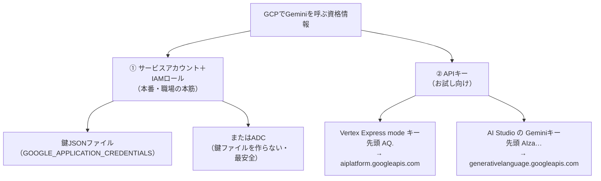

# ③ GCP / Vertex AI 準備 ── モックの右端を「本物のGemini」に差し替える

*個人検討ノートの一般化版（2026-11-18 同期・正は個人 Vault）*

> [!NOTE]
> **このノートの位置づけ**
> 初稿（2026-11-14）。**CLIの正確なフラグ・引数は公式で確認した概念どおり**に書くが、**逐語原文の機械照合（`curl`+`grep`）は清書時に回す**（本ノート末尾「出典」の原文は当たり付けまで。清書で実ページ照合する）。実装は筆者自身の手で行う前提で、本ノートは設計・手順・出典づけを担う。手順③の実施と、モデル世代・ロケーションの現在地（2.5世代の引退・`gemini-3.8-flash`・global/us/eu）は 2026-11-16 に追記した——この追記分の主要な逐語（引退日・モデルID・エンドポイント形式）は `curl`+`grep` で照合済み。

## 0. 手順の地図 ──【やる】と【紹介のみ】（2026-11-16 現在）

本ノートは実際にやる手順と背景知識が混ざる。先に区別を一覧にしておく。

| 節 | 内容 | 扱い | 状態（筆者の進捗） |
|---|---|---|---|
| §3.1〜3.2 | ① アカウント／② プロジェクト作成 | 【やる】 | 済 |
| §3.3 | ③ Vertex AI API 有効化 | 【やる】 | 済 |
| §3.4〜3.5 | ④ SA作成／⑤ ロール付与 | 【やる】 | 済 |
| §3.6 | ⑥ APIキー（資格情報）の発行＝認証JSONを `secrets/` へ | 【やる】 | **次はここ**＝実施は各キットの手順書.md（[環境構築キット](./kit/README.md)）・設計は [② 環境構築手順](./00_環境構築手順.md) §5.4 |
| §3.6.3〜3.6.4 | △ 鍵JSON（配布時のみ）／お試しキー2種 | 【紹介のみ】 | 自分では作らない |
| §3.7 | ⑦ LiteLLM 設定 | 【やる】 | これから |
| §3.8 | ⑧ 疎通確認 | 【やる】 | 直叩きは済・LiteLLM経由はこれから |
| §2.2・§4 | APIキー系統の全体像／Express 案・無料枠 | 【紹介のみ】 | 使わなかった（本番ルートで直行） |

## 1. ねらい ── なぜ GCP / Vertex AI なのか

このプロジェクトは、ブラウザ → FastAPIゲートウェイ → LiteLLM → LLM という鎖を、まずは**モックLLM**（決め打ちの返事を返す偽物）で端から端まで動かす。その鎖の**右端＝実際に推論するモデル**を、本物の Gemini に差し替える段になって必要になるのが、このノートで用意する **Google Cloud（GCP）の Vertex AI** である。

なぜ Vertex AI を選ぶのか。"Gemini" には入口が2つある。手軽な **AI Studio の Gemini API**（APIキー1つで始められる）と、**Vertex AI（GCP上）**（プロジェクト・IAM設定が要る代わりに、リージョン指定・監査・権限設計といった企業統制が効く）だ。新業務＝特許起案支援は未公開特許という機密を扱うため、統制の効く Vertex AI が本筋になる。だからこの予習でも、本番を見据えて **Vertex AI 経由で Gemini を呼ぶルート**を一度自分の手で通しておく。ここで本物の機密は一切使わず、記事やダミー文だけで練習する。

ありがたいことに、**LiteLLM は Vertex AI も AI Studio の Gemini も両対応**している。つまりどちらを選んでも**ゲートウェイのコードはほぼ不変**で、決定は「LiteLLM の設定＋GCP の資格情報をどう渡すか」という一点に落ちる。本ノートはその「資格情報の作り方と渡し方」を順を追ってほどく。

## 2. まず認証の全体像 ── 「2系統」を最初に区別する

ここが最初にして最大のつまずきどころである。GCP で Gemini を呼ぶ資格情報には、**性格のまったく違う2系統**があり、言葉がどれも「キー」「認証」と似ているせいで混ざりやすい。先に地図を持っておけば、以降の手順が「どの系統の話か」で迷わなくなる。

ひとつは本番・職場で使う**サービスアカウント＋IAMロール**の系統。もうひとつは、手早く試すための**APIキー**の系統で、この APIキーがさらに2種類に割れる。



### 2.1 ① サービスアカウント＋IAMロール（本番・職場の本筋）

**サービスアカウント**は、人ではなく「プログラムやサービスに与える身元（アカウント）」のこと。あなたのゲートウェイが Vertex AI を呼ぶとき、「誰の権限で呼んでいるのか」をこのサービスアカウントが名乗る。そのサービスアカウントに **IAMロール**で「Vertex AI を使ってよい」という権限を付けて初めて、推論リクエストが通る。このロールが後述する **Vertex AI User（`roles/aiplatform.user`。現在のGUI表示名は「Agent Platform ユーザー」＝§3.5.1）** である[^role]。

身元を証明する手段はさらに2通りある。**鍵JSONファイル**を発行してそのパスを環境変数で指す古典的な方法と、鍵ファイルを一切作らずに済ませる **ADC（Application Default Credentials）** だ。Google 自身は、ダウンロードした鍵ファイルはセキュリティリスクになると明言し、ADC や「アタッチされたサービスアカウント」を本番の推奨としている[^adc-risk]。学習でも**まずは鍵ファイルを作らない ADC** を既定にすると安全で手数も少ない（§3.6.2）。

### 2.2 ② APIキー ──【紹介のみ・使わない】お試し向けの系統

「APIキー」はさらに2種類に割れる（Express mode の `AQ.`／AI Studio の `AIza…`）。どちらも本プロジェクトでは使わない。2種の見分け方と 403 の罠は、発行の話としてまとめて §3.6.4 に置いた。

## 3. 手順 ──【やる】本番ルート（サービスアカウント＋IAM）

ここからは本筋＝サービスアカウントで Vertex AI を呼べるようにする道順を、①から順に通す。各コマンドの引数は公式で確認した概念どおりに書くが、プレースホルダ（大文字の `PROJECT_ID` 等）は自分の値に置き換える前提で、逐語の最終照合は清書に回す（冒頭の注記）。

### 3.1 ① GCP アカウントを作る

[Google Cloud コンソール](https://console.cloud.google.com/) にログインする。初回は無料トライアル（期間・クレジットは時期で変わるため、申込画面の表示で確認する）が使えることが多い。支払い情報の登録を求められる場合がある。ここは個人の身元（identity）に属する作業なので、筆者自身が進める。

### 3.2 ② プロジェクトを作る

GCP の課金・権限・APIはすべて**プロジェクト**という器の単位でまとまる。コンソール上部のプロジェクト選択から新規プロジェクトを作り、付与される**プロジェクトID**（例 `my-gateway-dojo`）を控える。このIDは後で LiteLLM の `vertex_project` に入れる値になる。以降の手順で `PROJECT_ID` とあるプレースホルダは、自分のプロジェクトIDの実値に読み替える。

### 3.3 ③ Vertex AI API を有効化する

GCP では、使いたいサービスのAPIを**プロジェクトごとに明示的に有効化**して初めて呼べる。Vertex AI も同じで、有効化しないと権限が正しくても「APIが無効」で弾かれる。コンソールの「APIとサービス」から **Vertex AI API** を検索して有効化するか、`gcloud` を使うなら次の形で有効化する（フラグは清書で逐語照合）。

```bash
gcloud services enable aiplatform.googleapis.com --project=PROJECT_ID
```

この手順は筆者が 2026-11-16 に Cloud Shell から自分のプロジェクトIDの実値で実行し、`Operation … finished successfully.` を確認した。

### 3.4 ④ サービスアカウントを作る

ゲートウェイが名乗る身元を1つ作る。公式が示すコマンドの形は次のとおり[^adc-risk]。

```bash
gcloud iam service-accounts create SERVICE_ACCOUNT_NAME --project=PROJECT_ID
```

これで `SERVICE_ACCOUNT_NAME@PROJECT_ID.iam.gserviceaccount.com` という名前（メールアドレス形式）のサービスアカウントができる。この文字列を次の手順で使う。

名前（ID）の公式の制約は「6〜30文字・小文字英数字とダッシュのみ」[^sa-id]。ただし筆者の実測（2026-11-16）では、大文字入りの名前でも作成が通った＝記載と実装が食い違っている。記載は「保証される範囲」と読み、実際に出来たメールアドレス（⑤で使う文字列）は `list` で確かめてから進む。

```bash
gcloud iam service-accounts list --project=PROJECT_ID
```

なお名前は「プログラムの身元」（§2.1）らしく役割で付けると意図が伝わる（例 `gateway-sa`。公式の保証範囲にも収まる）。

### 3.5 ⑤ `roles/aiplatform.user` を付与する

作ったサービスアカウントに、Vertex AI を使う権限＝**Vertex AI User ロール（`roles/aiplatform.user`）** を付ける[^role]。このロールは、推論を含む Vertex AI リソースの作成・読み取り・更新・予測などを広く許す一方、**IAMポリシー自体を書き換える管理権限は含まない**（実務者向けで、管理者ロールとは分かれている）[^role]。IAMバインディングを足す公式の形は次のとおり[^adc-risk]。

```bash
gcloud projects add-iam-policy-binding PROJECT_ID --member="serviceAccount:SERVICE_ACCOUNT_NAME@PROJECT_ID.iam.gserviceaccount.com" --role="roles/aiplatform.user"
```

> [!WARNING]
> **貼り付けの罠 ── `--` とフラグ名の間に空白を入れない（筆者実測・2026-11-16）**
> 行継続（`\`）付きで貼ると、`--member` が `-- member` と割れることがある。`--` 単独＋空白は「ここでフラグ終わり」という区切りの意味に化けるため、`unrecognized arguments: member=…（did you mean '--member'?）` で弾かれる。上のコマンドを1行で載せているのは、この事故を防ぐためでもある（迷ったら1行で貼る）。

#### 3.5.1 付与の確認 ── GUI は「見る場所」を間違えやすい

付与が通ると、出力の `bindings` に「ロール×サービスアカウント」のペアが出る（筆者実測・2026-11-16。メールの大文字は保持されていた）。あとから見るなら次の1コマンド。

```bash
gcloud projects get-iam-policy PROJECT_ID
```

GUI での確認は、つまずきが3つある（すべて筆者の実測・2026-11-16）。

1. **見る場所**＝「IAM と管理」→「IAM」（「ロール別に表示」ならロール名の下にSAがぶら下がる）。サービスアカウント画面の「アクセスを管理」には**出ない**。あれは逆向き＝「このSAという**資源**を誰が触れるか」で、SAには主体と資源の2つの顔がある[^sa-dual]。パネル自身も「プロジェクト ロールの割り当ては IAM ページで」と案内している。
2. **表示の鮮度**＝CLI で付与した直後は一覧に出ないことがある。ブラウザを再読み込みする。
3. **ロール名のねじれ**＝ID は `aiplatform.user`、現在のGUI表示名は「**Agent Platform ユーザー**」（旧「Vertex AI ユーザー」からリブランドで改名）[^role]。似た名前の「AI Platform ○○」は別製品（`roles/ml.*`）[^ml-legacy]。GUI で探すときは**ロールIDで検索する**のがぶれない。

### 3.6 ⑥ APIキー（資格情報）の発行 ── ○ADC を採用する

ここまでで「身元（④）」と「権限（⑤）」はできた。残るは、ゲートウェイがその身元を名乗るための**資格情報を手元に用意する**段＝いわゆる「APIキーの発行」である。

#### 3.6.1 概要 ── 方式は4つ・○ADC だけやる（△は紹介のみ）

発行の方式は4つある。本プロジェクトの既定は **○ADC** である——長期有効な鍵ファイルを自分から増やさず、Google 自身が鍵JSONをリスクと明言しているためだ[^adc-risk]。ただしスタック側の受け口は「認証JSONを `secrets/` に置き、`.env` の `GOOGLE_APPLICATION_CREDENTIALS=/secrets/<ファイル名>` で指す」で統一してあり（[② 環境構築手順](./00_環境構築手順.md) §5.4.1）、職場で鍵JSONが配布される場合はそれを置くだけでも同じ形で動く。残り2つのお試しキーは △紹介のみ＝やらない。

| 方式 | 採否 | ひとこと |
|---|---|---|
| ADC（鍵レス） | **○ 採用（既定）** | ログインで作る認証ファイルを `secrets/` に置く（§3.6.2） |
| サービスアカウント鍵JSON | △ 配布されたときだけ | 「本番のAPIキー発行」の正体。自分では作らない・配布鍵は `secrets/` へ（§3.6.3） |
| Vertex Express mode キー（`AQ.`） | △ 紹介のみ | お試し用。§4 の当初案ごと使わなかった（§3.6.4） |
| AI Studio の Gemini キー（`AIza…`） | △ 紹介のみ | 窓口が別の Gemini Developer API 用（§3.6.4） |

#### 3.6.2 ○ ADC で鍵レスにする（採用）

鍵ファイルを一切作らず、**ローカルの自分のログイン情報を資格情報として使う**のが ADC（Application Default Credentials）だ。ローカル開発では次の1コマンドで、ブラウザ認証を経て資格情報が所定の場所に置かれる[^adc-local]。

```bash
gcloud auth application-default login
```

これを一度通すと、LiteLLM を含む Google のクライアントライブラリが、**環境変数や鍵ファイルの指定なしに自動でその資格情報を見つけて**認証する（ADC は決まった場所を順に探す仕組み）[^adc-local]。認証処理はアプリのコードに1行も書かない——これが ADC の設計思想である。

**ホストに gcloud CLI は導入しない**（2026-11-18 改訂＝職場ではホストへのツール導入自体が難しい、という前提に合わせた）。上のログインは、compose に同梱した公式イメージのワンショットコンテナ（`docker compose run --rm gcloud`）の中で行い、できた認証ファイルを `secrets/` に直接書き出す。あとは `.env` の `GOOGLE_APPLICATION_CREDENTIALS=/secrets/<ファイル名>` が指すだけで、鍵JSONを置いた場合と同じ形になる。設計の背景は [② 環境構築手順](./00_環境構築手順.md) §5.4.1 と [解説07 認証設計](../05_論点解説/07_認証設計（プロバイダ非依存とGCP疎通の考え方）.md)、実行の順路は各キットの手順書.md に一本化した。本ノートが持つのは選定（§3.6.1）と考え方だけ。

なお `login` 単体では**自分（ログインした人間ユーザー）の資格情報**になり、④⑤で作った SA は使われない。SA の権限で動かす鍵レスの方法が**なりすまし（impersonation）**＝`gcloud auth application-default login --impersonate-service-account=<SAメール>`（実行するユーザーアカウントに Service Account Token Creator ロールが要る。フラグの存在は公式リファレンスで確認済み・2026-11-16）。方針＝**まず自分のユーザー資格情報の ADC で点灯 → SA なりすましへ格上げ**の二段とする（採否と詳細手順は実施時に公式リファレンスで確認のうえ確定する）。

##### 3.6.2.1 どこで実行するか ── Cloud Shell では不要（筆者確認・2026-11-16）

この1コマンドは**ローカルの開発機**（WSL／DevContainer）で打つ。Cloud Shell では不要——gcloud 自身が「この VM の資格情報が ADC として自動で使われるため不要」と警告する（筆者確認・2026-11-16。Cloud Shell は §3.8.1 のとおり最初から認証済み）。

続行した場合の記録（無害）：保存先は `/tmp/…` で、Cloud Shell で永続するのは `$HOME`（5GB）だけなので ADC ごと消える[^cloudshell-disk]。途中で促される `cloudresourcemanager.googleapis.com` の有効化だけはプロジェクトに残る。quota project（課金・クォータの計上先）も ADC に書かれるが、一緒に消える。

ローカルで作る場合も、ホストに gcloud は入れず、同梱のワンショットコンテナ内で実行して `secrets/` に書き出す（§3.6.2）。参考までに、素の gcloud をホストに導入した場合の既定の保存先は `$HOME/.config/gcloud/` 配下である[^adc-local]。

#### 3.6.3 △ 参考：サービスアカウント鍵JSON ── 「本番のAPIキー発行」の正体

本番・職場で「Vertex の APIキーを発行する」と言われたとき、実体はたいてい**サービスアカウントの鍵JSONファイルの発行**を指す（§3.6.4 のお試しキーとは別物）。鍵JSONはそのサービスアカウントとして認証するための秘密情報で、`gcloud` では次の形で書き出せる（フラグは清書で逐語照合）。

```bash
gcloud iam service-accounts keys create key.json \
  --iam-account=SERVICE_ACCOUNT_NAME@PROJECT_ID.iam.gserviceaccount.com
```

この `key.json` は**パスワードそのもの**に等しい。Google 自身が「サービスアカウント鍵はセキュリティリスクで、推奨されない」と警告している[^adc-risk]。だから本プロジェクトでは自分からは作らない。職場から配布された鍵を使う場合は `secrets/` に置き、§5 の秘密ハンドリングを厳守する。

#### 3.6.4 △ 参考：お試し用APIキー2種 ── `AQ.` と `AIza…` の見分け

「APIキーを発行する」と一言で言っても、GCP では**別物の2種類**を指しうる。取り違えると **403（アクセス拒否）** でハマる。

ひとつは **Vertex AI Express mode のキー**。Express mode は、組織やプロジェクトの設定を気にせず**APIキー1つで生成AIを試せる**軽量モードで、リクエストは Vertex の窓口 `aiplatform.googleapis.com` に送り、キーは `x-goog-api-key` ヘッダで渡す[^express]。このキーは先頭が `AQ.` で始まる。

もうひとつは **AI Studio（`aistudio.google.com`）で発行する Gemini API キー**。これは Vertex ではなく **Gemini Developer API**（別名 Generative Language API）向けで、窓口は `generativelanguage.googleapis.com`、やはり `x-goog-api-key` ヘッダで渡す[^aistudio]。先頭は `AIza…` で始まる。厳密には「Vertex AI のキー」ではない、別系統の入口である。

> [!WARNING]
> **`AQ.` と `AIza…` を取り違えると 403 になる**
> 2つのAPIキーは**窓口（エンドポイント）が違う**。**Express mode のキー（`AQ.`）は `aiplatform.googleapis.com` 用**、**AI Studio のキー（`AIza…`）は `generativelanguage.googleapis.com` 用**である[^express][^aistudio]。片方のキーをもう片方の窓口に出すと、キー自体は本物でも **403** で弾かれる。「キーは正しいのに拒否される」ときは、まず**キーの種類と向き先の一致**を疑う。

### 3.7 ⑦ LiteLLM の config.yaml に載せる

資格情報が用意できたら、LiteLLM にモデルと接続先を教える。LiteLLM は Vertex のモデルを **`vertex_ai/` で始まる名前**で指定し、プロジェクト・リージョン・資格情報を `litellm_params` に書く[^litellm]。構造は次のとおり（モデル名は使う世代に置き換える。具体名は使用時に Vertex のモデル一覧で確認する）。

```yaml
model_list:
  - model_name: default-llm            # ← ゲートウェイが呼ぶ論理名（§4.2の差し替え点）
    litellm_params:
      model: vertex_ai/gemini-3.8-flash # ← 実モデル名（2026-11-16 時点の現行 Flash。使用時に再確認）
      vertex_project: "PROJECT_ID"      # ← ②で控えたプロジェクトID
      vertex_location: "global"         # ← 現行世代の提供ロケーション（§3.7.1）
      # vertex_credentials: "/path/to/key.json"  # ← 参考：直書きする場合のみ。本プロジェクトは GOOGLE_APPLICATION_CREDENTIALS に統一＝書かない
```

ここで効くのが**論理名**の考え方だ。ゲートウェイのコードは `default-llm` という**論理名**だけを握り、それが Vertex のどのモデルに結びつくかは**この設定ファイルだけ**が知る。だからモデルを替えてもゲートウェイは無改修で済む。**本プロジェクトは `vertex_credentials` を書かず、環境変数 `GOOGLE_APPLICATION_CREDENTIALS` に統一した**——`secrets/` に置いた認証JSON（ADC でも鍵JSONでも）をこの変数で指せば、LiteLLM がそのまま拾う[^litellm][^adc-risk]（受け口の設計＝[② 環境構築手順](./00_環境構築手順.md) §5.4.1）。

#### 3.7.1 モデル名とロケーションは"生もの"

`model` と `vertex_location` は書いた瞬間から古び始める。実際、2.5 Flash は 2026-10-20 に引退済みで[^retire25]、引退モデルは新規プロジェクトから呼べない。現行（2026-11-16）の軽量枠は `gemini-3.8-flash`（GA）[^flash38]。

提供ロケーションの考え方も変わった。現行世代は単一リージョン（us-central1 等）でなく **`global`／`us`／`eu`** で提供される[^flash38]。LiteLLM が対応するのは `global` まで（`.rep.` マルチリージョン〔§3.8.2〕は記載なし・2026-11-16 確認）[^litellm-global]。学習は `global` 既定、本番でリージョン統制が要るときに対応状況を再確認する。

> [!WARNING]
> **モデル名を書く前に、公式のモデル一覧を見る**
> 「世代は使用時に確認」は飾りではなかった。コンソールのウェルカムページのサンプルコードですら、引退済みの `gemini-2.5-flash` を載せたままだった（筆者確認・2026-11-16）。モデル名・ロケーションを書く場面では、記憶やサンプルを信じず、公式のモデルページで**現行世代と提供ロケーション**を見てから書く。

### 3.8 ⑧ 疎通確認

設定したら、まず**小さなダミー文**で1往復させて、認証とモデル指定が通ることだけを確かめる。LiteLLM プロキシを立てて OpenAI 互換の `/v1/chat/completions` を叩くか、ゲートウェイの `POST /v1/invoke` から通す。確認するのは「200が返るか」「`usage`（消費トークン）が返るか」の2点で十分。機密は使わず「これはテストです。1文で応答して」程度のダミーで試す。エラーが返ったときは、403 なら「キーの種類違い（§3.6.4）・ロール未付与・API未有効化」を、404 なら §3.8.3 の切り分けを、それぞれ上から順に疑う。

#### 3.8.1 前倒しの疎通 ── Cloud Shell なら本人権限で直接叩ける

サービスアカウントや LiteLLM を用意する前でも、この疎通はできる。Cloud Shell は開いた時点でログインした本人の認証が済んでいるからだ。③の直後に通すと「API・認証・モデル指定」を早く切り分けられる。形は次のとおり（global 形・現行モデル・2026-11-16 時点。`PROJECT_ID` は自分の値に置き換える）。

```bash
curl -s -X POST -H "Authorization: Bearer $(gcloud auth print-access-token)" -H "Content-Type: application/json" "https://aiplatform.googleapis.com/v1/projects/PROJECT_ID/locations/global/publishers/google/models/gemini-3.8-flash:generateContent" -d '{"contents":[{"role":"user","parts":[{"text":"これはテストです。1文で応答して"}]}]}'
```

筆者は 2026-11-16 に us マルチリージョン形（§3.8.2 の3）で実行し、成功した。確認できたこと＝200・`usageMetadata`・`modelVersion: gemini-3.8-flash`・`trafficType: ON_DEMAND`（課金まわりも問題なし）。

もう1つの発見＝`totalTokenCount` 102 の内訳は入力9＋出力8＋**思考（`thoughtsTokenCount`）85**。現行 Flash は既定で"考えてから答える"ため、応答の短さと消費量は一致しない。LiteLLM の spend・予算管理の段で効いてくる（課金上の扱いはその際に料金ページで確認）。

#### 3.8.2 エンドポイントは「ホスト×ロケーション」のペアで決まる

Vertex の REST は、パス中の `locations/…` と**ホスト名が対**になっていて、片方だけ合っていても 404 になる（§3.8.3 で実際に踏んだ）。公式の形は3通りある[^endpoints]。

1. **global**：素のホストのまま使う。`https://aiplatform.googleapis.com/v1/projects/…/locations/global/…`
2. **単一リージョン**：リージョン名を頭に付けたホストにする。`https://{LOCATION}-aiplatform.googleapis.com/v1/…/locations/{LOCATION}/…`（例 `us-central1-aiplatform.googleapis.com`）
3. **us／eu マルチリージョン**：`.rep.` 入りの新形式ホストを使う。`https://aiplatform.us.rep.googleapis.com`（`eu` も同形）＋ `locations/us`

ゲートウェイ経由では、この組み立てを LiteLLM が肩代わりする（§3.7）。だから意識が要るのは直叩きのときだけでよい。

#### 3.8.3 404 の切り分け ── 実際に踏んだ順

筆者が 2026-11-16 に踏んだ順が、そのまま切り分けの手順になる（真因は①。直したら一発で通り、③の課金は問題なかった）。

1. **モデルの引退**（今回の真因）。コンソールのサンプルコードにあった `gemini-2.5-flash` を使ったら 404 になった。公式モデルページに引退（2026-10-20）が明記されていた[^retire25]。まず §3.7.1 のとおり、現行世代かを確認する。
2. **ホストとロケーションの不一致**。素のホストに `locations/us-central1` を組み合わせても、同じ 404 になる（§3.8.2）。
3. **課金アカウント未リンク**。新規プロジェクトで全モデルが 404 になる定番原因として、コミュニティで繰り返し報告されている[^billing404]。確認は次のコマンドで `billingEnabled: true` を見る。課金をリンクする際は、無料トライアルのクレジットがサインアップ時期によって Gemini 系サービスに充当できない場合がある点（§4.1）にも注意する。

```bash
gcloud billing projects describe PROJECT_ID
```

## 4. 【紹介のみ・使わなかった】学習の二段構え（Express 案）

2026-11-16 追記：実際には §3 の本番ルートで直行し、疎通まで完了した。本節は当初案＝使わなかった選択肢の記録として残す。

いきなりサービスアカウント＋IAMを組むと、認証でつまずいて「そもそも Gemini が返事をする体験」まで遠い。そこで学習としては二段に分ける。

まず **Express mode のキー1本**（`AQ.`）で、ゲートウェイの右端を最短で点灯させる。Express mode は組織やプロジェクトを気にせず**キーだけで生成AIを試せる**ので[^express]、「鎖が端から端までつながった」手応えを先に得られる。この段階の秘密は `.env` の `VERTEX_API_KEY` に1つ置くだけで済む（§5）。

次に、同じゲートウェイのまま**サービスアカウント＋`roles/aiplatform.user`＋ADC（または鍵JSON）へ"格上げ"**する（§3）。このとき**ゲートウェイのコードは変えず、LiteLLM の設定と資格情報だけが替わる**——「お試し → 本番」の差し替えがコード無改修で済むこと自体が、[LiteLLM Proxy と代替の検討](../90_基礎知識/01_LiteLLM_Proxyと代替.md)などで学んだ差し替え設計（ヘキサゴナル）の効き目を体で確かめる絶好の題材になる。だから Express での寄り道は無駄ではなく、むしろ学びの本筋だ。

### 4.1 【紹介のみ】無料枠の実際 ── どれが無料で、何に注意するか

「お試し」を無料で始められるかは、入口によって話がだいぶ違う。結論から言うと、**このプロジェクトに一番向くのは Vertex AI Express mode の無料枠**で、クレジットカード（支払い情報）の登録すら要らずに一定期間ためせる。無料で触れる道は次の3つで、上から順に手軽だ。

1. **Vertex AI Express mode の無料枠（おすすめ）**。新規ユーザーは、express mode に対応した生成AIの API を**一定期間・各クォータの範囲で無料**で使え、しかも**無料枠のサインアップに課金情報の登録が要らない**[^express-free]（期間・クォータなどの条件は時期で変わるため、公式の最新表示で確認する）。§3.6.4 の `AQ.` キー1本で始められるので、§4 の「まず右端を点灯させる」段にそのまま乗る。鎖の右端を、最短・無課金で本物の Gemini にできるのが効く。
2. **Google Cloud の無料トライアル**。新規ユーザー向けに一定額のクレジットを一定期間使える一般的な無料枠で、自動課金はされない[^gcp-free]。ただし**支払い情報の登録が要り**、時期の制約もある——公式は、サインアップ（または有料アップグレード）の時期によっては、このクレジットを Gemini 系サービス（AI Studio の Gemini API 費用を含む）の支払いに充てられない、と明記する[^gcp-free]。具体額・期間・充当条件は時期で変わるため、申込画面と公式の最新表示で確認する。もっとも本プロジェクトは①の Express 無料枠で足りるので、このクレジットを急いで取りに行く必要は薄い。
3. **AI Studio の Gemini API 無料枠**。§3.6.4 の `AIza…` キーで使える最も手軽な無料枠で、モデルごとのレート上限の範囲なら無料で呼べる[^aistudio-free]。ただし**無料ティアでは入力・出力が Google の製品改善（学習）に使われる**設定になっている（有料ティアは使われない）[^aistudio-free]ので、**本物の機密は絶対に流さない**。本プロジェクトはダミー文だけなので差し支えないが、職場の未公開特許を無料ティアに流すのは論外——この線引き自体が、機密の扱いを学ぶ題材そのものだ。

> [!TIP]
> **実際の選択（2026-11-16）＝ Express は使わず本番ルートで直行**
> 当初は「Express で点灯→格上げ」の予定だったが、§3 の本番ルートでそのまま疎通まで通った。本節の無料枠は**使わなかった選択肢の記録**。もし使うなら、条件（期間・クォータ・期日）は時期で変わるため申込画面と公式の最新表示を正とする（記載は 2026-11-14 時点）。

## 5. 秘密（クレデンシャル）の扱い

認証が通ると、こんどは**秘密をどこに置くか**が問題になる。原則はひとつ——**秘密は `.env` に出し、`config.yaml`・コード・git・コンテナイメージには直書き・同梱しない**。鍵JSONや ADC の認証ファイルは `secrets/` フォルダに置き、**環境変数でそのパスを指す**（ファイルの中身を設定に貼らない）。そして `.env` と `secrets/` の中身は、**`.gitignore` と `.dockerignore` の両方**に入れて、リポジトリにもイメージにも入り込まないようにする（片方だけだと、git には載らないがイメージには焼き込まれる、という漏れが起きる）。Google 自身が、ダウンロードした鍵ファイルは漏れたら追加情報なしで悪用され得るリスクだと明言している[^adc-risk]ので、長期有効な鍵ファイルを自分から作らない **ADC を既定**にする。ただし ADC の認証ファイルも秘密そのものなので、扱いは鍵JSONと同じにする。

| 秘密 | 置き場所 | 参照方法 | git/image |
|---|---|---|---|
| Vertex SA鍵JSON | `secrets/`（litellm に読み取り専用マウント） | `.env` の `GOOGLE_APPLICATION_CREDENTIALS=/secrets/<ファイル名>` | secrets/ の中身は gitignore＋dockerignore |
| ADC（鍵レス・学習既定） | `secrets/`（同梱のワンショット gcloud が生成） | 同上 | 同上 |
| Express modeキー（`AQ.`） | `.env` の `VERTEX_API_KEY` | LiteLLM／直叩き | `.env` は gitignore |
| LiteLLM master key | `.env` の `LITELLM_MASTER_KEY` | config.yaml で `os.environ/...` 参照 | 同上 |

> [!NOTE]
> **鍵JSONはイメージに「焼き込まない」でマウントする**
> コンテナで鍵JSONを使うなら、`COPY` でイメージに入れるのではなく、実行時に**ボリュームマウント**でホストのファイルを差し込む（イメージに焼くと、イメージを配った相手全員に秘密が渡ってしまう）。`GOOGLE_APPLICATION_CREDENTIALS` はそのマウント先のパスを指す。設定資材としての `.env`・`.gitignore`・`.dockerignore` の作り込みは [② 環境構築手順](./00_環境構築手順.md) 側に置く。

## 6. 関連

- [② 環境構築手順](./00_環境構築手順.md) ── DevContainer を含む開発環境の構築。`.env`・`.gitignore`・`.dockerignore` の実体はこちら。
- [LiteLLM Proxy と代替](../90_基礎知識/01_LiteLLM_Proxyと代替.md) ── なぜ LiteLLM に寄せるか（仮想キー・予算・spend）。

プロジェクト全体の進行では、STEP4（LiteLLM をつなぐ）・STEP5（差し替えを体感）がこのノートの出口にあたる。論理名による差し替え（§3.7）・機密の線引き（§4.1）・Vertex を使うべきかの背景（§1）は、本ノート内の該当節にまとめてある。

## 出典（一次・二次情報）

> [!NOTE]
> **確認日＝2026-11-14**
> 本初稿の脚注は公式ページでの「当たり付け（どこに何が書いてあるか）」までで、`原文「…」` の**逐語は清書時に `curl`+`grep` で機械照合**してから確定する。URLは実在を確認済み。**2026-11-16 追記分**（引退日・モデルID・エンドポイント形式）の主要な逐語は、追記時点で `curl`+`grep` 照合済み。

**一次（Google Cloud 公式・LiteLLM 公式）**
- Vertex AI User ロール / `roles/aiplatform.user`（Vertex AI のアクセス制御）
- Vertex AI in express mode（APIキーで試す・`aiplatform.googleapis.com`・`x-goog-api-key`）
- Gemini Developer API キー（AI Studio・`generativelanguage.googleapis.com`・`x-goog-api-key`）
- Application Default Credentials（`gcloud auth application-default login`・`GOOGLE_APPLICATION_CREDENTIALS`・鍵ファイルのリスク）
- LiteLLM Vertex AI provider（`vertex_ai/...`・`vertex_project`・`vertex_location`・`vertex_credentials`）
- Google Cloud 無料プログラム／無料トライアル（$300・90日・Gemini 系への充当の制約）
- Vertex AI express mode の無料枠（90日・課金情報不要）
- Gemini API（AI Studio）の無料ティア・レート上限・無料ティアのデータ利用
- Gemini 2.5 Flash モデルページ（引退日 2026-10-20）〔2026-11-16 追記〕
- Gemini 3.8 Flash モデルページ（モデルID・GA・提供ロケーション global/us/eu）〔同〕
- ロケーションとエンドポイント（global・単一リージョン・us/eu `.rep.` 形式）〔同〕
- LiteLLM Vertex AI provider（`vertex_location: "global"` 対応）〔同〕
- サービスアカウントの作成（IDは6〜30文字・小文字英数とダッシュのみ）〔同〕
- サービスアカウント概要（主体としての顔／資源としての顔の二面性）〔同〕
- 旧 AI Platform ロール群（`roles/ml.*`＝Vertex AI とは別物）〔同〕
- Cloud Shell の仕組み（VMは揮発・`$HOME` の5GBのみ永続）〔同〕

**二次（コミュニティ・参考）**
- Google Developer forums：新規プロジェクトで全 Gemini モデルが 404 になる事例（課金未リンクの切り分け）〔2026-11-16 追記〕

## 脚注

[^role]: Vertex AI の定義済みロール「Vertex AI User」はロールID `roles/aiplatform.user` を持ち、推論を含む Vertex AI リソースの作成・読み取り・更新・予測を広く許す一方、IAMポリシーの設定（`setIamPolicy`）は含まない（実務者向け）。清書時に逐語照合する。— [Vertex AI access control with IAM（Google Cloud 公式）](https://cloud.google.com/vertex-ai/docs/general/access-control)
　※2026-11-16 追記：同ページの現行版では、このロールの見出しが「Agent Platform User」に改名されている（`curl`+`grep` 照合済み。「Vertex AI User」の文字列はページ上から消えた＝Gemini Enterprise Agent Platform へのリブランドに伴う表示名変更とみられる）。ロールID `roles/aiplatform.user` は同日の CLI 実測でそのまま通り、不変。
[^adc-risk]: ADC のドキュメントは `GOOGLE_APPLICATION_CREDENTIALS` を資格情報の探索先の先頭に挙げ、サービスアカウント鍵について「Service account keys create a security risk and are not recommended.（サービスアカウント鍵はセキュリティリスクを生むため推奨されない）」と述べ、アタッチされたサービスアカウントの利用を本番の推奨とする。サービスアカウント作成（`gcloud iam service-accounts create`）とロール付与（`gcloud projects add-iam-policy-binding ... --role=...`）の形も同系ドキュメントに拠る。清書時に逐語照合する。— [Application Default Credentials（Google Cloud 公式）](https://cloud.google.com/docs/authentication/application-default-credentials)
[^adc-local]: ローカル開発ではクライアントライブラリが ADC を用い、「client libraries support Application Default Credentials (ADC); the libraries look for credentials in a set of defined locations（クライアントライブラリは ADC をサポートし、定められた複数の場所から資格情報を探す）」とされ、資格情報は `gcloud auth application-default login` で用意する。清書時に逐語照合する。— [Application Default Credentials（Google Cloud 公式）](https://cloud.google.com/docs/authentication/application-default-credentials)
[^express]: Vertex AI in express mode は、組織やプロジェクトを気にせず APIキーで生成AIを試せるモードで、リクエストは `https://aiplatform.googleapis.com/v1/...` に送り、キーは `x-goog-api-key` HTTPヘッダで渡す。清書時に逐語照合する。— [Vertex AI in express mode overview（Google Cloud 公式）](https://cloud.google.com/vertex-ai/generative-ai/docs/start/express-mode/overview)
[^aistudio]: Google AI Studio で発行する Gemini API キーは Gemini Developer API（Generative Language API）向けで、エンドポイントは `https://generativelanguage.googleapis.com/...`、キーは `x-goog-api-key` ヘッダで渡す（「Authorization keys are restricted to the Generative Language API (Gemini API) by default.」）。清書時に逐語照合する。— [Gemini API key（Google AI for Developers 公式）](https://ai.google.dev/gemini-api/docs/api-key)
[^litellm]: LiteLLM は Vertex AI のモデルを `vertex_ai/` 接頭辞で指定し、`litellm_params` に `vertex_project`・`vertex_location`・`vertex_credentials`（サービスアカウント JSON のパス）を書く。ADC（`gcloud auth application-default login`）や `GOOGLE_APPLICATION_CREDENTIALS` による認証にも対応する。清書時に逐語照合する。— [VertexAI [Anthropic, Gemini, Model Garden]（LiteLLM 公式）](https://docs.litellm.ai/docs/providers/vertex)
[^gcp-free]: Google Cloud の無料トライアルは、新規ユーザーに $300 分のクレジットを90日間提供し、使い切るか90日経過で請求用アカウントは自動で閉じ、手動で有料化しない限り課金されない。公式は、2026年11月16日以降に無料トライアル登録または有料アップグレードした場合、$300 クレジットを Gemini 系プラットフォームサービス（AI Studio の Gemini API 費用を含む）の支払いに充てられない、と注記する。確認日 2026-11-14・逐語は清書時に `curl`+`grep` で照合する。— [Free Google Cloud features and trial offer（Google Cloud 公式）](https://cloud.google.com/free/docs/free-cloud-features)／[Google Cloud Free Trial FAQs（公式）](https://cloud.google.com/signup-faqs)
[^express-free]: 新規の Google Cloud ユーザーは90日間、express mode に対応した生成AI の API を各クォータの範囲で無料で使え、無料枠のサインアップに課金情報の登録は要らない、とされる。確認日 2026-11-14・逐語は清書時に照合する。— [Vertex AI in express mode overview（Google Cloud 公式）](https://cloud.google.com/vertex-ai/generative-ai/docs/start/express-mode/overview)
[^aistudio-free]: Gemini API（AI Studio）には無料ティアがあり、モデルごとのレート上限の範囲で無料で使える。無料ティアでは入力・出力が Google の製品改善に使われる設定（有料ティアでは使われない）とされる。確認日 2026-11-14・逐語は清書時に照合する。— [Gemini API rate limits（Google AI for Developers 公式）](https://ai.google.dev/gemini-api/docs/rate-limits)／[Gemini Developer API pricing（公式）](https://ai.google.dev/gemini-api/docs/pricing)
[^retire25]: 公式モデルページは原文「Important: This model is being retired on October 20th, 2026. See Migrate to latest Gemini models」（重要：このモデルは2026年10月20日に引退する。最新Geminiモデルへの移行を参照）と告知する。確認日 2026-11-16・`curl`+`grep` 照合済み。— [Gemini 2.5 Flash（Google Cloud 公式）](https://docs.cloud.google.com/vertex-ai/generative-ai/docs/models/gemini/2-5-flash)
[^flash38]: 公式モデルページに原文「Model ID gemini-3.8-flash」「Launch stage: GA」とあり（確認日 2026-11-16・この2点は `curl`+`grep` 照合済み）、標準（PayGo）の提供ロケーションは global・us・eu とされる（提供ロケーションの逐語は清書時に照合）。— [Gemini 3.8 Flash（Google Cloud 公式）](https://docs.cloud.google.com/vertex-ai/generative-ai/docs/models/gemini/3-8-flash)
[^endpoints]: ロケーションのページは、global エンドポイントの形を原文「https://aiplatform.googleapis.com/v1/projects/${GOOGLE_CLOUD_PROJECT}/locations/global/publishers/google/models/${MODEL_ID}:generateContent」、マルチリージョンの表に原文「us https://aiplatform.us.rep.googleapis.com」「eu https://aiplatform.eu.rep.googleapis.com」と載せ、単一リージョンは `{LOCATION}-aiplatform.googleapis.com` 形とする。確認日 2026-11-16・`curl`+`grep` 照合済み。— [Locations（Google Cloud 公式）](https://docs.cloud.google.com/vertex-ai/generative-ai/docs/learn/locations)
[^litellm-global]: LiteLLM の Vertex AI プロバイダは、設定例に `"vertex_location": "global"` を載せ、「Some models support the global location（一部モデルは global ロケーションをサポートする）」と注記する。us/eu の `.rep.` マルチリージョンへの対応は記載がない。確認日 2026-11-16・逐語は清書時に照合する。— [VertexAI（LiteLLM 公式）](https://docs.litellm.ai/docs/providers/vertex)
[^sa-id]: サービスアカウント作成のページは、ID の制約を原文「The ID must be between 6 and 30 characters, and can contain lowercase alphanumeric characters and dashes.」（IDは6〜30文字で、使えるのは小文字英数字とダッシュ）とする。確認日 2026-11-16・`curl`+`grep` 照合済み。— [Create service accounts（Google Cloud 公式）](https://docs.cloud.google.com/iam/docs/service-accounts-create)
[^cloudshell-disk]: Cloud Shell の仕組みのページは、実体を「ephemeral Compute Engine virtual machine running Debian-based Linux（揮発的な GCE 仮想マシン）」とし、永続するのは「5 GB of free」の「persistent disk storage（永続ディスク）」＝`$HOME` だけとする。VM 側（`/tmp` 含む）はセッションで失われる。確認日 2026-11-16・キーワードは `curl`+`grep` 照合済み（逐語の全文は清書時に照合）。— [How Cloud Shell works（Google Cloud 公式）](https://docs.cloud.google.com/shell/docs/how-cloud-shell-works)
[^ml-legacy]: IAM ロール一覧の「AI Platform roles」のページには「AI Platform Admin」「AI Platform Viewer」「AI Platform Developer」（`roles/ml.*`）が並ぶ。これは旧 AI Platform（Training/Prediction）系で、Vertex AI の `roles/aiplatform.*` とは別系統。確認日 2026-11-16・表示名は `curl`+`grep` 照合済み。— [AI Platform roles（Google Cloud 公式）](https://docs.cloud.google.com/iam/docs/roles-permissions/ml)
[^sa-dual]: サービスアカウント概要のページは、「service accounts as principals and as resources（主体としてのサービスアカウント／資源としてのサービスアカウント）」の2つの顔を区別し、原文「Because service accounts are principals, you can manage access for service accounts just like you would for any other principal（サービスアカウントは主体なので、他の主体と同じようにそのアクセス権を管理できる）」とする。確認日 2026-11-16・`curl`+`grep` 照合済み。— [Service accounts overview（Google Cloud 公式）](https://docs.cloud.google.com/iam/docs/service-account-overview)
[^billing404]: 新規プロジェクトで全 Gemini モデルが 404（Publisher model was not found…）になる事例が複数報告され、Vertex AI API の有効化・課金アカウントのリンク・Vertex AI User ロールの確認が定番の切り分けとされる。コミュニティ報告（準公式ではない）のため、挙動の最終確認は自環境で行う。確認日 2026-11-16。— [New Project - 404 Model Not Found for all Gemini Models in Vertex AI（Google Developer forums・コミュニティ）](https://discuss.google.dev/t/new-project-404-model-not-found-for-all-gemini-models-in-vertex-ai/267443)
