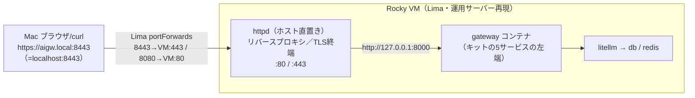

# Apache リバースプロキシ設定 ── Lima VM の前段 httpd（ゲートウェイの入口）

*個人検討ノートの一般化版（2026-11-18 同期・正は個人 Vault）*

> [!NOTE]
> **このドキュメントの位置づけ**
> Mac 上の Lima VM（運用サーバー再現）に[環境構築キット](kit/README.md)の5サービスを立てたうえで、**[構成図v2](../02_構成図/v2_DBと管理UIの反映.md) の入口＝httpd/apache（リバースプロキシ／TLS終端）をホスト（VM）直置きで再現する**手順。フロント側の業務システムが無いぶん、クライアント役は Mac のブラウザ／curl が務める。vhost・SELinux・firewalld の型は、筆者が別環境（ホスト httpd→コンテナ転送）で実証済みの構成を踏襲している。

## 1. ねらい ── 構成図の「入口」を本物にする

構成図v2 では、業務システムからの要求は https で httpd（ホストサーバー直置き）に入り、httpd が TLS を終端して GW コンテナの 80 番へ取り次ぐ。キット（compose 5サービス）はこの図の「コンテナから右」を再現するが、入口の httpd だけはコンテナの外＝ホストの仕事として残っている。本手順でこの前段を立てると、**Mac のブラウザ／curl（＝唯一無いフロントの代役）→ httpd（TLS終端）→ gateway コンテナ**という鎖が、運用サーバーと同じ形でつながる。

## 2. トポロジ ── Lima の転送と待ち受けポート

httpd はホスト（VM）の root サービスとして動くので、rootless コンテナと違い **80/443 をそのまま掴める**（特権ポートの壁が無い＝構成図・本番と同じ番号で待てる）。Mac からの到達は Lima のポート転送に任せ、**「Mac の 8080/8443 → VM の 80/443」の転送を足す**。



Lima の定義は、公開テンプレ [lima_template](https://github.com/KBi-K3i/lima_template) を基に**職場の Git ホスティングに置いた Lima リポジトリ**で管理している。その YAML の `portForwards:`（テンプレ既定は 8080→8080／8443→8443＝コンテナ httpd 練習用）を、ホスト httpd で使うときは次へ**差し替える**（変更後は VM を作り直すか `limactl edit` で反映）：

```yaml
portForwards:
  - guestPort: 80
    hostPort: 8080
  - guestPort: 443
    hostPort: 8443
```

> [!NOTE]
> **guestPort と hostPort が違う理由**
> VM 側（guest）は本番どおり 80/443 で待ち、Mac 側（host）は特権ポートを避けて 8080/8443 で受ける。Mac のブラウザからは `https://localhost:8443` が VM の `:443` に届く。コンテナ版 httpd の練習用に「8080→8080／8443→8443」の転送を使っている場合は、番号が同じでも**向き先の guestPort が違う**ので併用できない＝どちらの構成で使うかに合わせて portForwards を選ぶ。

## 3. httpd の導入（Rocky）

VM 内で httpd と TLS モジュールを入れる。

```bash
sudo dnf install -y httpd mod_ssl
```

転送に要るモジュール（`mod_proxy`・`mod_proxy_http`・`mod_headers`・`mod_ssl`）が載っていることを確かめる（Rocky は標準で同梱・有効）。

```bash
httpd -M | grep -E 'proxy_module|proxy_http_module|headers_module|ssl_module'
```

4行とも表示されればよい。

## 4. 自己署名証明書（TLS終端の鍵）

443 の VirtualHost に食わせる証明書と鍵を作る。`CN` は後で名前解決させるドメイン `aigw.local` に合わせ、Rocky 標準の置き場（`/etc/pki/tls/`）に出す。

```bash
sudo openssl req -x509 -newkey rsa:2048 -nodes -keyout /etc/pki/tls/private/aigw.key -out /etc/pki/tls/certs/aigw.crt -days 365 -subj "/CN=aigw.local"
```

自己署名なのでブラウザは警告を出す（再現練習としては承知で続行。本番は公的 CA／社内 CA の証明書に差し替える）。

## 5. VirtualHost 設定（転送の本体）

`/etc/httpd/conf.d/ai-gateway.conf` を作る。80 は 443 への入口（当面は同じ転送でよい）、443 が本命＝**TLS をここで終端し、復号後は平文 http で gateway の公開ポート 8000 へ取り次ぐ**（内部 http は構成図の「※内部http/https未定」の仮置きどおり。[論点台帳](../03_論点台帳.md) §3）。

```apache
<VirtualHost *:80>
    ServerName aigw.local

    ProxyPreserveHost On
    ProxyRequests Off
    ProxyPass        / http://127.0.0.1:8000/
    ProxyPassReverse / http://127.0.0.1:8000/

    RequestHeader set X-Forwarded-Proto "http"

    ProxyTimeout 300
    ErrorLog  /var/log/httpd/aigw_error.log
    CustomLog /var/log/httpd/aigw_access.log combined
</VirtualHost>

<VirtualHost *:443>
    ServerName aigw.local

    SSLEngine on
    SSLCertificateFile    /etc/pki/tls/certs/aigw.crt
    SSLCertificateKeyFile /etc/pki/tls/private/aigw.key

    ProxyPreserveHost On
    ProxyRequests Off
    ProxyPass        / http://127.0.0.1:8000/
    ProxyPassReverse / http://127.0.0.1:8000/

    RequestHeader set X-Forwarded-Proto "https"

    ProxyTimeout 300
    ErrorLog  /var/log/httpd/aigw_ssl_error.log
    CustomLog /var/log/httpd/aigw_ssl_access.log combined
</VirtualHost>
```

各ディレクティブの役割は Apache httpd 2.4 公式のとおり（`ProxyPass`＝背後サーバを本サーバの URL 空間へマッピングする転送の本体／`ProxyPassReverse`＝背後が返す `Location` 等の URL をプロキシ経由に書き戻す／`ProxyPreserveHost On`＝クライアントの `Host:` を奥へ渡す／`ProxyRequests Off`＝リバプロ構成の推奨。出典は末尾）。本構成ならではの2点だけ押さえる。

1. **`ProxyTimeout 300`**。LLM は1件数秒〜数十秒かかり、ストリーミングなら接続が長く開く。既定の `Timeout` のままだと長い生成で前段が先に切るので、余裕を取る（値は[論点台帳](../03_論点台帳.md) §3「遅さ・失敗への備え」とあわせて調整）。
2. **`X-Forwarded-Proto`**。TLS を前段で終端すると、奥の FastAPI から見た接続は http になる。元が https だったことをヘッダで伝えておくと、アプリ側でリダイレクトや URL 生成の判断に使える。

書けたら構文を確かめ、起動・自動起動を入れる。

```bash
sudo apachectl configtest
```

```bash
sudo systemctl enable --now httpd
```

待ち受けの確認：

```bash
sudo ss -ltnp | grep -E ':80 |:443 '
```

## 6. SELinux（Rocky は enforcing）

ホスト httpd から奥のポート（127.0.0.1:8000）への接続は、SELinux のブール `httpd_can_network_connect` が関わる。ただし筆者の別環境の実測では、**構成によってはブール off のまま通る**ので、先に動かして拒否が出たときだけ有効化する、の順がよい。拒否の有無はこう見る：

```bash
sudo ausearch -m avc -ts recent
```

`denied { name_connect } … comm="httpd"` が出ていたら有効化する：

```bash
sudo setsebool -P httpd_can_network_connect on
```

## 7. firewalld

標準ポート（80/443）なのでサービスで恒久許可して反映する。

```bash
sudo firewall-cmd --permanent --add-service=http --add-service=https
```

```bash
sudo firewall-cmd --reload
```

## 8. 動作確認（鎖を端から）

キット側の注意（[kit/README](kit/README.md)）どおり、**gateway がまだ sleep 待機／`main:app` 未実装なら、httpd は 502/503 を返す**（それ自体が「前段は生きて、奥が居ない」ことの確認になる）。順に確かめる。

VM 内から、まず httpd 自身：

```bash
curl -kI https://localhost/
```

gateway まで通す（アプリ起動後）：

```bash
curl -kI https://localhost/health
```

Mac 側は `/etc/hosts` に1行足すと、構成図と同じ「名前で入る」形になる（Lima では宛先が 127.0.0.1 になる点だけが実IP方式と違う）：

```bash
sudo sh -c 'echo "127.0.0.1 aigw.local" >> /etc/hosts'
```

ブラウザで `https://aigw.local:8443` を開き、自己署名警告→続行→ゲートウェイの応答、まで通れば入口は完成。

## 9. 自動化 ── 同梱スクリプトと Lima provision

§3〜§7 の手作業は、キット同梱のスクリプト **[`kit/vm/setup-apache.sh`](kit/vm/setup-apache.sh)** で一発化してある（冪等＝何度実行しても同じ結果に収束）。導入→証明書（既存なら再利用）→VirtualHost 配置→構文チェック→起動/自動起動→firewalld までを通し、SELinux だけは本文の「拒否が出たら」方式のまま＝スクリプトは確認コマンドの案内を表示するに留める。VM 内で1回実行する：

```bash
sudo bash setup-apache.sh aigw.local http://127.0.0.1:8000
```

引数は ServerName と上流 URL（省略時はこの既定値）。さらに進めるなら、**Lima の provision（`mode: system`）にこのスクリプトを組み込む**と「VM を作った時点で前段も出来ている」まで自動化できる（使用中の Lima リポジトリの YAML の provision に貼り込むか、リポジトリから取得して実行する形）。

> [!NOTE]
> **DevContainer では自動化できない（層が違う）**
> devcontainer.json のライフサイクルフック（`postCreateCommand` 等）は**コンテナの中**で走る。httpd は**ホスト（VM）直置き**なので、コンテナ内からは手が届かない。コンテナ側で完結させたいなら httpd 自体をコンテナ化して compose に足す型もあるが、構成図の「ホストサーバー直置きの httpd」再現からは外れる。だから自動化の正解は**スクリプト（または Lima provision）**の層になる。

## 10. トラブルシューティング

- **502/503**：奥（gateway）が居ない。キットが sleep 待機モードか、`main:app` 未実装のときの正常な姿。`docker-compose ps` と §8 の順で切り分ける。
- **SELinux の拒否**：§6。`ausearch` で AVC が出ていなければ SELinux は無罪＝`ProxyPass` の宛先ポートや gateway の `ports:` を見直す。
- **Mac から届かない**：Lima の `portForwards` が §2 の2組（80/443 向き）になっているか。コンテナhttpd練習用（8080/8443 向き）のままだと、ホスト httpd には届かない。

## 11. 関連ドキュメント

- 入口の設計：[構成図v2](../02_構成図/v2_DBと管理UIの反映.md)（httpd＝リバプロ/TLS終端・内部http/https未定の注記）
- 奥の5サービス：[開発環境構築](00_環境構築手順.md) §5／[環境構築キット](kit/README.md)
- 未決論点の比較：[論点台帳](../03_論点台帳.md) §3（内部http/https・遅さ・失敗への備え）

## 出典（一次情報）

各ディレクティブ・コマンドの根拠。逐語照合は筆者の別ノート（ホスト httpd→コンテナ転送の実証構成）で実施済みの公式ページ群に拠る。

- [mod_proxy（Apache httpd 2.4 公式）](https://httpd.apache.org/docs/2.4/mod/mod_proxy.html) ── `ProxyPass`／`ProxyPassReverse`／`ProxyPreserveHost`／`ProxyRequests`／`ProxyTimeout`
- [mod_proxy_http（Apache httpd 2.4 公式）](https://httpd.apache.org/docs/2.4/mod/mod_proxy_http.html) ── HTTP プロキシ機能の本体
- [mod_headers — RequestHeader（Apache httpd 2.4 公式）](https://httpd.apache.org/docs/2.4/mod/mod_headers.html#requestheader) ── `X-Forwarded-Proto` の付与
- [Name-based Virtual Host Support（Apache httpd 2.4 公式）](https://httpd.apache.org/docs/2.4/en/vhosts/name-based.html) ── `ServerName` による振り分け
- [SELinux の使用（RHEL 9・Red Hat 公式）](https://docs.redhat.com/ja/documentation/red_hat_enterprise_linux/9/html-single/using_selinux/index) ── `setsebool -P` と `httpd_can_network_connect`
- [ausearch(8)（公式 man）](https://www.mankier.com/8/ausearch) ── AVC 拒否の確認（`-m avc` `-ts recent`）
