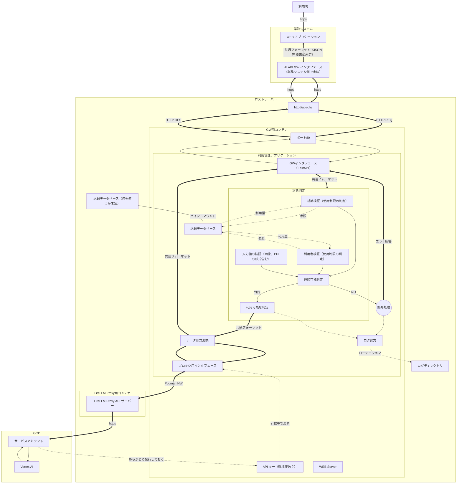

# 構成図 v0 ── 原案（職場システム構成イメージの凍結スナップショット）

*個人検討ノートの一般化版（2026-11-16 同期・正は個人 Vault）*

> [!NOTE]
> **これは凍結スナップショット（基準点）**
> 筆者が書いた原本「職場のシステム構成イメージ」の 2026-11-14 時点のコピー。**差分の基準点（v0）として固定**する（この v0 は以後変えない）。原本は引き続き自由に編集してよい。見直し反映版は [v1_見直し反映](./v1_見直し反映.md)。

## 筆者の未決メモ（原案時点）

- こういうのをシステム構成図と呼んでよいのかな？
- service_account は、現状、1つの共通アカウントで組織内のユーザーに提供するといわれているが、疑似的に1ユーザー管理するか、service_accountもユーザーごとに発行する可能性も将来あるかもしれない。ただし、1ユーザー1アカウントだと、アカウント発行が大変になるはず（情報管理はしやすいかもしれないが）。
- ホストサーバー間の通信方法は未定。外部との通信はhttpsなので、それで統一すべき？
- あと、テキスト以外もユーザーの入力値としてあり得る。その場合、共通フォーマットをJSONにしてよいのか。

## 構成図（原案）

