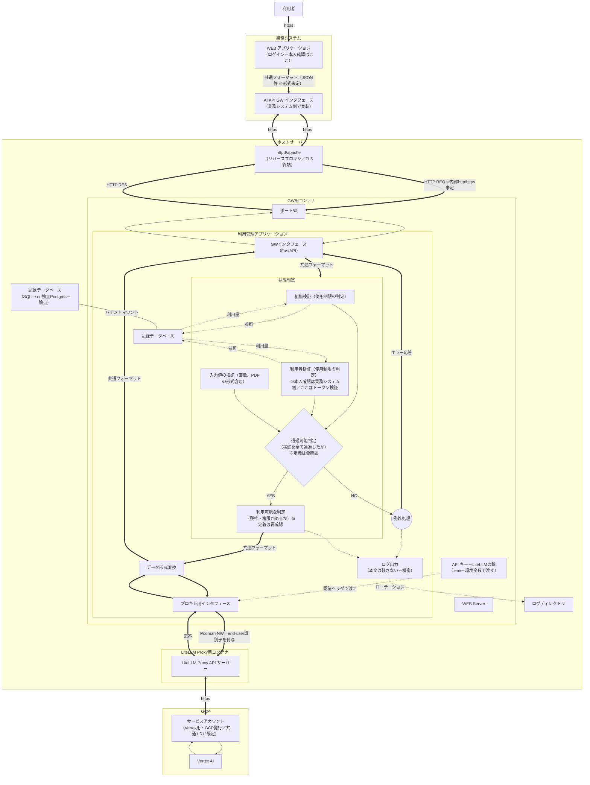

# 構成図 v1 ── 見直し反映版

*個人検討ノートの一般化版（2026-11-16 同期・正は個人 Vault）*

> [!NOTE]
> **この版は何か**
> v0（原案）に、相談で挙げた「見直しどころ」を反映した版。**技術的に誤解を生む描き方を正し、まだ決めていない所は"注記"として図に残した**（決めてはいない）。各変更が何を意味し・どう動くかは下の「変更点」で説明し、まだ決めていない選択肢の比較は [論点台帳](../03_論点台帳.md) に集約する（図＝結果、本文＝概念と挙動、台帳＝未決の比較）。基準スナップショットは [v0_原案](./v0_原案.md)。

## 変更点（v0 → v1）

v0 は、部品の配置（何がどこに居るか）はひととおり描けていた。残っていたのは、**鍵**と**身元**の流れをめぐる、技術的に誤解を生む描き方である。v1 の変更はこの2つの描き直しが中心で、話題としては次の5つに分かれる（各説明は 2026-11-16 に、名前の列挙から概念・挙動・理由まで書き下ろす形へ拡充した。旧メモ＝初版にあった8行の列挙）。

| 節 | テーマ | 旧メモの番号 |
|---|---|---|
| §1 | 鍵の描き分け（`api_key`／`service_account`／認証ヘッダ） | 1・2 |
| §2 | 身元の流れ（本人確認 → トークン検証 → end-user 識別子） | 4・5 |
| §3 | 入口の役割（リバースプロキシ／TLS終端）と内部通信 | 3・8の一部 |
| §4 | 2つの判定の暫定定義 | 6 |
| §5 | 記録と機密（記録DB・ログ） | 7・8 |

### 1. 鍵の描き分け ── `api_key` と `service_account` は別の鍵

v0 には `service_account → api_key` という線があった。これだと「GCP の鍵から LiteLLM の鍵が作られる」という親子関係に読めてしまう。実際は、この2つは**発行元も、守っている区間も別**である。利用者から Vertex までの道はリレーになっていて、**区間ごとに、その区間の受け手が発行した鍵で守る**。そこで v1 では線を削除し、それぞれのノードに「何の鍵か・誰が発行するか」を書き込んだ。

#### 1.1 `api_key` ── GW が LiteLLM に名乗るための鍵

**LiteLLM Proxy が発行する鍵**で、GW→LiteLLM の区間を守る。LiteLLM には「仮想キー」という仕組みがあり、キー単位で使えるモデル・予算・レート上限を紐づけられる。この `api_key` がその単位になる（→ [03_LiteLLM Proxyと代替](../90_基礎知識/01_LiteLLM_Proxyと代替.md)）。

置き場は `.env`（環境変数）で、コンテナ起動時に注入する（[論点台帳](../03_論点台帳.md) §4 で決定済み）。git リポジトリにもコンテナイメージにも入れない。鍵は「設定」であって「コード」ではないからである。

#### 1.2 「認証ヘッダで渡す」── 鍵の運び方

図で `api_key -.認証ヘッダで渡す.-> proxy_if` と描いた線の中身である。プロキシ用インタフェースが LiteLLM を呼ぶとき、環境変数から読んだ `api_key` を、HTTP リクエストの**認証ヘッダ（`Authorization: Bearer <api_key>`）**に載せて送る。

ヘッダに置くのは HTTP の作法による。やり取りの中身（プロンプト等）は**ボディ**に、認証のような「中身ではない運搬上の情報」は**ヘッダ**に置く。URL に鍵を入れないのも同じ線上の判断である。URL はアクセスログや履歴に平文で残りやすく、漏洩面が広がる。

受け取った LiteLLM の挙動はこうなる。毎リクエストでこの鍵を照合し、無い・違う呼び出しは認証エラー（401）で弾く。合っていれば、その鍵に紐づく予算・レート・モデル制限を適用したうえで Vertex へ中継する。

#### 1.3 `service_account` ── LiteLLM が Vertex に名乗るための鍵

**GCP が発行する鍵**で、LiteLLM→Vertex の区間を守る。図では「共通1つが既定」と明記した。利用者ごとに鍵を配らなくても、「誰が使ったか」は §2.2 の end-user 識別子で賄えるからである。per-user（利用者ごとの SA）は分離こそ強いが、発行・失効の管理が人数分に膨らむ。比較と最終判断は [論点台帳](../03_論点台帳.md) §4。

### 2. 身元の流れ ── 本人確認・トークン検証・end-user 識別子

鍵が「呼び出し元システムの正しさ」の証明だとすれば、こちらは「**操作している人間が誰か**」の話である。v0 では、この身元をどこで確認し、どこまで運ぶのかが描かれていなかった。v1 では**3つの場所が分担する一本の流れ**として明記した。業務システムが確認し、GW が検証し、LiteLLM が集計する。

#### 2.1 本人確認は業務システム側（`check_user` はトークン検証だけ）

ログイン（ID・パスワード等で「本人か」を確かめること）は**業務システムが担う**。確認に成功すると、業務システムは証として**トークン**（改ざんを検知できる通行証）を発行し、以後のリクエストに添えて GW へ送る。

GW の `check_user` はログインをやり直さない。やるのは**検証**だけである。受け取ったトークンが本物か、改ざんされていないか、期限切れでないかを確かめる。確認と検証を分けるのは、GW でログインをやり直すとパスワード等の機密を GW 側にも置くことになり、守る場所が増えるためである。身元は「自己申告の ID」でなく「検証できるトークン」で運ぶのが原則（→ [ヘッダとボディ（IDを入れない）](../90_基礎知識/05_ヘッダとボディ（IDを入れない）.md)）。

#### 2.2 end-user 識別子 ── 検証済みの身元を LiteLLM まで運ぶ

図で `proxy_if` → `proxy_api` の線に付けた「end-user識別子を付与」の中身である。トークン検証で確定したユーザー ID を、LiteLLM への転送リクエストに **end-user 識別子（OpenAI 互換 API の `user` フィールド）**として添える。

これが無いとどうなるか。LiteLLM から見える呼び出し元は「GW の `api_key` 1本」だけになり、**全員の利用が1つの財布に混ざる**。識別子を添えると、LiteLLM が **end-user 単位で spend（誰が・どれだけ使い・いくら掛かったか）を記録**し、人別の予算・レート制限も掛けられる（→ [06_横断機能とデータの持ち方](../90_基礎知識/02_横断機能とデータの持ち方.md)）。

つまり、**鍵は共通のまま、集計だけを人別にできる**。これが §1.3「`service_account` は共通1つでよい」の根拠であり、「人ごとに仮想キーを配らない」（発行・失効の管理が人数分に膨らむ）で済む理由でもある。

### 3. 入口の役割 ── httpd はリバースプロキシ／TLS終端

鍵と身元が「中身」の話なら、httpd は「入口の造り」の話である。v0 では httpd が何のために居るのか書かれていなかったので、v1 で役割を明記した。

**リバースプロキシ**は、外から来たリクエストをいったん受け、背後のアプリ（GW コンテナ）へ取り次ぐ役である。外に見せる入口を1つに絞れるので、背後のポートやコンテナ構成を隠せる。

**TLS 終端**は、https の暗号化をここで「終わらせる」ことを指す。業務システム〜httpd の区間は https（暗号化通信）で届き、httpd が復号して内側へ渡す。だから **httpd より内側を http のままにする選択肢**が生まれる（運用は楽だが、内部の盗聴には弱くなる）。内側も https に統一するか・さらに mTLS まで上げるかは監査方針しだいなので、図では「※内部http/https未定」の注記のまま残した（比較は [論点台帳](../03_論点台帳.md) §3）。暗号化と証明書のきほんは、HTTPS／TLS の一般的な解説にゆずる。

### 4. 2つの判定の暫定定義（※要確認）

判定の二段構え（`通過可能判定` → `利用可能判定`）は v0 から図にあったが、名前だけで違いが読めなかった。v1 では仮置きの意味を併記した。定義の持ち主は職場なので、確認が取れたら書き換える（[論点台帳](../03_論点台帳.md) §5 の ⚠）。

仮置きの解釈はこうである。**通過可能判定**は、3つの検証（組織・利用者・入力値）を**全部通過したか**の合流点。1つでも落ちれば例外処理へ流れ、エラー応答とログになる。**利用可能判定**は、通過したうえで**実際に使ってよいか**（残枠・権限が残っているか）の判定である。

二段に分けて描いたのは、エラーの性質が違うからである。「入力や身元が不正」は呼び出し側が直すべき誤りで、「正しいが枠が無い」は時間や配分の問題。応答の形も、使い手への案内も変わってよい。

### 5. 記録と機密 ── 記録DBとログ

最後は、使った記録をどこへどう残すかである。ここは決定ではなく、**論点の明示**として図に書き込んだ。

#### 5.1 記録DB（SQLite or 独立 Postgres）

利用量の記録先である。**SQLite** はファイル1つで動いて軽いが、複数コンテナからの同時共有に弱い。**独立 Postgres** は共有に強いが、立てて守る手間が増える。さらに LiteLLM 側の事情が絡む。仮想キー・spend 集計を使うなら LiteLLM が Postgres を要するため、「どうせ立てるなら記録もそちらへ寄せるか」という選択肢が出る。比較は [論点台帳](../03_論点台帳.md) §3。

#### 5.2 ログに本文を残さない

`logging` ノードに方針を明記した。本文（プロンプトや添付ファイル）をログに残すと、未公開情報がログディレクトリへ複製され、漏洩面が広がる。だから原則、残すのは**メタ情報だけ**にする（誰が・いつ・どの機能を・結果はどうだったか・利用量はいくらか）。本文まで要る調査にどう備えるかは、ログ保持方針として職場に確認する筋である（[論点台帳](../03_論点台帳.md) §4）。

> [!NOTE]
> **まだ"決めていない"もの（図には注記として残置）**
> 内部通信 http/https の統一可否・記録DBの選定・`service_account` 共有/個別・2つの判定の正確な定義・非テキスト入力（画像/PDF）と共通フォーマット。これらは [論点台帳](../03_論点台帳.md) で選択肢と代償を並べて詰める。

## 構成図（見直し反映）

