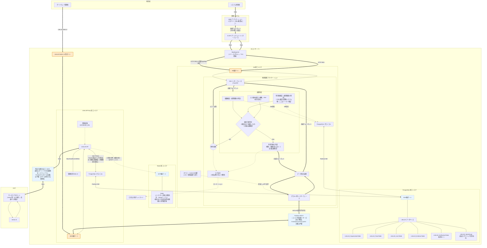

# 構成図 v2 ── DBと管理UIの反映

*個人検討ノートの一般化版（2026-11-18 同期・正は個人 Vault）*

> [!NOTE]
> **この版は何か**
> 2026-11-18 朝に筆者が手打ちで作成した版。v1 までの「論点の注記」中心から一歩進め、**LiteLLM まわりの実体（PostgreSQL コンテナ・テーブル群・管理者用 Web UI・ポート）を描き込んだ**。同日に AI アシスタントが litellm-docs（ローカルクローン＋公式サイト）で機械照合し、タイポと事実関係を修正。さらに同日のレビュー合意で、判定群の位置・v1注記・外向き通信の描き方を調整した（修正内容は下の変更点・詳細は [論点台帳](../03_論点台帳.md) §5）。未決の論点を先取りしている箇所には図中に ※ を残している。

## 変更点（v1 → v2）

- **PostgreSQL 用コンテナを新設**。LiteLLM のデータベース実体として 5432 番ポートと、公式スキーマどおりのテーブル群（`LiteLLM_OrganizationTable`・`LiteLLM_TeamTable`・`LiteLLM_UserTable`・`LiteLLM_EndUserTable`、および論点に直結する `LiteLLM_VerificationToken`〔仮想キー〕・`LiteLLM_SpendLogs`〔支出ログ〕）を描いた。GW の組織検証・利用者検証は、v1 の自前「記録データベース（バインドマウント）」ではなく、このDBを PostgreSQL プロトコルで参照する形に改めた（※ただし台帳 §3「記録DBの選定」「spend反映のタイミング」は保留のまま＝直読みか管理API経由かは未決。図は選択肢の一つを描いた仮置き）。
- **LiteLLM Proxy コンテナの実体を描き込み**。4000 番ポートの API・管理者用 Web UI（`http://localhost:4000/ui`）・`DATABASE_URL` 環境変数を追加した。
- **利用者を2役に分割**。「システム利用者」と「ゲートウェイ管理者」を分け、管理者→ LiteLLM Admin UI の経路を足した。
- **機械照合による修正（2026-11-18 AI アシスタント）**：`litell_db`→`litellm_db`・`api`→`api_key`（タイポで宙に浮いていたノードを接続）／`PostgresSQL`→`PostgreSQL`／DBアクセスの注記「60分毎？」→ 公式確認の内容（spend 系はバッチ書き込み・本番推奨は60秒毎、既定の間隔は調査中）へ差し替え／テーブル名に `LiteLLM_` 接頭辞を付与／末尾の余分なコードフェンスを削除。
- **レビュー合意による調整（2026-11-18 同日・筆者回答）**：①状態判定・ログ出力・データ形式変換・例外処理を v1 どおり「利用管理アプリケーション」の中へ戻した。②v1の注記を復元（httpd＝リバースプロキシ／TLS終端・`api_key`＝LiteLLMの鍵で `.env` 渡し〔台帳 §4 決定済み〕・WEBアプリケーション＝ログイン・本人確認はここ）。③GCPへの外向き通信は、コンテナ内の「443番ポート」をやめ（443は宛先＝GCP側のポートで、コンテナ側が待ち受けるのではないため）、**ホストの「外向き通信の出口（NAT）」を経由する線**として描いた（2026-11-18 筆者指摘＝ホストを通る口を図に残す、を反映。「宛先443」の表記は筆者指定で省略）。ただし公式確認のとおり**コンテナの外向き接続は既定で可能**で、`ports:`（公開設定）は「外からコンテナへ」の方向専用＝**外向きのために compose.yaml に書く項目は無い**[^docker-egress]。送信元ポートも固定でなく、OSが接続ごとに自動で割り当てる（エフェメラルポート）。この旨は図の注記にも明記した。④GW→LiteLLM の線の受け手を `proxy_api`（v1のノード名の名残＝v2では未定義で宙に浮いていた。機械照合でも見落とし）から `port4000` へ筆者が付け替え＝コンテナの公開ポートに合流する正しい形。⑤**compose.yaml に書く/書かないの見える化**（2026-11-18 筆者指摘＝「書く必要が無いならそれが分かるように」）：コンテナ間通信の「Podman NW IF」の箱を新設し、`ports:` に書く公開ポート（80番・4000番＋Admin UI 用ポート）を**オレンジ実線**、書かない口（Podman NW・外向きNAT・5432番）を**青点線**で塗り分け、図の下に凡例を付けた。⑥**Redis 用コンテナを追加**（2026-11-18 同日・説明用）：compose の5サービス化（開発環境構築 §5.1.4）に合わせ、6379番ポートと Redis（インスタンス間の状態共有・spendバッファ）の箱を描いた。litellm からの線は**点線＝箱のみで未接続**（有効化は性能規模の与件＝ピーク見積りの確認後）を表し、6379番は `ports:` に書かない口なので青点線スタイル。

> [!NOTE]
> **凡例 ── compose.yaml に書くポート・書かない口**
> **オレンジ実線＝`ports:`（公開）に書く口**。80番ポート（ホストの httpd がGWコンテナへ入るため）と、4000番ポート＋ホスト側の Admin UI 用ポート（管理者が外から UI へ入るため）。公開＝「外からコンテナへ」の方向を開ける設定である。
> **青点線＝compose.yaml の `ports:` に書かない口**。コンテナ間（GW⇔LiteLLM・GW/LiteLLM⇔Postgres の 5432番・LiteLLM⇔Redis の 6379番〔有効化時〕）は Podman NW 上でサービス名により解決され、公開は不要。GCP への外向きは NAT 経由で既定のまま可能＝送信元ポートは OS が接続ごとに自動割当（エフェメラル）なので、そもそも固定の番号を書けない[^docker-egress]。

## 出典（一次情報）

2026-11-18 取得・逐語は `curl`＋`grep` で機械照合済み。

- [Networking overview（Docker 公式）](https://docs.docker.com/engine/network/) ── 外向き接続は既定で可能・`-p`/`--publish`（`ports:`）は外からの公開用

## 脚注

[^docker-egress]: 原文「Containers have networking enabled by default, and they can make outgoing connections.」（コンテナは既定でネットワークが有効になっており、外向きの接続を行える）、および「Use the `--publish` or `-p` flag to make a port available outside the host」（`--publish`／`-p` フラグは、ポートをホストの外から利用可能にするために使う）＝公開設定は「外から中へ」の方向のための仕組み。— [Networking overview（Docker 公式）](https://docs.docker.com/engine/network/)
