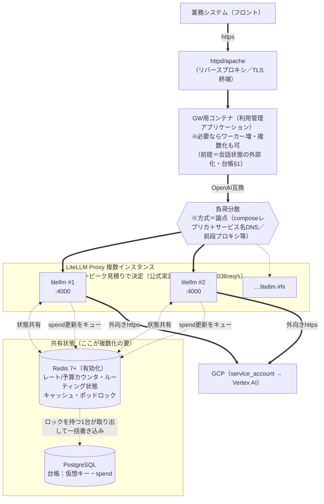

# 構成図 v3 ── 複数インスタンス構成（説明用）

*個人検討ノートの一般化版（2026-11-18 同期・正は個人 Vault）*

> [!NOTE]
> **この版は何か**
> 性能規模の与件（利用者約1300人・最悪ピーク1000req/s級の可能性＝[論点台帳](../03_論点台帳.md) §3）に備えた**複数インスタンス構成の説明用の図**。v2（単一インスタンス・Redis箱のみ）の発展形で、**スケールしたときに何がどう変わるかだけ**を描く——コンテナ内部の詳細（判定・テーブル群・管理UI等）は [v2](v2_DBと管理UIの反映.md) が正。台数・負荷分散方式・ワーカー数は**未決＝ピーク見積り待ち**として図に※で残す。**同日追記＝この形を実体化した**：開発の本命＝×2・運用サンプル＝×4・お試し＝1台版、の3段構えで[環境構築キット](../01_開発環境/kit/README.md)に実装済み（負荷分散の実体＝nginx の `litellm_lb.conf`）。

## 変更点（v2 → v3）

- **litellm を複数インスタンス化**。公式の線引きは「マシンの台数」ではなく**ワーカープロセスの数**——「`--num_workers` でも複数レプリカでも、ワーカープロセスが2つ以上になったら Redis を使う」[^redis-req]。1プロセスでは大きなCPUを使い切れないため、64コア級の単一サーバーでも実体は多ワーカー／多コンテナ＝この図の形になる。公式推奨は「1ワーカー/ポッドで水平スケール（多ワーカー1コンテナ詰めは最後の手段）」[^one-worker]。
- **Redis を「箱のみ」から「有効化」へ**。v2 で点線だった接続が実線になる。レート制限・予算カウンタ・ルーティング状態・キャッシュ・ポッドロックを全ワーカーで共有し（無いと「4ワーカーで毎分100件制限が実質400件通る」[^redis-req]）、spend 更新は Redis にキューして**ロックを持つ1台がまとめて DB へ書く**（トランザクションバッファ＝[開発環境構築](../01_開発環境/00_環境構築手順.md) §5.1.4 の機能を本番で使う形）。
- **GW→litellm 間に負荷分散を明示**。方式は論点（compose のレプリカ＋サービス名DNS／前段プロキシ等）。
- **GW 側の複数化は注記のみ**。利用管理アプリも水平に増やせるが、会話状態を外部（DB）に置くことが前提になる（台帳 §1「会話の継続」と連動）＝未決のため点線注記。

## 構成図（複数インスタンス）

> [!NOTE]
> **64コア・メモリ500GB級の単一サーバーでも、この図になる理由**
> 「大きい1台＝単一インスタンスでよい」とはならない。Redis が要るかの公式基準はプロセス数で[^redis-req]、大きなCPUを活かすには必然的にワーカー／コンテナを並べることになる（単一VMでは「ワーカー数＝vCPU数」が公式目安）。つまり**複数「マシン」は不要でも、複数「プロセス」は不可避**＝共有状態（Redis）の前提は変わらない。なお1台構成は可用性（SPOF）が別の論点として残る＝職場に確認する筋。

## 出典（一次情報）

2026-11-18 取得・逐語はローカルクローン（`litellm-docs`）で `grep` 照合済み。

- [What Needs Redis（LiteLLM 公式）](https://docs.litellm.ai/docs/proxy/redis_requirements) ── Redis の線引き（ワーカープロセス数）・無い場合に壊れるもの
- [Server Tuning（LiteLLM 公式）](https://docs.litellm.ai/docs/proxy/server_tuning) ── 1ワーカー/ポッド＋水平スケール推奨
- [Benchmarks（LiteLLM 公式）](https://docs.litellm.ai/docs/benchmarks) ── インスタンス数ごとの実測スループット

## 脚注

[^redis-req]: 原文「Use Redis when you run more than one worker process, either through `--num_workers` or multiple replicas.」（`--num_workers` によるものでも複数レプリカによるものでも、ワーカープロセスを2つ以上動かすなら Redis を使う）。共有が無い場合の例として原文「a limit of 100 requests per minute across 4 workers really lets through 400」（4ワーカーでは毎分100件の制限が実際には400件を通してしまう）。— [What Needs Redis（LiteLLM 公式）](https://docs.litellm.ai/docs/proxy/redis_requirements)
[^one-worker]: 原文の趣旨＝「ほとんどのデプロイはポッドあたり1 Uvicorn ワーカーで水平にスケールすべき」（Kubernetes では 1 worker/pod を推奨し、1コンテナに多ワーカーを詰めるのは Gunicorn 管理が要る最後の手段とする）。単一VMの場合は「`NUM_WORKERS` をマシンの vCPU 数に」との指針。— [Server Tuning（LiteLLM 公式）](https://docs.litellm.ai/docs/proxy/server_tuning)／[Production Best Practices（同）](https://docs.litellm.ai/docs/proxy/prod)
