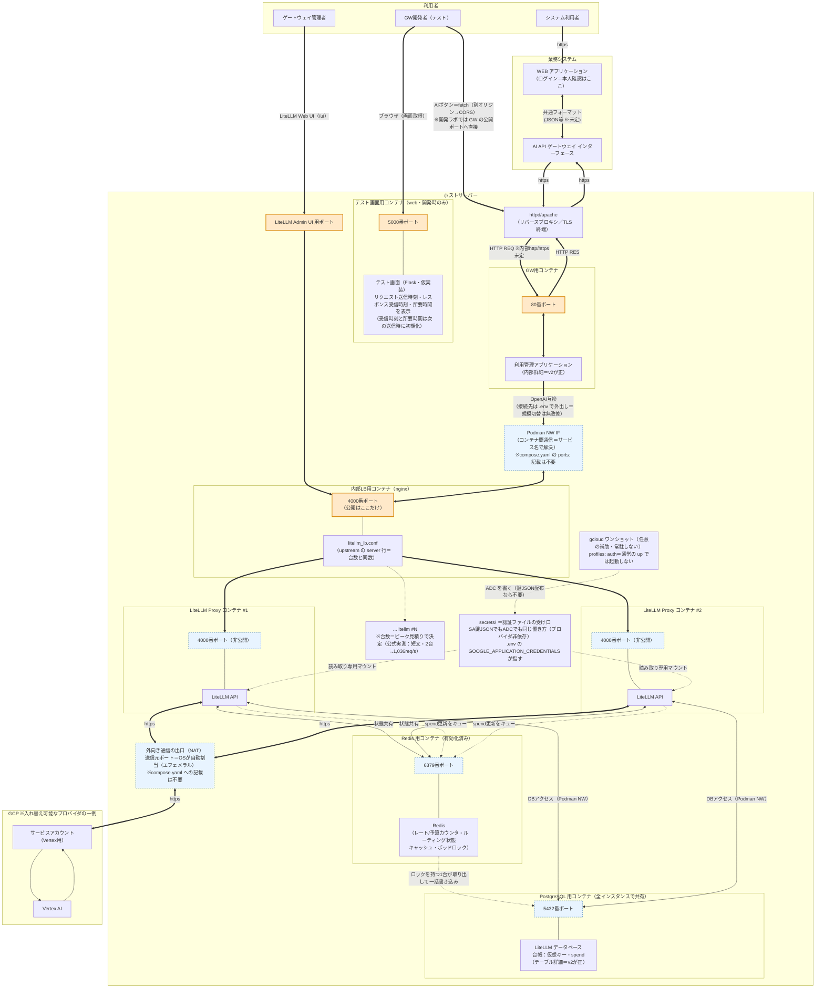
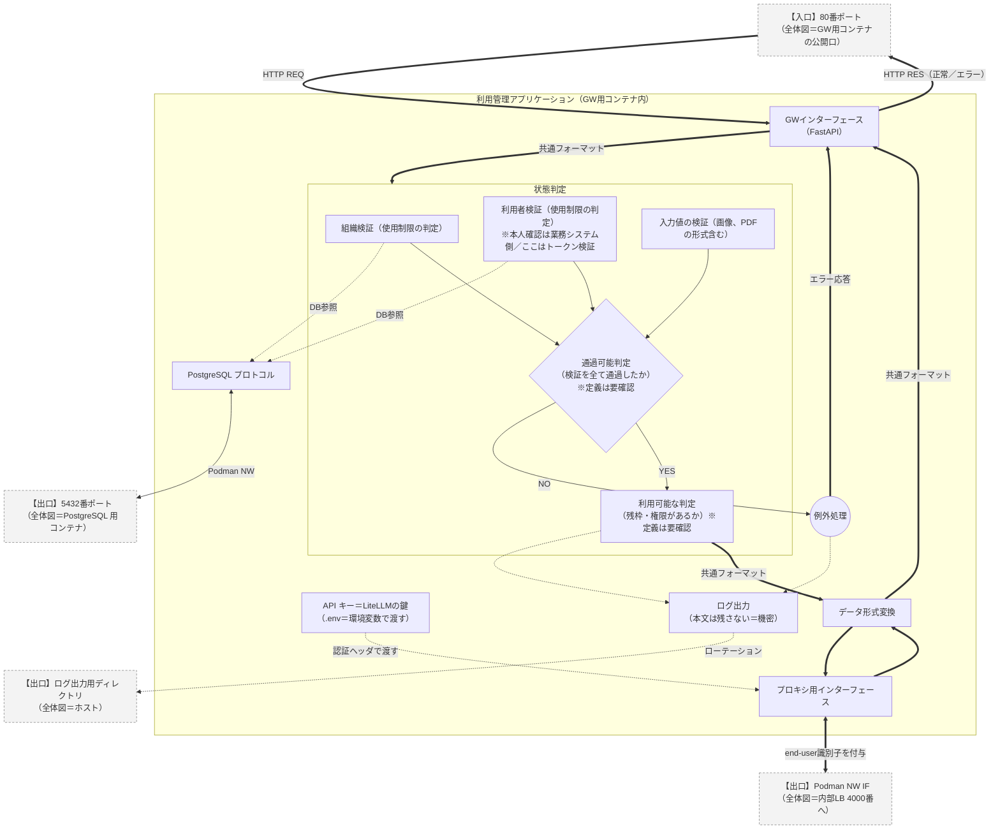

# 構成図 v4 ── 複数インスタンスの詳細版とテスト画面

*個人検討ノートの一般化版（2026-11-18 同期・正は個人 Vault）*

> [!NOTE]
> **この版は何か**
> v3 は「スケールしたとき何が変わるか」だけを描いた説明用の大づかみな図だった。この v4 は、同じ複数インスタンス構成を **v2 と同じ詳細の流儀**（コンテナ箱・ポート実体・compose.yaml に書く/書かないの色分け・Podman NW IF・外向きNAT）で描き直し、あわせて **GW開発者がテストで使うテスト画面（web コンテナ）** を追加した版。GW コンテナの内部詳細（判定群・テーブル群）は引き続き [v2](./v2_DBと管理UIの反映.md) が正で、この図では畳んで1箱にしてある。

## 変更点（v3 → v4）

- **複数インスタンスを詳細化**。[v3](./v3_複数インスタンス.md) で `{{負荷分散}}` と注記だけだった部分を実体で描いた——内部LB は nginx コンテナ（`litellm_lb.conf` の `upstream` に台数と同数の `server` 行）で、**4000番の公開は LB 側だけ**。各 litellm インスタンスの 4000番は非公開（コンテナ間＝Podman NW でサービス名により解決）になる。
- **テスト画面（web コンテナ）を追加**。GW開発者がテストで使う Flask の1画面（仮実装）で、AIボタンはブラウザから GW へ直接 fetch する（別オリジン＝CORS）。画面には**リクエスト送信時刻・レスポンス受信時刻・所要時間**が表示され、**受信時刻と所要時間は次の送信時に初期化**される。開発時のみ立てるコンテナで、本番構成には置かない。同時リクエスト数（初期値1）を数字で指定でき、並列送信時は各リクエストの状態・個別所要時間と全体の所要時間が表示される。実体は[環境構築キット](../01_開発環境/kit/README.md)各フォルダの `web/`（`app.py`＝配信・`templates/index.html`＝構造・`static/style.css`＝見た目・`static/app.js`＝挙動の4ファイル）。
- **認証の受け口 `secrets/` を描いた**。スタック本体が依存するのは「`.env` の環境変数」と「`secrets/` に置くファイル」の2つだけ（プロバイダ非依存＝2026-11-18 の設計変更）。Vertex AI の認証JSON（SA鍵でも ADC でも同じ置き方）を置き、`.env` の `GOOGLE_APPLICATION_CREDENTIALS` がそのパスを指す。ADC を作る gcloud ワンショットは**任意の補助**（`profiles: auth`＝通常の up では起動しない・削除しても本体は動く）。
- **Redis は有効化済みの実線**（v3 を踏襲）。状態共有は全インスタンス、spend 更新は Redis にキューし、ロックを持つ1台が DB へ一括書き込みする[^redis-req]。
- **GW内部詳細の別図を併載**。本図で1箱に畳んだ「利用管理アプリケーション」の中身を、入口（80番ポート）と出口（Podman NW→内部LB・5432番・ログ）が全体図と対応する単独の Mermaid で下の「GW内部詳細」節に示した。中身そのものは v2 と同じ（＝v2 が正）で、v4 では出口が LB 向きになる点だけが違う。

> [!NOTE]
> **凡例 ── compose.yaml に書くポート・書かない口**
> **オレンジ実線＝`ports:`（公開）に書く口**。80番（ホストの httpd が GW コンテナへ入るため）・LB の 4000番＋Admin UI 用ポート（管理者が外から入るため）・テスト画面の 5000番（**開発時のみ**。本番構成では web コンテナごと置かない）。
> **青点線＝`ports:` に書かない口**。各 litellm インスタンスの 4000番（入口は LB だけ＝コンテナ間は Podman NW でサービス名解決）・5432番・6379番・外向き NAT。外向きは既定のまま可能で、送信元ポートは OS が接続ごとに自動割当（エフェメラル）なので固定の番号を書けない[^docker-egress]。

> [!NOTE]
> **テスト画面の使いどころ（GW開発者）**
> 送信時刻・受信時刻・所要時間が画面に残るので、「どこまで速いか」を体感でなく数字で確かめられる。所要時間はブラウザ計測（fetch 開始→応答受領）＝**GW→LB→litellm→プロバイダの往復込み**の値であり、認証ファイル未設置のときはプロバイダ段のエラーが返るまでの時間になる（＝経路の切り分けにも使える）。同時リクエスト数を増やせば、LB 越しの並列挙動（複数インスタンスへの分散・応答のばらつき）も1画面で観察できる。

## GW内部詳細（簡素化した箱の中身）

本図で1箱に畳んだ「利用管理アプリケーション」の中身だけを取り出した図。両端に置いた灰色の点線の箱が全体図との接続点で、**【入口】80番ポート**から入り、**【出口】Podman NW IF（→内部LB 4000番）・5432番ポート・ログ出力用ディレクトリ**へ抜ける。中身の構造（判定群・例外処理・ログ・変換）は v2 と同じ＝v2 が正。

## 出典（一次情報）

2026-11-18 取得（v2・v3 作成時に逐語照合済みの一次情報を再掲）。

- [What Needs Redis（LiteLLM 公式）](https://docs.litellm.ai/docs/proxy/redis_requirements) ── Redis の線引き（ワーカープロセス数）・spend のトランザクションバッファ
- [Networking overview（Docker 公式）](https://docs.docker.com/engine/network/) ── 外向き接続は既定で可能・`ports:` は外からの公開専用

## 脚注

[^redis-req]: 原文「Use Redis when you run more than one worker process, either through `--num_workers` or multiple replicas.」（`--num_workers` によるものでも複数レプリカによるものでも、ワーカープロセスを2つ以上動かすなら Redis を使う）。spend 更新は各インスタンスが Redis にキューし、ロックを持つ1台がまとめて DB へ書き込む。— [What Needs Redis（LiteLLM 公式）](https://docs.litellm.ai/docs/proxy/redis_requirements)
[^docker-egress]: 原文「Containers have networking enabled by default, and they can make outgoing connections.」（コンテナは既定でネットワークが有効になっており、外向きの接続を行える）、および「Use the `--publish` or `-p` flag to make a port available outside the host」（`--publish`／`-p` フラグは、ポートをホストの外から利用可能にするために使う）。— [Networking overview（Docker 公式）](https://docs.docker.com/engine/network/)
