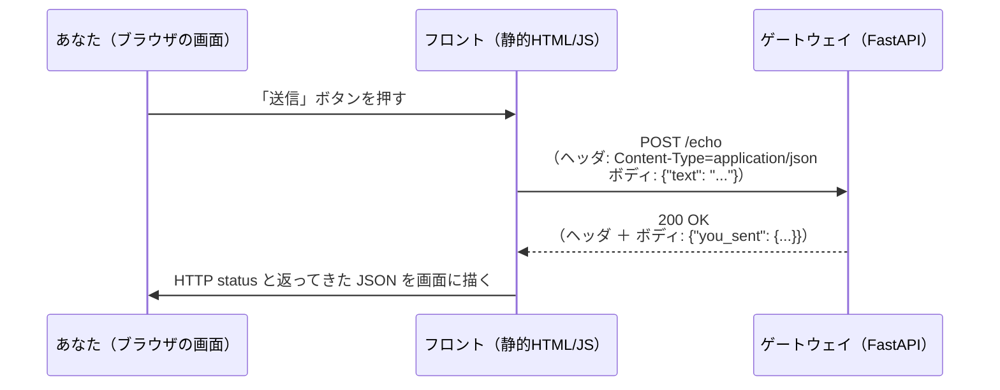

# Phase 0 詳細設計 ── 歩く骨格（ブラウザのボタン → FastAPI → 画面に表示まで一往復）

*個人検討ノートの一般化版（2026-11-16 同期・正は個人 Vault）*

> [!NOTE]
> **このドキュメントの位置づけ（3枚の役割分担）**
> - **要件・全体像**＝個人ノート側の INDEX（STEP地図）と全体設計（鎖・封筒・差し替え・機密）＝「何を・どんな形に組むか」。どちらも本セットには収録していないが、その骨子は[構成図](../02_構成図/v1_見直し反映.md)と[論点台帳](../03_論点台帳.md)で追える（本文中の「全体設計 §n」は、この親ドキュメントの節番号を指す）。
> - **本書＝詳細設計**＝その鎖の**いちばん左端の一環（Phase 0）**を、どのファイル・どの関数・どの手順で、どの順序で作るかを実装の一歩手前まで落とす。全体設計 §8 の STEP 対応表で言う「1 Webの一往復を見る」を、スライス直前の軽い詳細設計として起こしたもの。
> - **実装は筆者／本書の参照コードは"叩き台"**＝下に載せる `app.py`・`index.html` は完成品を配る台本ではなく、筆者が **写経・改変して理解しながら `step0/` に書く**ための下敷きです（プロジェクト方針＝AI アシスタントはコードを書かない）。手を動かす実装・コードのQ&Aは VS Code 上の AI アシスタント（DevContainer 内）で行い、本書は"設計判断と根拠・観察の手引き"に徹します。
>
> 学習・自己判断用（本物の機密データは使わない・ダミー文のみ）。★は筆者が決める欄（自己申告）。

---

## 1. この Phase のゴールと受け入れ基準

Phase 0 で狙うのは、これから育てていく長い鎖（ブラウザ → ゲートウェイ → LiteLLM → Vertex AI）の、まず**いちばん左端の一環だけを端から端まで1本つなぐ**ことです。封筒も機能ポートも LLM も、この段階では一切作りません。作るのは「ブラウザのボタンを押す → HTTP リクエストが飛ぶ → FastAPI が受けて返す → 画面に結果が出る」という**薄い縦スライス**で、ここが動いて初めて「鎖が通る土台ができた」と言えます。全体設計 §8 の STEP 対応表でいう「1 Webの一往復を見る」が、この Phase の実体です。

なぜ機能を削ってまで"一往復"だけを先に通すのか。それは、このプロジェクトのいちばん大事な学習目標が **「Webの仕組みを、自分の目で見て掴む」**（本プロジェクトの第一の学習目標）だからです。要約や関連さがしといった中身を作り込む前に、**メソッド・ヘッダ・ボディ・ステータス・CORS** という"Webの部品"を、ブラウザの開発者ツール（Network タブ）と `curl` で実際に観察できる状態にしておく。ここで部品の手触りを得ておくと、Phase 1 以降の封筒（どのフィールドをボディに置くか）や統一エラー（どのステータスで返すか）の設計判断が、画面で見た実物に裏打ちされて腹落ちします。

受け入れ基準は「端まで動く」と「一往復が目に見える」の2本立てで、下の表を満たせば Phase 0 は完成です。

| # | 受け入れ基準（完成の線） | 確かめ方 |
|---|---|---|
| A | FastAPI ゲートウェイが起動し、`GET /health` が `200` とボディ `{"status":"ok"}` を返す | `curl -i .../health`・ブラウザで直接開く |
| B | `POST /echo` に送った JSON が、ボディ `{"you_sent": …}` としてそのまま返る | `curl -i -X POST …`・フロントのボタン |
| C | ブラウザのボタン → fetch → 画面表示までが**別オリジン越し**に通る（＝CORS を越える） | F12 → Network タブで1件のリクエストを観察 |
| D | サーバを起動しない**自己テスト**（`python app.py`）が `self-test OK` で緑になる | 検査ゲート（実行＋型）を通す土台 |
| E | Network タブで、その1件の**メソッド・ヘッダ・ボディ・ステータス**を指し示せる | 下の §6 の観察表の各欄を言葉にできる |

> [!NOTE]
> **Phase 0 で"作らない"もの（YAGNI＝全体設計 §7）**
> 封筒（envelope）・統一エラー・`feature` 出し分け・機能ポート（`Summarizer`／`RelatedFinder`）・LiteLLM 接続・Vertex AI・認証トークン検証・監査ログ・HTTPS・コンテナ化は**すべて後の Phase**。Phase 0 は `/echo` という"鏡"で一往復の形だけを通し、鎖の継ぎ目（ボタン→HTTP→サーバ→画面）が全部つながることを確かめます。`/echo` が返す中身は意味を持たず、**往復が成立したことの証拠**です。

---

## 2. 設計（なぜこの形か）── Webの一往復

ゴールが「一往復を目で見る」である以上、まず押さえるべきは **Web が何でできているか** です。Web のやり取りは、どれだけ賢いアプリでも根っこは **「要求（リクエスト）→ 応答（レスポンス）」の往復**ひとつに還元できます。Phase 0 はその往復を**最小の1回**だけ取り出して、部品が見えるようにしたものです。



この1往復を分解すると、観察すべき"部品"が4つ見えてきます。それぞれが Network タブのどこに表示されるかまで含めて掴むのが、この節の狙いです。

- **メソッド**＝何をする往復か。取得は `GET`（`/health` を開く）、送信は `POST`（`/echo` に本文を送る）。副作用の有無や"べき等か"といった REST の作法の深掘りはここでは扱わず（出典に挙げた MDN 等の一次資料に譲る）、「GET は読む・POST は送る」を体で覚えます。
- **ヘッダ**＝メッセージの"表書き"＝メタ情報。`Content-Type: application/json` は「このボディは JSON ですよ」という申告で、これが無いとサーバは中身の読み方を取り違えます。表書き（ヘッダ）と中身（ボディ）に何を置くかの住み分けは基礎知識編の[ヘッダとボディ（IDを入れない）](../90_基礎知識/05_ヘッダとボディ（IDを入れない）.md)が主題として扱う論点で、Phase 1 で封筒を「ボディに置く」と決める布石になります。
- **ボディ**＝実際の中身。今回は送る JSON（`{"text": "..."}`）と返る JSON（`{"you_sent": {...}}`）。`/echo` はこのボディを鏡のように返すので、「送ったものが確かに届いて戻った」が一目で分かります。
- **ステータスコード**＝結果の合図。`200` は成功、`4xx` はこちら側（リクエスト）の誤り、`5xx` はサーバ側の誤り。Network タブで赤く光るかどうかで、往復が成立したかが即わかります。

> [!NOTE]
> **CORS に出会う理由（なぜこの Phase で避けられないのか）**
> フロントの HTML は別ポート（例 5500 の簡易 HTTP サーバ）から配り、API は 8000 にいます。ブラウザから見ると**出所（オリジン）が違う**＝`http://localhost:5500` と `http://localhost:8000` は別物です。ブラウザは安全のため、スクリプトが別オリジンへ投げたリクエストの**応答を既定でブロック**します。これを越えるには、サーバ側が「このオリジンからのアクセスは許す」とヘッダで宣言する必要があり、その仕組みが **CORS（Cross-Origin Resource Sharing）**。全体設計 §2 の注記どおり、このプロジェクトは**本番でもブラウザが FastAPI を直接 fetch する**設計なので、CORS は避けて通れません。だから Phase 0 であえて別オリジン構成を踏み、Network タブで**プリフライト（`OPTIONS` の事前確認）**が飛ぶ様子まで見ておきます。練習なので全オリジン許可（`allow_origins=["*"]`）にしますが、**本番はフロントのオリジンだけ**を列挙する――この違い（許可するオリジンの絞り方）は、認証・セキュリティ・公開を扱う後続 Phase で改めて深掘りします。

> [!TIP]
> **深掘りの入口（基礎知識編）**
> ヘッダ／ボディの住み分けは[ヘッダとボディ（IDを入れない）](../90_基礎知識/05_ヘッダとボディ（IDを入れない）.md)、HTTP メッセージの生の構造は[HTTPメッセージの実体](../90_基礎知識/06_HTTPメッセージの実体.md)。HTTP/REST の全体像（メソッド・ステータス・べき等性）は出典に挙げた MDN 等の一次資料へ。Phase 0 は"手を動かして実物を見る"側で、"なぜそうなるか"はこれらへ渡します。

---

## 3. 環境（軽量な Linux＋uv）

実装に入る前に、壊しても戻せる**隔離された作業場**を1つ用意します。全体設計 §8 の STEP 対応表でいう「0 環境と安全網」に当たる準備で、Phase 0 ではまず**軽い Linux＋uv**で素早く往復を通すのが狙いです。いずれ全体設計のとおり **DevContainer↔社内 Git ホスティング（GitLab 等）のフルコンテナ**（[環境構築手順](../01_開発環境/00_環境構築手順.md)）へ移しますが、一往復を見るだけならコンテナを立てる重さは要らず、開発ホスト（Linux）上の `uv` プロジェクトで十分に速く回せます。

なぜ Linux＋uv かは、本プロジェクトの土台方針そのものです。

- **Linux**：本番は RHEL(Linux) 上のコンテナなので、開発段階から Linux で動かす練習が最短です（Windows の開発機なら WSL2 の Ubuntu のような Linux 環境でよい）。
- **uv**：依存と Python 版をプロジェクト単位で固定でき、`uv run` で再現よく動きます。
- **型ゲート（実行＋mypy＋pyright）**：「実行は通るのに Pyright(エディタの Pylance) が怒る」型の誤りを、基礎段階で潰すための安全網です（本プロジェクトの必須運用）。

プロジェクトを作ります（置き場所は任意。以下は例として `~/work` 配下を使います）。

```
mkdir -p ~/work && cd ~/work && uv init ai-gateway --python 3.12 --no-workspace
```

依存を入れます（ゲートウェイ本体＝FastAPI／起動＝uvicorn／テスト用クライアント＝httpx）。

```
cd ~/work/ai-gateway && uv add fastapi uvicorn httpx
```

> [!NOTE]
> **この Phase の型チェックの通し方（FastAPI 版）**
> 依存なしの一時環境で mypy/pyright を回す汎用の検査スクリプトでは FastAPI を import するコードを検査できないので、**プロジェクト内の `uv run`** を使います（STEP0 の作法を踏襲）。成果物へ反映する前に、筆者の手元で下の3つが**すべてクリーン（rc=0）**になることを確かめます。
> - 実行：`uv run python step0/app.py`（自己テストが `self-test OK`）
> - mypy：`uv run --with mypy mypy --python-version 3.12 step0/app.py`
> - pyright：`uv run --with pyright pyright --pythonversion 3.12 step0/app.py`

---

## 4. 実装（参照コード＝叩き台）

ここからが手を動かす中心ですが、下の2ファイルは**完成品として配るものではありません**。「これをコピーすれば終わり」ではなく、**一行ずつ写経し、変数名や返す形を自分で少しいじって、挙動がどう変わるかを確かめる**ための叩き台です（プロジェクト方針＝AI アシスタントはコードを書かない／筆者が `step0/` に実装する）。写経の途中で「なぜこの型注釈が要るのか」「CORS の行を消すと何が起きるのか」と手を止めて実験することこそ、この Phase の学びです。コード自体は、旧 STEP1 で**実行＋mypy＋pyright（Python 3.12）がすべてクリーン**を確認済みの版を下敷きにしています（型注釈つき・CORS 全許可は練習用）。

### 4.1 ゲートウェイ本体 `step0/app.py`

まず骨格だけのゲートウェイを作ります。エンドポイントは2つだけ――`GET /health`（サーバが生きている証明）と `POST /echo`（送った JSON を鏡で返す）――で、これ以上は足しません。末尾の `_self_test()` は**サーバを起動せずに**ルートを叩く関数で、`python app.py` が一瞬で終わるので検査ゲートに向きます。

```python
"""Phase 0 of the AI Gateway Dojo: the smallest possible gateway skeleton.

Two endpoints only, so you can watch a single HTTP round trip:
  GET  /health -> {"status": "ok"}      (open it in the browser)
  POST /echo   -> {"you_sent": <body>}  (the frontend button calls this)

Run the self-test (no server, good for the type/exec gate):
    uv run python step0/app.py
Serve it for real:
    uv run uvicorn step0.app:app --reload --port 8000
"""
from __future__ import annotations

from typing import Any

from fastapi import FastAPI
from fastapi.middleware.cors import CORSMiddleware

app = FastAPI(title="AI Gateway Dojo - Phase 0")

# Practice-only: allow any origin so the static HTML page (served on another
# port) may call this API. In production you list the exact front-end origins.
app.add_middleware(
    CORSMiddleware,
    allow_origins=["*"],
    allow_methods=["*"],
    allow_headers=["*"],
)


@app.get("/health")
def health() -> dict[str, str]:
    """Liveness probe: proves the server is up and reachable."""
    return {"status": "ok"}


@app.post("/echo")
def echo(payload: dict[str, Any]) -> dict[str, Any]:
    """Echo the received JSON back, so the round trip is visible."""
    return {"you_sent": payload}


def _self_test() -> None:
    """Exercise the routes in-process (no network, no blocking server)."""
    from fastapi.testclient import TestClient

    client = TestClient(app)

    health_res = client.get("/health")
    assert health_res.status_code == 200, health_res.status_code
    assert health_res.json() == {"status": "ok"}, health_res.json()

    echo_res = client.post("/echo", json={"text": "hello"})
    assert echo_res.status_code == 200, echo_res.status_code
    assert echo_res.json() == {"you_sent": {"text": "hello"}}, echo_res.json()

    print("self-test OK: /health and /echo behave as expected")


if __name__ == "__main__":
    _self_test()
```

> [!NOTE]
> **コードの読み方（文系向け・写経のときに手を止める箇所）**
> - `app = FastAPI(...)`：アプリ本体を作る。これに"エンドポイント（入口）"をぶら下げていく。
> - `app.add_middleware(CORSMiddleware, ...)`：§2 の CORS をここで宣言している。**試しにこの行をコメントアウトして**フロントから叩くと、ブラウザが応答をブロックする様子（CORS エラー）を観察できる。
> - `@app.get("/health")` / `@app.post("/echo")`：「このメソッドでこのパスに来たらこの関数を呼べ」という目印（デコレータ）。`get` と `post` の違いが §2 のメソッドに対応する。
> - `dict[str, str]` / `dict[str, Any]`：返り値・引数の"型"。型を書くと mypy/pyright が誤りを早く見つける（型ゲートの効き目）。`payload: dict[str, Any]` が、受け取った JSON ボディを辞書として受ける宣言。
> - `_self_test()`：サーバを起動せず中身だけ試す関数。だから `python app.py` が一瞬で終わり、検査ゲート（§3）に向く。

### 4.2 超簡単フロント `step0/index.html`

次に、ボタン1つの素朴なフロントを作ります。フレームワークは使いません――**仕組みが見える**ことが最優先だからです（本プロジェクトのコード方針）。`fetch()` の呼び出しで、**自分の手でメソッド・`Content-Type` ヘッダ・ボディを組み立てている**ことに注目してください。§2 で分解した部品が、そのままコードの各行に対応します。

```html
<!doctype html>
<html lang="ja">
  <head>
    <meta charset="utf-8" />
    <title>AIゲートウェイ道場 Phase 0</title>
  </head>
  <body>
    <h1>記事アシスタント ― Phase 0：まず往復を見る</h1>
    <p>
      下の文章を <code>/echo</code> に送り、返ってきたものを表示します。ブラウザの開発者ツール（Networkタブ）を開いて、実際のHTTPを観察しましょう。
    </p>
    <textarea id="text" rows="4" cols="60">これはテストの記事本文です。</textarea>
    <br />
    <button id="send">送信（POST /echo）</button>
    <pre id="out"></pre>

    <script>
      // Where our gateway lives. Change the port if you run uvicorn elsewhere.
      const API = "http://localhost:8000";

      document.getElementById("send").onclick = async () => {
        const text = document.getElementById("text").value;
        // fetch() makes the browser send one HTTP request.
        // Note how WE build the method, the Content-Type header, and the body.
        const res = await fetch(API + "/echo", {
          method: "POST",
          headers: { "Content-Type": "application/json" },
          body: JSON.stringify({ text: text }),
        });
        const data = await res.json();
        document.getElementById("out").textContent =
          "HTTP status: " + res.status + "\n" + JSON.stringify(data, null, 2);
      };
    </script>
  </body>
</html>
```

この `fetch` の3つの設定（`method`・`headers`・`body`）が、§2 のメソッド・ヘッダ・ボディそのものです。写経したら **`Content-Type` を消すとサーバがどう反応するか**、**`method` を `GET` に変えると何が起きるか**を試すと、部品の役割が一段くっきりします。

---

## 5. 動かす＋観察

コードが揃ったら、2つのサーバ（API とフロント配信）を別ターミナルで立て、ブラウザと `curl` の両方から往復を起こします。ここが「Webの仕組みを目で見る」という Phase 0 のゴールの本番で、**ただ動かすのではなく、Network タブと `curl -i` で部品を1つずつ指し示す**のが目的です。

ゲートウェイを起動します（プロジェクト直下から）。

```
cd ~/work/ai-gateway && uv run uvicorn step0.app:app --reload --port 8000
```

別のターミナルで、フロントを配ります（素の HTTP サーバ＝別オリジンを作るため）。

```
cd ~/work/ai-gateway/step0 && python3 -m http.server 5500
```

ブラウザで `http://localhost:5500/index.html` を開き、**F12 → Network タブ**を出してからボタンを押します。別オリジン（5500 → 8000）への fetch なので、ここで §2 の CORS を実地で通過します。プリフライト（`OPTIONS`）が先に飛ぶ場合は、それも1件のリクエストとして観察対象です。

サーバを介さず HTTP を直接叩いて、ヘッダとステータスを生で見ます（`-i` でレスポンスヘッダも表示）。

```
curl -i http://localhost:8000/health
```

```
curl -i -X POST http://localhost:8000/echo -H "Content-Type: application/json" -d '{"text":"hello"}'
```

`curl -i` では応答の1行目（`HTTP/1.1 200 OK`）とヘッダ群、空行、ボディ（JSON）という**HTTP メッセージの構造そのもの**が素のテキストで見えます。ブラウザの Network タブが"整形して見せる"のに対し、`curl -i` は"生で見せる"――同じ往復を2つの道具で見比べると、部品の実在が腹落ちします。

---

## 6. テスト（self-test＋curl＋Network の確認表）

受け入れ基準（§1）を**実行可能な確認**に落とし、1つずつ緑にしていきます。まずサーバを起動しない自己テストで"中身"を固め、次に `curl` で HTTP を直接確かめ、最後にブラウザの Network タブで"見えること"自体を確認する――この3段で §1 の A〜E をすべて踏みます。

サーバ不要の自己テスト（＝検査ゲートの土台）。

```
cd ~/work/ai-gateway && uv run python step0/app.py
```

| 確認項目 | 操作 | 期待する結果 | §1 の基準 |
|---|---|---|---|
| 自己テスト | `uv run python step0/app.py` | `self-test OK: ...` と表示 | D |
| health | `curl -i .../health` | `HTTP/1.1 200`、ボディ `{"status":"ok"}` | A |
| echo | `curl -i -X POST .../echo ...` | `200`、ボディ `{"you_sent":{"text":"hello"}}` | B |
| フロント往復 | ボタン押下 → 画面に status と JSON | 別オリジン越しに結果が描画される（CORS を越える） | C |

ブラウザの Network タブでは、押下で発生した1件を選び、下の4欄を**自分の言葉で指し示せる**ことを確認します。これができれば §1-E（往復が目に見える）が満たせます。

| 見る部品 | Network タブのどこ | Phase 0 での実物 |
|---|---|---|
| メソッド | リクエストの先頭（Method 列／Request 行） | `POST`（`/echo`）・`GET`（`/health`） |
| ヘッダ | Headers タブ（Request/Response Headers） | 送り：`Content-Type: application/json`／返り：`content-type: application/json` |
| ボディ | Payload（送信）／Response（受信） | 送り：`{"text":"..."}`／返り：`{"you_sent":{...}}` |
| ステータス | Status 列／Status Code | `200`（成功。赤く光れば 4xx/5xx） |

> [!NOTE]
> **検査ゲートを通してから成果物へ**
> コードをドキュメント（や成果物）へ反映する前に、筆者の手元で **実行＋mypy＋pyright が rc=0**（§3 の3コマンド）になっていることを確かめます。`payload: dict[str, Any]` のような型注釈が、まさにこのゲートで「型チェッカが怒らない」ことを保証する部品です（本プロジェクトの必須運用）。

---

## 7. この Phase が次に効く

Phase 0 で Network タブと `curl` を通して見た部品は、そのまま次以降の設計判断の"材料"になります。ここで得た実物の手触りがあると、抽象的に思えた封筒や統一エラーが「あの画面のどこに乗るか」で考えられるようになる――それがこの薄いスライスを最初に通す本当の見返りです。

- **ボディに見た JSON → Phase 1 の封筒（envelope）**。`/echo` が鏡で返した `{"text":...}` を眺めたうえで、「業務の要求（`feature`・`input`・`options` …）は**ヘッダでなくボディ（封筒）に置く**」という全体設計 §5 の判断が納得できます。封筒は結局このボディの形を決める作業です。
- **ステータスで見た成功/失敗 → Phase の統一エラー**。`200` と `4xx/5xx` の色の違いを見ておくと、「どの誤りをどのステータスで返すか」という統一エラーの設計が、画面の実物に紐づきます。
- **越えた CORS → ブラウザ直叩きの前提**。別オリジン越しに通したこと自体が、全体設計 §2 の「AIボタンはブラウザ → FastAPI を直接 fetch する」という鎖の形を支える実地検証になっています。
- **FastAPI の骨格 → ゲートウェイ本体の土台**。この `app` に、次 Phase 以降で `POST /v1/invoke`（封筒）・機能ポート・LiteLLM クライアントをぶら下げていきます。Phase 0 の `app.py` は捨てずに育てる幹です。

---

## 8. 関連

- このプロジェクトの地図・方針：個人ノート側の INDEX（STEP地図）／全体設計（§2 鎖・§8 STEP対応）／AI作成要綱（いずれも本セット未収録。概観は[構成図](../02_構成図/v1_見直し反映.md)・[論点台帳](../03_論点台帳.md)で追える）
- 設計の"なぜ"（深掘り）：ヘッダ／ボディの住み分けは[ヘッダとボディ（IDを入れない）](../90_基礎知識/05_ヘッダとボディ（IDを入れない）.md)／HTTP メッセージの生の構造は[HTTPメッセージの実体](../90_基礎知識/06_HTTPメッセージの実体.md)／HTTP・REST の全体像と CORS の深掘りは出典に挙げた MDN 等の一次資料へ
- 環境の土台：[00_環境構築手順（DevContainer↔Git ホスティング）](../01_開発環境/00_環境構築手順.md)
- 次の Phase：封筒（envelope）＝全体設計 §5（「封筒という考え方」の整理ノートは個人ノート側）

## 出典

本書の技術的主張のうち、**個人の学習ノートに原著・根拠があるもの**（HTTP/REST のメソッド・ヘッダ/ボディの住み分け・CORS・封筒）は各ノート（§2・§8 の参照先）へ送った。**手元のノートに文献が無い個別技術**（FastAPI・CORS 仕様・HTTP ステータスの定義）は、下記の一次情報で裏づけた（URL は実在を確認済み。逐語引用はせず筆者の要約として記す）。

**公式一次情報**

- FastAPI（Python の型ヒントで API を作る Web フレームワーク。Pydantic による検証と OpenAPI ドキュメント自動生成を備える）[^fastapi]。
- MDN「Cross-Origin Resource Sharing (CORS)」（ブラウザが別オリジンへのアクセスを既定で制限し、サーバ側の `Access-Control-Allow-Origin` 等のヘッダで許可を宣言する仕組み。単純でないリクエストは `OPTIONS` のプリフライトで事前確認する）[^cors]。
- MDN「HTTP response status codes」（`200 OK`＝成功／`4xx`＝クライアント側の誤り／`5xx`＝サーバ側の誤り）[^status]。

## 脚注

[^fastapi]: FastAPI 公式。標準の **Python 型ヒント**で API を作る Web フレームワーク。**Pydantic** によるデータ検証と、**OpenAPI（Swagger UI/ReDoc）**に基づく対話的ドキュメントの自動生成を備える（Starlette＋Pydantic＋Uvicorn 上に構築）。本書の `@app.get` / `@app.post` と型注釈つきハンドラはこの作法に従う。 — [FastAPI（公式）](https://fastapi.tiangolo.com/)
[^cors]: MDN Web Docs「Cross-Origin Resource Sharing (CORS)」。ブラウザは、あるオリジンのスクリプトが**別オリジン**の資源へ出した要求の応答を、サーバが追加の HTTP ヘッダ（`Access-Control-Allow-Origin` 等）で許可しない限り既定でブロックする。副作用を持ち得る要求は、本番の要求の前に `OPTIONS` による**プリフライト**で許可を確かめる。 — [CORS（MDN）](https://developer.mozilla.org/en-US/docs/Web/HTTP/CORS)
[^status]: MDN Web Docs「HTTP response status codes」。応答の結果を示す3桁コード。`2xx`＝成功（`200 OK`）、`4xx`＝クライアント側の誤り、`5xx`＝サーバ側の誤り。本書 §2・§6 の「200/4xx/5xx」の区分はこの定義に拠る。 — [HTTP response status codes（MDN）](https://developer.mozilla.org/en-US/docs/Web/HTTP/Status)
