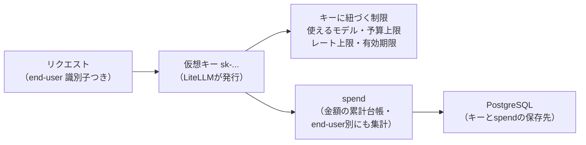
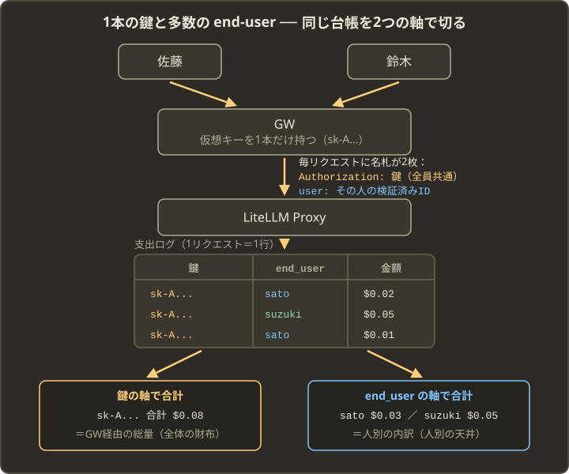

# 01 利用管理 ── 使用制限・記録DB・仮想キーの論点を議論できるようにする

*個人検討ノートの一般化版（2026-11-18 同期・正は個人 Vault）*

> [!NOTE]
> **この解説が支える台帳の行**
> [論点台帳](../03_論点台帳.md) §3「使用制限をどこで数えるか」「記録DBの選定」、§4「`service_account` 共有/個別」。この3行はどれも、**LiteLLM の利用管理の仕組み**が前提になっている。仕組みを知らないまま表だけ見ると、「仮想キーは Postgres 必須」の一言が選択肢とどうつながるのか取れず、議論が止まる。そこで、仕組み → LiteLLM の守備範囲（できる・できない）→ 記録DB論点への帰結、の順にほどく。

## 1. まず仕組み ── LiteLLM の利用管理は「鍵にぶら下がる台帳」

LiteLLM Proxy はモデルの中継役であると同時に、「誰に・どこまで使わせ、いくら使ったかを数える」利用管理の機能を標準で持っている[^vk-overview]。その組み立ては一貫していて、すべて**鍵（仮想キー）を起点**に紐づく。部品は4つ——仮想キー・spend・end-user 識別子・保存先の DB——で、ひとつずつ見ていく。

### 1.1 仮想キー ── 制限ルールをぶら下げる「取っ手」

仮想キー（Virtual Key）は、**LiteLLM Proxy が自分で発行する `sk-...` 形式の鍵**である。Vertex の本物の鍵（`service_account`）とは別物で、LiteLLM の入口だけで通用する館内パスにあたる。構成図で「api_key＝LiteLLMの鍵」と描いたものの正体がこれ（[構成図v1](../02_構成図/v1_見直し反映.md) §1.1）。

ただの合言葉ではない。発行するとき、キーごとに**使えるモデル・予算上限・レート上限・有効期限**を設定できる[^vk-params]（→ [03_LiteLLM](../90_基礎知識/01_LiteLLM_Proxyと代替.md) §3.1）。つまり仮想キーは、認証の道具であると同時に、**制限ルールをぶら下げる「取っ手」**でもある。「誰に・どこまで使わせるか」は、この取っ手の単位で決まる。

### 1.2 spend ── 鍵ごとの家計簿

リクエストが1件通るたび、LiteLLM は消費トークン数をモデル単価で金額に換算し、キーやユーザーごとに**累計**していく[^vk-spend-usd]。この累計が **spend（支出）**である。予算上限との突き合わせはこの家計簿で行われ、上限を超えるリクエストは上流のモデルへ送られる前に拒否される[^budget-reject]。

集計の実体は「**1リクエスト＝1行**」の支出記録である。名前こそ「ログ」だが、実体はログファイルではなく **Postgres のテーブル（`LiteLLM_SpendLogs`）**で、DB を繋いであればリクエストが通るたび**自動で1行**書かれる[^spendlogs-table][^spendlogs]。ただし「1リクエスト＝1行」は結果の形の話で、**書き込みの瞬間は即時ではない**——公式のDB解説はこの行挿入を「インターバルで実行されるバッチ処理」と位置づけ[^spendlogs-batch]、本番ベストプラクティスも spend 更新を毎リクエストでなく約60秒ごとにまとめて書く設定（`proxy_batch_write_at`）を推奨している。だから DB を読む側（たとえば GW の残枠判定）は、間隔ぶん古い値を見得る前提で設計する（論点化＝台帳 §3「spend反映のタイミング」・2026-11-18 追補）。テーブルだからこそ、後述のように軸（`group_by` 等）を選んだ集計ができる。その1行に「どの鍵で呼ばれたか（→鍵が属するチーム）・`end_user`・タグ・モデル・トークン数・金額」という**複数の名札が同時に**付く[^spendlog-fields]。だから「鍵ごとの集計」と「人ごとの集計」は択一ではなく、**同じ台帳を別の軸で切った眺め**であり、予算の上限も軸ごとに独立に掛けられる。この構成なら、キー予算＝GW 経由の総量の天井、end-user 予算＝人別の天井、という二段構えになる。

2つの切り口は理屈だけでなく、公式の支出レポート API に実装されている。`/global/spend/report` は、`group_by=customer` を指定すれば **end-user 別**の、`api_key=` を指定すれば**鍵1本ぶん**の集計を返す[^spend-report]。注意点は、公式ページの `user`（Internal User）が**鍵の持ち主**を指す別概念であること。この構成では鍵の持ち主＝GW なので、その軸は「GW 全体」と同義にしかならず、**人別の軸には `end_user`（customer）を使う**。下の図がこの関係の全体である。

見どころは支出ログの表で、**鍵の列は全行同じ（1本の共通鍵）なのに、`end_user` の列だけ人ごとに変わる**こと。だから下段の2つの切り口——鍵の軸で足せば全体の財布、`end_user` の軸で足せば人別の内訳——が同じ台帳から同時に出てくる。1件ぶんの生データ（usage）と累計（spend）の関係は [04_usageとトークン](../90_基礎知識/03_usageとトークン.md) §4-3 が正典。残枠を「金額」で数えると決めたこと（台帳 §3・2026-11-16）とも、この家計簿が金額建てである点で噛み合っている。

### 1.3 end-user 識別子 ── 鍵は1本のまま、人別に数える

社員一人ずつに仮想キーを配ると、発行・失効の管理が人数分に膨らむ。そこで**キーは GW に1本**だけ持たせ、リクエストごとに検証済みのユーザー ID を **end-user 識別子**として添える[^enduser-id]。LiteLLM はこの識別子の単位でも spend を集計するので、鍵を増やさずに「誰がどれだけ使ったか」が出る[^enduser-budget]（→ [06_横断機能とデータの持ち方](../90_基礎知識/02_横断機能とデータの持ち方.md)）。識別子の渡し方そのものは [構成図v1](../02_構成図/v1_見直し反映.md) §2.2 で説明した。

> [!NOTE]
> **「検証済みのユーザー ID」はどうやって手に入れるか（2026-11-16 追補）**
> 共通フォーマット（ボディ）に `user_id` 欄を設けて書いてもらう、ではない。ボディの ID は呼び出し側が自由に書けるため、なりすましの入口になる。正しい流れは次のとおり。
> 1. ログイン成功時に、業務システムが**トークン**（署名つきの通行証。中に「誰か」を示すクレームが入る）を発行する。
> 2. 業務システムは GW を呼ぶとき、このトークンを HTTP の `Authorization` ヘッダに載せて送る。GW→LiteLLM の `api_key` と同じ場所だが、**区間が違うので衝突しない**（区間ごとに別の Authorization が付く）。
> 3. GW の `check_user` が署名と期限を検証し、**通ったトークンの中身からユーザー ID を取り出す**。この「トークン由来の ID」だけを正とし、ボディに書かれた身元は信じない。
>
> 仕分けの原則は「身元→検証済みトークンから導く／業務 ID（案件・機能）→検証されるボディ／追跡 ID→ヘッダ可」（正典＝[ヘッダとボディ（IDを入れない）](../90_基礎知識/05_ヘッダとボディ（IDを入れない）.md)）。LiteLLM 自身も同じ思想で、JWT 認証を有効にすると、検証済みトークン由来の end-user ID がヘッダ・ボディの申告値より優先され、呼び出し側は上書きできない[^enduser-jwt]。

> [!WARNING]
> **end-user は「鍵の持ち主の申告値」── GW の検証が集計の正しさを支える（2026-11-16 追補）**
> LiteLLM は、鍵を持つ呼び出し元（この構成では GW）が `user` に入れてきた値を、真偽を確かめずそのまま end-user として計上する。公式も「エンドユーザーは user パラメータを自己申告でき、その場合コストは鍵の持ち主ではなく申告された end-user に計上される」と注意している[^enduser-warn]。つまり人別集計が正しくあり続ける前提は、**GW がトークン検証済みの ID だけを `user` に入れる**こと（上の追補の流れ）。ここが崩れると、人別の予算も集計も信用できなくなる。

### 1.4 保存先 ── 仮想キーと spend は PostgreSQL に住む

ここが記録DB論点の土台になる。仮想キーや spend は「状態」であり、LiteLLM はその保存先として **PostgreSQL** を使う[^pg-req]。つまり「仮想キー・予算・spend を使う」と決めた瞬間、**LiteLLM の隣に Postgres が1台立つことが確定する**。本番構成ではさらに、レート制限の状態共有のために Redis が推奨される（→ [03_LiteLLM](../90_基礎知識/01_LiteLLM_Proxyと代替.md) §3.1 の本番運用ノート）。利用管理はタダではなく、DB を1台養う覚悟とセットである。

## 2. 守備範囲 ── どこまで寄せられて、どこから独自実装か

既定の筋は「**数える仕事は LiteLLM に寄せる**」である。自前 GW で予算・制限を作り直すと、同じ数字を2か所で数える二重管理に陥るからだ（→ [03_LiteLLM](../90_基礎知識/01_LiteLLM_Proxyと代替.md) §3.2 の線引き表）。ただし寄せられるのは **LiteLLM の語彙にあるもの**だけで、その外側は独自実装になる。境界を具体に見る。

### 2.1 寄せてよいもの（標準機能で賄える範囲）

次はすべて LiteLLM の標準機能で、自分で作る必要がない[^spend-scope]。

- キー単位の**予算上限・レート制限・有効期限**
- end-user 単位の **spend 集計**（人別の「誰がどれだけ」）
- プロバイダの**フォールバック・リトライ・差し替え**
- 管理UIでのキー発行・spend やログの閲覧

要件候補に挙がっている「予算アラート」「使いすぎの人の制限」は、ほぼこの範囲に収まる。

### 2.2 LiteLLM の語彙に無いもの（独自実装の見当）

LiteLLM が知っている言葉は「キー・チーム・end-user・モデル・金額」までで、**業務の言葉を知らない**。だから次の4つは GW 側＝独自実装の候補になる。

1. **組織のルール**：部門への予算配分・月次の締め・部門間の融通。LiteLLM の予算は「鍵単位の上限」であって、業務としての予算運用そのものではない。
2. **業務の粒度の見せ方**：案件・機能単位の利用状況を、誰に・どの画面で見せるか。識別子やタグとして LiteLLM に渡すことはできても、「見せ方」は自前になる。
3. **利用者への伝え方**：残枠僅少の警告文、上限到達（`quota_exceeded`）のときの画面文言、増枠申請→承認のような運用フロー。
4. **本文を伏せた監査ログ**：何を記録し、何を伏せるかという機密の設計は GW の責務（台帳 §4）。

この仕分けは [03_LiteLLM](../90_基礎知識/01_LiteLLM_Proxyと代替.md) §3.2 線引き表の下段（自前GWの責務）を、このプロジェクトの言葉に言い直したものである。

### 2.3 寄せるときの注意 ── LiteLLM 依存は1枚に閉じ込める

寄せると決めても、仮想キーや spend の API の形を**フロントとの契約（共通フォーマット）に漏らさない**。GW の中に LiteLLM 専用の薄いクライアント層を1枚だけ置き、依存をそこへ閉じ込める。将来プロキシ層を別製品へ替えることになっても、この1枚の差し替えで済む（→ [03_LiteLLM](../90_基礎知識/01_LiteLLM_Proxyと代替.md) §3.5）。

## 3. 帰結 ── 記録DBの論点は「三択」に立ち直る

仕組みが分かると、台帳の「SQLite or Postgres」という二択は、問いの形が粗かったと分かる。**寄せるかどうかで前提が変わる**からである。

**寄せる場合（既定の筋）**：Postgres は選択肢ではなく**前提**になる（LiteLLM 用に必ず立つ）。すると自前の記録DBが引き受けるのは §2.2 の「業務固有の記録」（組織ルール・監査メタ・判定ログ）だけに縮む。その置き場が、あらためて三択になる。

1. **小さく SQLite**：業務固有分だけならファイル1枚で足りる可能性が高い。ただし複数コンテナからの同時書き込みには弱い。
2. **LiteLLM の Postgres に相乗り**：養う DB が1台で済む。ただし LiteLLM のスキーマ更新と衝突し得るし、障害も一蓮托生になる。
3. **独立 Postgres**：分離はきれいだが、養う DB が2台になる。

**寄せない場合**：Postgres 無しの SQLite 1枚で始められるが、予算・レート・spend をすべて自作することになり、二重管理の罠へ真っすぐ向かう。「数える仕組みを一度自作して学ぶ」が目的でない限り、選ぶ理由は薄い。

> [!NOTE]
> **会議で確認する問い（この論点を決めるために要る与件）**
> - 制限の**単位**は個人・組織・機能のどれか（仮想キーと end-user の設計に直結する）
> - **組織の配分ルール**（部門予算・締め）はあるか（独自実装の規模が決まる）
> - 利用状況の**ダッシュボード**は要るか・誰が見るか（見せ方の自前実装の要否が決まる）

> [!TIP]
> **Postgres コンテナはいつ・どう立てるか（2026-11-16 追補）**
> Postgres が要るのは**仮想キー機能の前提条件として**であって、プロキシ本体の要件ではない（§1.4 の Requirements）。裏を返せば、鍵を `.env` の1本で持つ**素通しの最小構成なら DB 無しで動く**。だから立てるタイミングはフェーズで分けられる。
> 1. **コンテナ（箱）は構築手順で最初から並べる**（★2026-11-16 筆者の選択）。compose に gateway・web・litellm・postgres の4サービスを最初から置き、同じコンテナネットワークでサービス名で引く。公式クイックスタートが最初から litellm＋db の2コンテナを並べる形（下記5）と同形であり、DB が居ても素通しの邪魔にはならない。環境構築が一度で済み、後から compose を触る手戻りも消える。
> 2. **機能の有効化はスライスに合わせる＝「箱は先・機能は後」**。歩く骨格の間は DB を遊ばせたまま素通しで一本通し、仮想キーの発行・予算設定・end-user 集計は利用管理のスライスで初めて触る。切り分けが難しくなるのは「新しい箱と新しい機能を同時に増やした」ときなので、箱を先に安定させておくことはむしろ切り分けに効く。
> 3. 作法は2つ。**キーと spend の台帳は消えてはいけない**ので named volume 等で必ず永続化する（消えると鍵の発行からやり直し）。接続情報（`DATABASE_URL`）は `api_key` と同じ補給線＝`.env` から環境変数で注入し、コードにもイメージにも入れない。
> 4. Postgres が立った瞬間、上の三択の「② 相乗り」が現実の選択肢になる。本番相当では Redis も視野（§1.4）。
> 5. この形は自己流ではなく**公式のクイックスタートと同じ**である。公式 compose は `litellm`（本体イメージ）と `db`（`postgres:16`）の**2コンテナ構成**で、`DATABASE_URL` をサービス名 `db` で指し、`postgres_data` の named volume を定義している[^compose-qs]＝**Postgres はコンテナに同梱されず、別サービスとして自分で並べる**。DB 無しで同じイメージを動かす最小運用も公式に明記されている（ただし仮想キー・spend 追跡・予算は不可）[^no-db]。

## 4. 深掘りの入口

- 仕組みの正典：[03_LiteLLM Proxyと代替](../90_基礎知識/01_LiteLLM_Proxyと代替.md)（仮想キー・線引き表・ロックイン回避）／[04_usageとトークン](../90_基礎知識/03_usageとトークン.md)（usage と spend）／[06_横断機能とデータの持ち方](../90_基礎知識/02_横断機能とデータの持ち方.md)（end-user で人別集計）
- 図との対応：[構成図v1](../02_構成図/v1_見直し反映.md) §1（鍵の描き分け）・§2（身元の流れ）
- 決定の記録先：[論点台帳](../03_論点台帳.md) §3・§4

## 出典（一次情報）

いずれも 2026-11-16 取得・逐語は実ページで機械照合済み。

- [Virtual Keys（LiteLLM 公式）](https://docs.litellm.ai/docs/proxy/virtual_keys) ── 仮想キーの役割・キー単位の設定・spend の自動更新・PostgreSQL 要件
- [Cost Tracking（LiteLLM 公式）](https://docs.litellm.ai/docs/proxy/cost_tracking) ── キー・ユーザー・チーム単位の支出追跡
- [Customers / End-Users（LiteLLM 公式）](https://docs.litellm.ai/docs/proxy/customers) ── end-user 単位の支出追跡・予算と、ID の受け取り順
- [Budgets, Rate Limits（LiteLLM 公式）](https://docs.litellm.ai/docs/proxy/users) ── 予算・レート制限と超過時の拒否
- [Docker Quick Start（LiteLLM 公式）](https://docs.litellm.ai/docs/proxy/docker_quick_start) ── 公式 compose の2コンテナ構成（litellm＋postgres:16）と DB 無し運用
- [What is stored in the DB（LiteLLM 公式）](https://docs.litellm.ai/docs/proxy/db_info) ── DBテーブル一覧と挿入頻度（※2026-11-18 取得・ローカルクローン `litellm-docs/docs/proxy/db_info.md` で照合）

## 脚注

[^vk-overview]: 原文「Track Spend, and control model access via virtual keys for the proxy」（プロキシ用の仮想キーで、支出を追跡し、モデルへのアクセスを制御する）。— [Virtual Keys（LiteLLM 公式）](https://docs.litellm.ai/docs/proxy/virtual_keys)
[^vk-params]: 原文「Use this, if you need to set default upperbounds for max_budget, budget_duration or any key/generate param per key.」（キーごとの max_budget・budget_duration その他の /key/generate パラメータに既定の上限を設けたいときに使う）。同ページの設定例には `models`・`duration`・`tpm_limit`・`rpm_limit` もキー発行のパラメータとして並ぶ（筆者確認）。— [Virtual Keys（LiteLLM 公式）](https://docs.litellm.ai/docs/proxy/virtual_keys)
[^vk-spend-usd]: 原文「This is automatically updated (in USD) when calls are made to /completions, /chat/completions, /embeddings using litellm's completion_cost() function.」（/completions・/chat/completions・/embeddings が呼ばれると、litellm の completion_cost() 関数により〔米ドル建てで〕自動的に更新される）。— [Virtual Keys（LiteLLM 公式）](https://docs.litellm.ai/docs/proxy/virtual_keys)
[^budget-reject]: 原文「If the reservation would exceed the budget, LiteLLM rejects the request before sending it to the provider.」（予約分が予算を超える場合、LiteLLM はプロバイダへ送る前にそのリクエストを拒否する）。— [Budgets, Rate Limits（LiteLLM 公式）](https://docs.litellm.ai/docs/proxy/users)
[^enduser-id]: 原文「LiteLLM checks for a customer/end-user ID in the following order (first match wins):」（LiteLLM は次の順で customer／end-user の ID を確認する〔最初に一致したものを採用する〕）。受け取り方の一覧には `x-litellm-end-user-id` ヘッダや、OpenAI 標準の `user` フィールド（リクエストボディ）が並ぶ（筆者確認）。— [Customers / End-Users（LiteLLM 公式）](https://docs.litellm.ai/docs/proxy/customers)
[^enduser-budget]: 原文「Track spend, set budgets and permissions for your customers.」（顧客〔エンドユーザー〕の支出を追跡し、予算と権限を設定する）。— [Customers / End-Users（LiteLLM 公式）](https://docs.litellm.ai/docs/proxy/customers)
[^enduser-jwt]: 原文「Since the claim comes from a token LiteLLM has already validated, callers cannot override it with x-litellm-end-user-id, metadata.user_id, etc.」（このクレームは LiteLLM が検証済みのトークンに由来するため、呼び出し側が x-litellm-end-user-id や metadata.user_id などで上書きすることはできない）。— [Customers / End-Users（LiteLLM 公式）](https://docs.litellm.ai/docs/proxy/customers)
[^pg-req]: 原文「Need a postgres database (e.g. Supabase, Neon, etc)」（PostgreSQL のデータベースが必要〔例：Supabase・Neon など〕）。仮想キー機能の Requirements（前提条件）として明記されている。— [Virtual Keys（LiteLLM 公式）](https://docs.litellm.ai/docs/proxy/virtual_keys)
[^spend-scope]: 原文「Track spend for keys, users, and teams across 100+ LLMs.」（100 以上の LLM をまたいで、キー・ユーザー・チーム単位で支出を追跡する）。— [Cost Tracking（LiteLLM 公式）](https://docs.litellm.ai/docs/proxy/cost_tracking)
[^spendlogs]: 原文「LiteLLM will maintain all the logs in LiteLLMSpendLogs for Auditing Purposes」（LiteLLM は監査のため、すべてのログを LiteLLMSpendLogs に保持する）。spend リセットの説明中の記述で、リセット後も記録自体は残ることが示されている。— [Cost Tracking（LiteLLM 公式）](https://docs.litellm.ai/docs/proxy/cost_tracking)
[^spendlogs-table]: 原文「The following spend gets tracked in Table LiteLLM_SpendLogs」（次の支出が、テーブル LiteLLM_SpendLogs に記録される）。前提手順の Step 1 は「Setup LiteLLM with a Database」（データベースと一緒に LiteLLM をセットアップする）＝自動記録の前提は DB 接続である。— [Cost Tracking（LiteLLM 公式）](https://docs.litellm.ai/docs/proxy/cost_tracking)
[^spendlog-fields]: 原文「"end_user": "palantir", # Customer - the `user` sent in the request」（`end_user`＝リクエストで送られた user の値が入る〔Customer〕）。支出ログ1件のサンプル応答の一部で、同じ1件の中に team_id・request_tags・model_group 等の項目も並ぶ（筆者確認）。— [Cost Tracking（LiteLLM 公式）](https://docs.litellm.ai/docs/proxy/cost_tracking)
[^enduser-warn]: 原文「End users can provide the user parameter in their request bodies, doing this will increment the cost reported via /customer/info?end_user_id=self-declared-user, and not for the user that owns the key as reported by that API.」（エンドユーザーはリクエストボディで user パラメータを自己申告でき、その場合コストは、その API が報告する鍵の持ち主ではなく、自己申告された end-user に計上される）。— [Cost Tracking（LiteLLM 公式）](https://docs.litellm.ai/docs/proxy/cost_tracking)
[^spend-report]: 原文「Customer [this is `user` passed to `/chat/completions` request]」（Customer とは、/chat/completions リクエストで渡した user のこと）。支出レポートのページには、`group_by=customer` で customer 別に集計する例（Spend Per Customer）と、`api_key=` 指定で特定の鍵ぶんを集計する例（Spend for Specific API Key）が並んでいる（筆者確認）。— [Cost Tracking（LiteLLM 公式）](https://docs.litellm.ai/docs/proxy/cost_tracking)
[^compose-qs]: 公式リポジトリの `litellm/deploy/docker/docker-compose.quickstart.yml`（2026-11-16 取得・実物で照合）は、`litellm`（`image: docker.litellm.ai/berriai/litellm:latest`）と `db`（`image: postgres:16`）の2サービス構成で、原文「DATABASE_URL: postgresql://litellm:${POSTGRES_PASSWORD:-litellm}@db:5432/litellm」の形でサービス名 `db` を指し、`postgres_data` の named volume を定義している。— [Docker Quick Start（LiteLLM 公式）](https://docs.litellm.ai/docs/proxy/docker_quick_start)
[^no-db]: 原文「For API access without database-backed model management, virtual keys, or spend tracking, run the same image with a config file:」（データベースに裏打ちされたモデル管理・仮想キー・支出追跡なしの API アクセスだけなら、同じイメージを設定ファイルだけで走らせる）。— [Docker Quick Start（LiteLLM 公式）](https://docs.litellm.ai/docs/proxy/docker_quick_start)
[^spendlogs-batch]: `LiteLLM_SpendLogs` の Row Insert Frequency 欄の原文「Medium - this is a batch process that runs on an interval.」（中程度——これはインターバルで実行されるバッチ処理である）。2026-11-18 取得・ローカルクローンの `docs/proxy/db_info.md` で `grep` 照合。— [What is stored in the DB（LiteLLM 公式）](https://docs.litellm.ai/docs/proxy/db_info)
