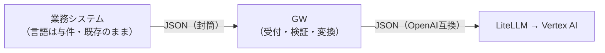

# 03 共通フォーマット ── 「JSONでよいか」を議論できるようにする

*個人検討ノートの一般化版（2026-11-16 同期・正は個人 Vault）*

> [!NOTE]
> **この解説が支える台帳の行**
> [論点台帳](../03_論点台帳.md) §1「共通フォーマットはJSONでよいか」（選択肢＝JSON固定／JSON＋版 `api_version`）。ひとまず JSON にするつもりでいても、「なぜ JSON でよいのか」「そもそもどういう仕組みか」を言えないと、会議でこの行を前に進められない。しかも仕組みを知ると、この行は**問いの形そのものが変わる**（JSON か否か、ではなくなる）。そこで、JSON の仕組み → GW の共通フォーマットに向く理由 → 論点の立ち直り → 弱点と限界、の順にほどく。

## 1. まず仕組み ── JSON とは何か

共通フォーマットの候補に名前が挙がっている JSON（JavaScript Object Notation）は、データを**文字の並び（テキスト）だけで書き表す記法**である。仕様の正典 RFC 8259 は、冒頭で「軽量・テキストベース・言語非依存のデータ交換形式」と定義している[^json-def]。専用アプリでしか開けないバイナリ形式と違い、中身はただの文字なので、メモ帳で開いてもそのまま読める。まず実物を1つ見る（本件の封筒を先取りした雰囲気の例。正式な席の設計は §3.3 で改めて扱う）。

```json
{
  "api_version": "1",
  "request_id": "9f1c-…-uuid",
  "feature": "summarize",
  "input": {
    "text": "本日の議事録の要点をまとめてほしい。……",
    "max_chars": 400,
    "highlight_terms": ["期限", "担当"]
  },
  "options": { "stream": true, "locale": "ja" },
  "context": null
}
```

### 1.1 骨組みは「キー: 値」と配列の2つだけ

波かっこ `{ }` が**オブジェクト**で、「名前（キー）と値」のペアを並べる入れ物である。RFC 8259 の定義では、オブジェクトは0個以上の名前/値ペアの集まりで、名前は文字列、値には後述のどの型でも置ける[^json-object]。角かっこ `[ ]` が**配列**で、値を順番どおりに並べる入れ物である[^json-array]。この2つは入れ子にできる。上の例でも、`input` の値はオブジェクトで、その中の `highlight_terms` の値は配列になっている。手紙にたとえるなら「見出しつきの便箋」と「箇条書き」の2つだけで文面を組み立てるようなもので、覚える構文がとにかく少ない。

### 1.2 持てる型は6種類

値として書けるものは6種類と決まっている。RFC 8259 は、4つの基本型（文字列・数値・真偽値・null）と2つの構造型（オブジェクト・配列）を表現できる、と定める[^json-types]。

| 型 | 書き方の例 | 上の例では |
|---|---|---|
| 文字列 | `"要約して"` | `"summarize"` |
| 数値 | `42`・`3.14` | `400` |
| 真偽値 | `true`・`false` | `"stream": true` |
| null | `null` | `"context": null` |
| オブジェクト | `{ "key": "値" }` | `input`・`options` の値 |
| 配列 | `[1, 2, 3]` | `highlight_terms` の値 |

6種類しか無いことは、制約というよりむしろ強みになる。受け取る側が備えるパターンが少なく、どの言語の読み書きライブラリも、この6種類を自分の言語の型（Python なら `dict`・`list`・`str`・`int` …）へ素直に対応づけられるからである。なお `context` を `null` にしているのは「業務文脈は今回なし」を明示する書き方で、null はまさに「値が無いことを値として書く」ための型である。

### 1.3 名前は JavaScript 由来・仕様は言語非依存

名前のとおり、JSON は JavaScript の標準（ECMAScript プログラミング言語標準）から派生した[^json-ecma]。ただし仕様そのものは特定言語に依存しない形で独立に定義されている[^json-def]。だから Python で書く GW も、別の言語で書かれた既存の業務システムも、同じ JSON をそれぞれ自前の道具で読み書きできる。

## 2. なぜ GW の共通フォーマットに向くか

仕組みはこれだけである。この単純さを頭に置くと、GW（フロントと LLM の間に立つ関所）のやり取りに JSON が向く理由は、4つに束ねられる。

### 2.1 人がそのまま読める ── 切り分けの速さに直結する

テキスト形式の価値は、開発でも運用でも「目で見て確かめられる」ことに尽きる。ブラウザの開発者ツール（Network タブ）は行き交う JSON を整形して見せてくれるし、`curl` で GW を叩けば封筒の中身が端末にそのまま出る。「業務システムと GW のどちらがおかしいか」を切り分けるとき、流れているデータを人が読めるかどうかで速度が大きく変わる。ログに残した封筒（本文を伏せたメタ部分）を後から追うときも同じことが効く。

### 2.2 言語非依存 ── 業務システムと GW の言語が違っても通じる

本件の GW は、既存の業務システムと、これから作る GW という**別々の持ち主・別々の言語**のプログラムをつなぐ。共通フォーマットを特定言語のオブジェクト直列化（ある言語専用のバイナリ保存形式）にしてしまうと、相手にも同じ言語・同じライブラリを強いることになる。JSON なら契約は「データの形」だけで済み、双方が自分の言語の道具で読み書きする[^json-def]。



### 2.3 スキーマ検証と相性がよい ── Pydantic・OpenAPI がそのまま乗る

型が6種類しか無い単純な形式だからこそ、「この形で送れ」という契約（スキーマ）を機械可読に書く道具が成熟している。GW 側では Pydantic が、受け取った JSON を検証しながら型へ変換し、`feature` を判別子にした判別付きユニオンで機能ごとの中身を安全に振り分けられる。フロントとの契約書も、OpenAPI の `oneOf`＋`discriminator` で素直に表現できる。つまり、これまで共通仕様として設計してきた封筒・判別・契約の道具立ては、JSON を前提にするとそのまま使える。

### 2.4 Web の事実上の標準 ── 両隣がすでに JSON を話している

決め手はこれになる。GW の両隣を見ると、フロント側はブラウザの `fetch` で呼ぶ Web API＝JSON のやり取りが標準形であり、LLM 側の入口である OpenAI 互換 API（LiteLLM）も、リクエスト・レスポンスとも JSON である。台帳 §2 の「データ形式変換」の行が**GW内で封筒↔OpenAI互換を変換**と書けるのも、変換の両側がどちらも JSON だからにほかならない。両隣がすでに JSON を話しているのに、真ん中の共通フォーマットだけ別の形式にすると、関所の出入りの両方で翻訳が増えるだけで、得るものが無い。

## 3. 「JSONでよいか」の論点はこう立ち直る

向く理由が4つ並ぶと、台帳のこの行は問いの形が変わって見えてくる。

### 3.1 JSON そのものは、ほぼ決まり筋

§2 の4つを覆すだけの対抗馬は、この構成では見当たらない。あえて挙げるなら、XML は同じテキスト形式だが、同じ内容をタグで囲んで繰り返すぶん長くなる。Protocol Buffers のようなバイナリ形式は小さく速いが、人がそのまま読めず、スキーマをコンパイルする道具立ても増える。社内の限られた利用者が使う内部 GW で、封筒のサイズも小さい本件では、どちらの持ち味も効かない。「JSONでよいか」への答えは「よい」でほぼ動かない。

### 3.2 本当の論点① ── 版の席（`api_version`）を初版から入れるか

台帳の選択肢「JSON固定／JSON＋版」の実質はここにある。封筒の書式を将来変えるとき、封筒自身に版の番号が書いてあれば、GW は古い書式と新しい書式を見分けて、両方を同時に受けられる（併存）。書いていなければ、届いた封筒がどの書式のつもりなのか、受け手は推測するしかない。席の値段は1フィールドで、今なら足すだけで済む。内部 GW なら、封筒の `api_version` と「どの版まで面倒を見るか」の宣言だけで版管理は足りる、というのが検討の結論である（方針の合言葉は「足すのは無印・壊すのは v2」）。台帳の決め手欄「版を最初から入れると後方互換が楽」は、この仕組みの一行要約にあたる。

### 3.3 本当の論点② ── 封筒の席をどう設計するか

JSON と決めただけでは、「何というキーを置くか」は何も決まっていない。機能が未定でも今日決められるのは**外側（封筒）だけ**であり、版・ID・機能名・入力・オプション・文脈・状態・使用量・エラーという9つの席を、理由つきで置いていくのが封筒の設計だった。会議で握るべき中身は、この席の一覧である。

### 3.4 本当の論点③ ── 中身（`input`／`result`）をどう判別するか

封筒の中身は機能ごとに違う形のまま運ぶ。`feature` を判別子にした判別付きユニオンにしておけば、中身の型は目印1個で一意に決まり、3つ目の機能は既存に1行も触らず足すだけで済む。

まとめると、台帳のこの行は「JSON か否か」ではなく「**JSON の上に、版・封筒・判別という約束をどう載せるか**」として会議に出すのが生産的である。前者は §2 の4つで即答できる。後者こそ共通仕様の設計そのものであり、フロントと先に合意すべき契約（contract-first）の中身になる。

## 4. 弱点と限界 ── 選んだあとに踏む穴を先に知る

ほぼ決まり筋とはいえ、JSON は万能ではない。向く理由と同じ源泉——テキストであること・型が6種類しか無いこと——から、弱点も素直に出てくる。

### 4.1 バイナリをそのまま運べない

JSON の文字列は Unicode 文字の並びと定義されており[^json-string]、画像や PDF の**バイト列はそのままでは積めない**。運ぶなら、バイト列を文字に変換（base64）して文字列の席に載せるか、JSON の外側（multipart など）で別口に運ぶかになり、どちらにも代償がある。これが台帳 §1 の隣の行「非テキスト（画像・PDF）の運び方」であり、[解説04](./04_非テキスト入力の運び方（base64・multipart）.md) で扱う。

### 4.2 コメントが書けない

RFC 8259 の文法がトークンとして挙げるのは、6つの構造文字・文字列・数値・3つのリテラル名（true／false／null）で[^json-tokens]、コメントの構文はこの中に無い。解説記事やサンプルの例に `//` の説明コメントが付いていることがあるのは解説用の方言（jsonc）であって、実際の通信に書き込むと不正な JSON になる。§1 の例にコメントが1つも無いのはそのためである。機械同士のメッセージでは実害がほぼ無いが、「JSON を設定ファイルにも使い回したい」となった途端に効いてくる弱点なので、覚えておく。

### 4.3 数値の精度に上限がある

仕様は、受け付ける数値の範囲と精度に実装が上限を設けることを認めている[^json-limits]。広く使われる IEEE 754 倍精度の実装（ブラウザの JavaScript がまさにそれ）を前提にすると、実装間で値が正確に一致すると見なせる整数は ±(2^53−1) の範囲までである[^json-interop]。トークン数や金額（残枠は金額建て＝台帳 §3）がこの範囲を超えることはまず無い。ただし、桁の大きい ID を数値のまま運ぶと受け手側で丸められる恐れがあるので、**ID は文字列で運ぶ**という定石だけ守っておけば、この弱点は避けて通れる（§1 の例で `request_id` が文字列なのも同じ筋である）。

> [!NOTE]
> **会議で確認する問い（この論点を決めるために要る与件）**
> - 業務システム側の**実装言語と既存の API 規約**はどうなっているか（JSON 前提に支障が無いか・封筒の命名で合わせるべき社内規約があるか）
> - **`api_version` を初版の封筒に置く**ことに合意できるか（§3.2。契約の最初の握りどころ）
> - **非テキスト（画像・PDF）をいつから扱うか**（§4.1 が現実になる時期。台帳 §1 の隣の行＝解説04 とセットで）

## 5. 深掘りの入口

- 隣の論点：[解説04](./04_非テキスト入力の運び方（base64・multipart）.md)（base64・multipart）
- 決定の記録先：[論点台帳](../03_論点台帳.md) §1

## 出典（一次情報）

2026-11-16 取得・逐語は実ページで機械照合済み。

- [RFC 8259: The JavaScript Object Notation (JSON) Data Interchange Format（IETF 公式）](https://www.rfc-editor.org/rfc/rfc8259.html) ── JSON の定義・4基本型＋2構造型・オブジェクトと配列・文字列と数値の規定・トークンの文法

## 脚注

[^json-def]: 原文「JavaScript Object Notation (JSON) is a lightweight, text-based, language-independent data interchange format.」（JavaScript Object Notation〔JSON〕は、軽量でテキストベース、言語に依存しないデータ交換形式である）。— [RFC 8259（IETF 公式）](https://www.rfc-editor.org/rfc/rfc8259.html)
[^json-object]: 原文「An object is an unordered collection of zero or more name/value pairs, where a name is a string and a value is a string, number, boolean, null, object, or array.」（オブジェクトは、0個以上の名前/値ペアの順序を持たない集まりである。名前は文字列であり、値は文字列・数値・真偽値・null・オブジェクト・配列のいずれかである）。— [RFC 8259（IETF 公式）](https://www.rfc-editor.org/rfc/rfc8259.html)
[^json-array]: 原文「An array is an ordered sequence of zero or more values.」（配列は、0個以上の値の順序つきの並びである）。— [RFC 8259（IETF 公式）](https://www.rfc-editor.org/rfc/rfc8259.html)
[^json-types]: 原文「JSON can represent four primitive types (strings, numbers, booleans, and null) and two structured types (objects and arrays).」（JSON は、4つの基本型〔文字列・数値・真偽値・null〕と、2つの構造型〔オブジェクト・配列〕を表現できる）。— [RFC 8259（IETF 公式）](https://www.rfc-editor.org/rfc/rfc8259.html)
[^json-ecma]: 原文「It was derived from the ECMAScript Programming Language Standard.」（ECMAScript プログラミング言語標準から派生した）。— [RFC 8259（IETF 公式）](https://www.rfc-editor.org/rfc/rfc8259.html)
[^json-string]: 原文「A string is a sequence of zero or more Unicode characters」（文字列は、0個以上の Unicode 文字の並びである）。— [RFC 8259（IETF 公式）](https://www.rfc-editor.org/rfc/rfc8259.html)
[^json-tokens]: 原文「The set of tokens includes six structural characters, strings, numbers, and three literal names.」（トークンの集合は、6つの構造文字・文字列・数値・3つのリテラル名からなる）。JSON テキストを構成するトークンの列挙であり、コメントはこの中に含まれない。— [RFC 8259（IETF 公式）](https://www.rfc-editor.org/rfc/rfc8259.html)
[^json-limits]: 原文「This specification allows implementations to set limits on the range and precision of numbers accepted」（この仕様は、受け付ける数値の範囲と精度に実装が上限を設けることを認めている）。— [RFC 8259（IETF 公式）](https://www.rfc-editor.org/rfc/rfc8259.html)
[^json-interop]: 原文「Note that when such software is used, numbers that are integers and are in the range [-(2**53)+1, (2**53)-1] are interoperable in the sense that implementations will agree exactly on their numeric values.」（そのようなソフトウェア〔IEEE 754 倍精度を実装するもの〕が使われる場合、-(2^53)+1 から (2^53)-1 の範囲にある整数は、実装間で数値が正確に一致するという意味で相互運用可能である点に注意）。— [RFC 8259（IETF 公式）](https://www.rfc-editor.org/rfc/rfc8259.html)
