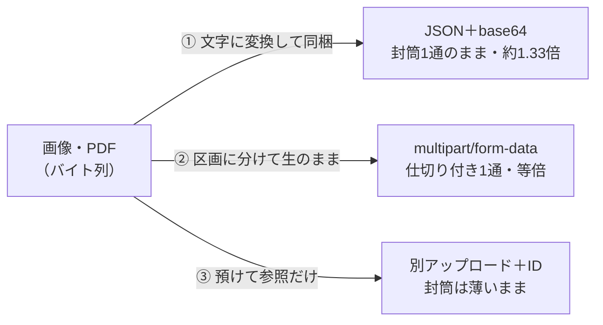

# 04 非テキスト入力の運び方 ── base64・multipart の論点を議論できるようにする

*個人検討ノートの一般化版（2026-11-16 同期・正は個人 Vault）*

> [!NOTE]
> **この解説が支える台帳の行**
> [論点台帳](../03_論点台帳.md) §1「非テキスト（画像・PDF）の運び方」「画像・PDFを扱うか・いつから」。前者の選択肢には ①JSON＋base64 ②multipart ③メタJSON＋別アップロード と並ぶが、base64 や multipart が何をする仕組みか知らないまま表だけ見ると、「サイズ膨張」「実装が増える」という代償が実感として読めず、議論が止まる。そこで、なぜ非テキストだけ一手間かかるのか → 運び方3方式の仕組み → 決めたときの影響範囲 → この案件での立ち直り、の順にほどく。

## 1. まず問題 ── なぜ非テキストは一手間かかるのか

コンピュータが扱うファイルは、テキストも画像も PDF も、中身はすべて**バイト列**である。バイトとは 0〜255 の値を取る小さな数値で、ファイルとはこの数値がずらりと並んだものにすぎない。テキストファイルが「文字」として読めるのは、「この数値はこの文字」という文字コードの約束でバイト列を読んでいるからだ。いっぽう画像や PDF のバイト列には、そういう「文字として読む約束」がない。数値の並びそのものが色や図形や圧縮データを表していて、無理に文字として開くと記号の羅列に化ける。こうした「文字として読めないバイト列」を**バイナリ**と呼ぶ。

ここで、この GW の共通フォーマットの話とぶつかる。フロントと GW のやり取りは JSON の封筒でそろえる方向で検討している（→ [解説03](./03_共通フォーマット（JSONという選択）.md)）。JSON は名前のとおり文字で書き表す形式で、値として運べるのは文字列・数値・真偽値といった「文字で書けるもの」だけである。画像のバイト列には、文字コードとして読めない並びが普通に含まれる。だから、そのまま JSON の文字列欄へ流し込むことはできず、書式ごと壊れてしまう。

注意したいのは、運べないのは JSON という**書式**のほうであって、HTTP ではないことだ。HTTP のボディはもともとバイト列を運ぶ器で、PDF をそのまま載せること自体はできる。つまり本当の問いは「HTTP で送れるか」ではない。「**文字しか書けない封筒（JSON）と、文字ではないバイト列を、どう折り合わせるか**」である。これが台帳の論点「非テキストの運び方」の正体で、答えの型は 3 つしかない。バイト列を文字に変換して封筒に書き写すか（①）、封筒のほうを仕切り付きの荷姿に作り替えて生のまま載せるか（②）、現物は別便で預けて封筒には預かり証だけ書くか（③）。

## 2. 仕組み ── 運び方3方式をひとつずつ

台帳の選択肢①②③は、いま挙げた 3 つの型にそのまま対応する。まず見取り図を置き、ひとつずつ中へ入る。

### 2.1 ① JSON＋base64 ── バイト列を文字に着替えさせて同梱する

base64 は、どんなバイト列でも 64 種類の文字（A〜Z・a〜z・0〜9・`+`・`/`）だけの文字列に書き直す変換方式で、インターネット標準の RFC 4648 が定義している。生まれた動機がそのまま用途を言い当てていて、もともと「文字（US-ASCII）しか通らない環境」でデータを保存・転送するための道具である[^b64-why]。RFC 自身も base64 を、人間が読むためではなく、任意のバイト列を文字で運ぶための表現と位置づけている[^b64-design]。JSON の文字列欄はまさに「文字しか通らない環境」だから、ここに base64 がぴたりとはまる。

#### 2.1.1 変換の仕組み ── 3バイトを4文字に書き直す

仕組みは数の読み替えである。1 バイトは 8 ビット（2進数 8 桁）ぶんの情報を持つ。いっぽう 64 種類の文字は、2 の 6 乗＝64 なので、1 文字で 6 ビットぶんを表せる[^b64-six]。8 と 6 の歩幅がそろう最小の長さは 24 ビットになる。そこで base64 は、入力を 3 バイト＝24 ビットずつまとめ、それを 6 ビットずつ 4 つに区切り直し、各 6 ビットを 1 文字に置き換える[^b64-24bit]。たとえば文字列 ABC（3 バイト）を base64 にかけると `QUJD` という 4 文字になる（筆者確認：`printf %s ABC | base64`）。情報の中身は同じまま、表記だけが 3 バイトから 4 文字へ増えている。荷物をいったん電報の文字列に書き起こして送り、受け取った側が元のモノへ組み立て直すようなもので、中身は変わらず、運搬用の着替えのぶんだけ膨らむ。

#### 2.1.2 だから約1.33倍に膨らむ

3 バイトが必ず 4 文字になるのだから、長さは 4/3 倍＝約 1.33 倍、言い換えると約 33% 増える。10MB の PDF なら、封筒に入る文字列はおよそ 13.3MB になる。入力が 3 バイトで割り切れない端数は、64 文字とは別に用意された 65 文字目 `=` を詰め物（パディング）にして埋める[^b64-pad]。base64 文字列の末尾に `=` が付いているのを見かけたら、それがこの詰め物である。

#### 2.1.3 得るものと代償

得るものは「封筒 1 通」の単純さである。ファイルも JSON の 1 フィールドに収まるので封筒の形は崩れず、フロントは JSON を組むだけで完結する。代償は 3 つある。サイズが約 1.33 倍に膨らむこと。文字列まるごとをメモリに抱えてデコードする形になりやすいこと。そして、ファイルの現物が「ただの長い文字列」として本文に同居するため、本文をログへ残す設計と組み合わさるとログ肥大を起こすこと（§3.2）。小さめのファイルを、まず動かす段階で運ぶには、もっとも楽な道である。

### 2.2 ② multipart/form-data ── 1通を区画に分けて生のまま載せる

①とは発想を逆にする。バイト列を文字に着替えさせるのではなく、「文字しか書けない封筒」のほうを、モノが入る荷姿に作り替える。`multipart/form-data` は HTTP のボディを複数の**区画（part）**に分ける詰め方で、RFC 7578 が定義している。出自は Web のフォーム送信で、申込フォームの入力欄やファイル添付欄に入れた一連の値をまとめて送り返す方法として定められた[^mp-abstract]。ブラウザのファイルアップロードは、今日もこの形式で飛んでいる。

仕組みの要は**仕切り**である。ボディの中に `boundary` と呼ばれる仕切りの文字列を立て、それで区切った区画を並べていく[^mp-boundary]。各区画には名札が義務づけられていて、`Content-Disposition` ヘッダで「フォームのデータである」と種別を名乗り[^mp-disposition]、あわせて `name` パラメータで欄の名前を名乗る[^mp-name]。だから受け取る側は「この区画はメタ情報の JSON、この区画は画像の現物」と名札で見分けられる。区画の中身は文字でもバイト列でもよく、バイト列は変換なしの生のまま載る。つまり膨らまない。仕切り付きの弁当箱に、手紙（文字のメタ情報）とおかず（バイナリの現物）をマスで分けて同梱する、と思えばよい。

得るものはサイズと流れ作業である。等倍のまま運べ、届いた区画から順に処理（ストリーム処理）しやすいので、大きいファイルに向く。代償は実装と契約の複雑さで、フロントは JSON を組むだけでは済まず `FormData` で荷造りする実装が増え、GW には「まず multipart を解いてから中の JSON を読む」一段が増える。封筒設計への跳ね返りは §3.1 で見る。

### 2.3 ③ メタだけJSON＋別アップロード ── 現物は預けて、封筒には預かり証だけ

3 つ目は、そもそも封筒に現物を入れない道である。ファイル本体は先に別のアップロード口（専用の API や共有ストレージ）へ送って預け、引き換えに ID（預かり番号）を受け取る。本来の封筒（JSON）には、その ID だけを書く。GW は ID を頼りに保管場所から現物を取り出して使う。クロークに荷物を預けて番号札をもらい、手紙には「荷物は札の 42 番」とだけ書く形で、いわゆる**参照渡し**である。

封筒は薄いまま保たれ、同じファイルを毎回送り直さずに使い回せ、巨大なファイルにも耐える。そのかわり 3 方式でいちばん実装が重い。アップロード口という新しい契約（API）と、現物の保管場所（ストレージ）という新しい部品が増える。さらに、預けた物をいつ消すか（寿命）、他人の番号札で取り出せないか（認可）という運用の問いまで付いてくる。小さい入力は base64・大きい入力は「先にアップロード→参照 ID を封筒へ」というハイブリッドを組むとき、この形はその後半を担う。

### 2.4 三つの道の見比べ

ここまでを並べると、どの道も「何かを得て、何かを払う」型だと分かる。

| 観点 | ① JSON＋base64 | ② multipart | ③ メタJSON＋別アップロード |
|---|---|---|---|
| サイズ | 約1.33倍に膨張 | 等倍（生のまま） | 封筒は薄いまま（本体は別便） |
| 封筒（JSON 1通）の形 | 崩れない | 崩れる（区画の二層構造） | 崩れない（ID の席を足すだけ） |
| 増える実装 | デコードと検査 | multipart の荷造りと解析 | アップロード口・保管・寿命と認可 |
| 向く場面 | 小さめファイル・まず動かす | 大きいファイルの直送 | 使い回し・巨大ファイル |

## 3. 影響範囲 ── 決めた瞬間、どこまで波及するか

運び方は入口だけの話に見えるが、決めた瞬間に封筒・ログ・長さ上限・LLM への渡し方の 4 か所へ波及する。台帳の「代償」欄を見比べることは、実のところ、この波及の大きさを見比べることである。

### 3.1 封筒設計との関係

①は封筒を変えない。封筒の `input` は機能ごとに中身を差し替える設計なので、base64 文字列の欄を中身側に足すだけで済む。②は「封筒＝JSON の 1 通」という前提そのものを崩す。multipart の区画の 1 つに封筒（JSON）を入れ、残りの区画にファイルを置く二層構造になり、フロント・GW の双方で「封筒を読む前の荷ほどき」が一段増える。③は封筒を保つが、封筒の**外**に「アップロード API」という契約がもう 1 本増える。フロントと取り交わす共通仕様の紙が 1 枚から 2 枚になる、と言い換えてもよい。

### 3.2 ログ肥大 ── base64 を本文ログに残すと爆発する

台帳 §4 には「ログに本文/入力を残すか（原則メタのみ）」という論点が別にある。非テキストはこの論点を直撃する。base64 はファイルの現物を「ただの長い文字列」へ変えて本文に同居させる形なので、リクエスト本文をそのままログへ書く設計と組み合わさると、添付 1 回でログが現物と同じだけ（膨張ぶんでそれ以上に）膨れる。容量だけの話でもない。長大な文字列はログの検索性を落とし、ログを読める人なら誰でも元のファイルを復元できるから、未公開情報の漏えい面も現物のまま広がる。つまり非テキストを扱う日が来たら、「本文は残さず、サイズ・形式・ハッシュといったメタだけ記録する」原則がテキストのとき以上に強く効く。業務データをヘッダに入れない理由（サイズ上限・ログ漏えい）と同根の話である。

### 3.3 長さ上限・トークン論点との連動

台帳 §3 の「入力の長さ上限をどこで・何で数えるか」とも連動する。非テキストでは、数える物差しが 2 本に分かれるからだ。1 本目は運搬のサイズ（バイト数）で、①を選ぶと約 1.33 倍の膨張が上限の手前で効いてくる。2 本目はモデルへ入れた後のトークン数で、これは PDF をテキストに抽出してみないと決まらない。だから入口での検査（巨大ファイルを弾くサイズ上限・本当にその形式かの確認）と、抽出後のトークン見積り（超えそうなら `payload_too_large` の統一エラーで返す）は、別々の関門として設計する。

### 3.4 LLM 側がどう受けるかは別段の話

ここまで見てきたのはフロント→GW の区間、つまり「運び込み方」である。GW→LLM の区間、すなわちマルチモーダル対応のモデルへ画像や PDF をどう渡すかは、別の論点として切り分けたい。テキストのチャット入力と違って、文書・画像の渡し方はプロバイダごとに形式差が出やすく、差し替え自由（プロバイダ中立）が漏れやすい場所だからである。検討の筋としては、「PDF→テキスト抽出を GW 側の前処理に寄せ、LLM には正規化済みテキストを渡す」形を無難としている。運び込み方（この解説）と渡し方（マルチモーダル対応）を混ぜると議論がこじれるので、台帳でも「運び方」と「扱うか・いつから」は別の行に分けてある。

## 4. この案件での立ち直り ── 「テキストのみ＋穴だけ用意」の裏づけ

台帳の「画像・PDFを扱うか・いつから」の行には、「歩く骨格はテキスト1本、画像は『穴』だけ用意が無難」という暫定が置いてある。仕組みを見てきた目で読み直すと、この暫定は勘ではなく、構造に根拠のある筋だと分かる。

理由は 2 つある。第一に、どの方式にも実装の増分がある（§2）。いちばん軽い①でさえ、デコードとサイズ検査とログ対策が付いてくる。第二に、非テキストを入れた瞬間、封筒・ログ・上限・LLM への渡し方の 4 か所へ同時に波及する（§3）。歩く骨格の目的は、縦 1 本を最小構成で通して骨格の正しさを確かめることだから（→ [論点台帳](../03_論点台帳.md) §7）、波及の大きい荷物は骨格が立ってから載せるのが順序である。

そして、この後回しが危険な先送りにならないことも、封筒の設計から言える。封筒は「外側＝共通、中身＝機能ごとに差し替え」の二層でできているので、①や③なら封筒を作り直さずに、あとから中身側へ席を足せる。つまり「穴」は実質すでに開いている。唯一、封筒そのものを荷姿ごと作り替える②だけは、あとからの乗り換えで手戻りが大きい。だから会議で先に確かめるべきことは絞られて、「②が必須になるほど大きいファイルを、最初から扱う要件があるか」の一点になる。無ければ、扱うと決まった時点で①から始め、サイズで詰まったら②や③へ広げる、という順送りがそのまま使える。

> [!NOTE]
> **会議で確認する問い（この論点を決めるために要る与件）**
> - 画像・PDF を扱う**要件**は実際にあるか・いつからか（Copilot 型の利用像で、画面から渡したい素材に画像・PDF が入るか）＝台帳 §1 の要件行
> - 扱うなら**想定サイズと形式**はどのくらいか（小さめ中心なら①で始められる。②が要るほど大きいなら、封筒設計〔§3.1〕へ最初から跳ねる）
> - スキャン PDF が混ざるか（＝OCR の要否。抽出を GW 側に寄せるか、文書入力ごと LLM に任せるかの分かれ目）
> - 非テキストの**保存・ログの方針**はどうするか（原則メタのみ・現物は残さない、でよいか＝台帳 §4 と連動）

## 5. 深掘りの入口

- 同時並行の解説：[解説03](./03_共通フォーマット（JSONという選択）.md)（共通フォーマットに JSON を選ぶ話。「JSON は文字しか運べない」の前提側）
- 決定の記録先：[論点台帳](../03_論点台帳.md) §1

## 出典（一次情報）

いずれも 2026-11-16 取得・逐語は実ページで機械照合済み。

- [RFC 4648: The Base16, Base32, and Base64 Data Encodings（IETF）](https://www.rfc-editor.org/rfc/rfc4648.html) ── base64 の目的・64＋1文字の構成・3バイト→4文字の符号化・パディング
- [RFC 7578: Returning Values from Forms: multipart/form-data（IETF）](https://www.rfc-editor.org/rfc/rfc7578.html) ── multipart/form-data の定義・boundary と区画・各区画の名札（Content-Disposition・name）

## 脚注

[^b64-why]: 原文「Base encoding of data is used in many situations to store or transfer data in environments that, perhaps for legacy reasons, are restricted to US-ASCII [1] data.」（データの base 符号化は、おそらく歴史的経緯により US-ASCII データしか扱えないよう制限された環境で、データを保存・転送する多くの場面で使われる）。— [RFC 4648: The Base16, Base32, and Base64 Data Encodings（IETF）](https://www.rfc-editor.org/rfc/rfc4648.html)
[^b64-design]: 原文「The Base 64 encoding is designed to represent arbitrary sequences of octets in a form that allows the use of both upper- and lowercase letters but that need not be human readable.」（Base 64 符号化は、任意のオクテット〔バイト〕列を、大文字と小文字の両方を使える、ただし人間に読める必要はない形で表現するために設計されている）。— [RFC 4648: The Base16, Base32, and Base64 Data Encodings（IETF）](https://www.rfc-editor.org/rfc/rfc4648.html)
[^b64-six]: 原文「A 65-character subset of US-ASCII is used, enabling 6 bits to be represented per printable character.」（US-ASCII の 65 文字の部分集合を使い、印字可能文字 1 つにつき 6 ビットを表現できるようにする）。65 文字目はデータでなくパディング用の `=` で、データを表すのは 64 文字である（筆者注・次の脚注を参照）。— [RFC 4648: The Base16, Base32, and Base64 Data Encodings（IETF）](https://www.rfc-editor.org/rfc/rfc4648.html)
[^b64-24bit]: 原文「The encoding process represents 24-bit groups of input bits as output strings of 4 encoded characters.」（符号化の処理は、入力ビットの 24 ビット〔＝3 バイト〕のまとまりを、4 つの符号化文字からなる出力文字列として表現する）。— [RFC 4648: The Base16, Base32, and Base64 Data Encodings（IETF）](https://www.rfc-editor.org/rfc/rfc4648.html)
[^b64-pad]: 原文「The extra 65th character, "=", is used to signify a special processing function.」（追加の 65 文字目 "=" は、特別な処理を示すために使う）。この特別な処理が、3 バイトに満たない端数を埋めるパディングである（筆者注）。— [RFC 4648: The Base16, Base32, and Base64 Data Encodings（IETF）](https://www.rfc-editor.org/rfc/rfc4648.html)
[^mp-abstract]: 原文「This specification defines the multipart/form-data media type, which can be used by a wide variety of applications and transported by a wide variety of protocols as a way of returning a set of values as the result of a user filling out a form.」（本仕様は multipart/form-data メディア型を定義する。これは、利用者がフォームに記入した結果である一連の値を返す方法として、幅広いアプリケーションで使え、幅広いプロトコルで運べる）。— [RFC 7578: Returning Values from Forms: multipart/form-data（IETF）](https://www.rfc-editor.org/rfc/rfc7578.html)
[^mp-boundary]: 原文「A multipart/form-data body contains a series of parts separated by a boundary.」（multipart/form-data のボディは、boundary〔境界文字列〕で区切られた一連の区画〔part〕を含む）。— [RFC 7578: Returning Values from Forms: multipart/form-data（IETF）](https://www.rfc-editor.org/rfc/rfc7578.html)
[^mp-disposition]: 原文「Each part MUST contain a Content-Disposition header field [RFC2183] where the disposition type is "form-data".」（各区画は、disposition 種別を "form-data" とした Content-Disposition ヘッダフィールドを必ず含まなければならない）。— [RFC 7578: Returning Values from Forms: multipart/form-data（IETF）](https://www.rfc-editor.org/rfc/rfc7578.html)
[^mp-name]: 原文「The Content-Disposition header field MUST also contain an additional parameter of "name"」（Content-Disposition ヘッダフィールドは、さらに "name" パラメータも必ず含まなければならない）。この値がフォーム上の欄の名前＝区画の名札になる（筆者注）。— [RFC 7578: Returning Values from Forms: multipart/form-data（IETF）](https://www.rfc-editor.org/rfc/rfc7578.html)
