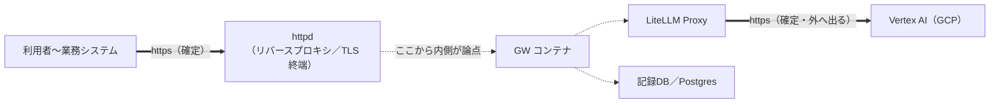

# 05 内部通信のhttps化 ── 「面倒」の正体を証明書の手間までほどく

*個人検討ノートの一般化版（2026-11-16 同期・正は個人 Vault）*

> [!NOTE]
> **この解説が支える台帳の行**
> [論点台帳](../03_論点台帳.md) §3「内部通信 http/https」。選択肢は内部http／全https統一／mTLS で、代償欄には「http＝楽／https＝証明書運用が増える。監査方針が決める」とだけある。「内部通信、https だと面倒？」という感触はこの一行から来ているが、「証明書運用」がどんな作業の束なのか具体が無いと、面倒さを理由に http を選ぶのも、安全さを理由に https を選ぶのも、どちらも勘のままになる。そこで、どの区間の話か → 面倒の正体（作業の棚卸し）→ http が許される条件 → この案件での立ち直り、の順にほどく。

## 1. まず前提 ── これは「TLS終端のあとの区間」の話

最初に取り違えやすいのは、この論点が「システム全体を https にするかどうか」の話ではないことである。利用者から入口までは、すでに https で確定している。

構成図では、利用者〜業務システム〜httpd の区間が https で描かれていて、ここは動かない。入口の httpd は**TLS終端**、つまり https の暗号をここで解いて（封筒を開けて）内側へ平文で渡す役を担う（[構成図v1](../02_構成図/v1_見直し反映.md) §3）。TLS終端という考え方の正典は [05_HTTPSとTLS](../90_基礎知識/07_HTTPSとTLS（暗号化と証明書）.md) §5.4 で、「前段のプロキシで終端し、裏のアプリへは内部の HTTP で渡す」形が、そこでも"いちばんよくある形"として挙がっている。

論点はその内側である。httpd→GW、GW→LiteLLM、GW や LiteLLM→DB という、同じホストの中を走る区間を http のままにするか、https に統一するかを決めるのがこの行になる。なお外へ出る LiteLLM→Vertex の区間は https で確定済みである。インターネットを渡る区間なので、そもそも選択の余地がない。

## 2. 「面倒」の正体 ── 内部 https に要る作業の棚卸し

区間が定まったので、台帳の「証明書運用が増える」を作業の単位まで割る。内部を https にすると決めた瞬間に増えるのは次の5つで、どれも1回やって終わりではなく、回し続ける仕事（運用）を含む。そこが面倒さの核心になる。

### 2.1 証明書の発行 ── 内部向けは公開CAが使えない

https で待ち受けるサーバーは、どれも「証明書＋秘密鍵」のペアを持たなければならない（[05_HTTPSとTLS](../90_基礎知識/07_HTTPSとTLS（暗号化と証明書）.md) §5.3）。GW・LiteLLM・DB を https 化するなら、証明書もそのサービスぶん用意することになる。

最初の壁は、その証明書を誰に発行してもらうかである。公開サイトなら Let's Encrypt のような公開CAで済むが、公開CAの発行は「そのドメイン名の持ち主であること」の検証が前提なので、内部限定の名前はそもそも検証できない。Let's Encrypt 公式も `localhost` を例に、固有の持ち主が存在せず `.com` のようなトップレベルドメインに根ざさない名前には証明書を提供できない、と明言している[^le-localhost]。コンテナのサービス名（`litellm` など）やホスト内だけで通じる名前も、公開ドメインに根ざさない点は同じである。

だから内部向けの発行経路は、**自己署名**（自分で自分に署名する）か**社内CA**（組織内の認証局に CSR＝署名要求を出して発行してもらう）の二択になる（[05_HTTPSとTLS](../90_基礎知識/07_HTTPSとTLS（暗号化と証明書）.md) §5.3 の表）。自己署名は手元だけで作れるが、既定では誰にも信頼されない。社内CAは信頼の配布が一度で済むぶん、発行の窓口・段取りを組織と握る必要がある。Let's Encrypt 公式自身も、公開CAが使えないこの種の用途では「自己署名またはローカルのルートで署名し、トラストストアで信頼させる」方法を最善としている[^le-trust]。

### 2.2 配布と信頼設定 ── すべてのクライアントにCA証明書を登録する

発行できても、それだけでは通信は通らない。証明書を検証するのは**呼ぶ側（クライアント）**だからである。TLS のサーバー認証は、クライアントが手元の「信頼できる発行元の一覧」と証明書を突き合わせて初めて成立する。公開サイトで意識しないで済むのは、ブラウザが公開CAの一覧を最初から内蔵しているからにすぎない（[05_HTTPSとTLS](../90_基礎知識/07_HTTPSとTLS（暗号化と証明書）.md) §5.3）。内部の呼び出し元はブラウザではない。httpd・GW の HTTP クライアント・LiteLLM・DB クライアントが、それぞれ別々に検証用の一覧を持っている。

そこで、自己署名証明書（または社内CAの証明書）を、呼ぶ側すべての信頼一覧に登録して回る作業が発生する。1か所でも登録し損ねると、その区間は検証エラーで通信ごと落ちる。さらにコンテナ特有の事情が重なる。イメージを作り直すたびに中身は素の状態へ戻るので、登録はビルドや起動の手順に織り込んでおかないと、再構築のたびに同じエラーを踏む。OS の信頼ストアとは別に、言語ランタイムやライブラリが独自の一覧を同梱している場合もあり、「どこに入れれば効くか」の調査が要ることもある。

### 2.3 名前の一致 ── 呼ぶ名前を証明書の SAN に揃える

配布と並ぶもう1つの検証条件が、名前の一致である。証明書は「このドメイン名の持ち主です」という署名入りの身分証なので（[05_HTTPSとTLS](../90_基礎知識/07_HTTPSとTLS（暗号化と証明書）.md) §5.3）、クライアントが呼んだ名前と、証明書に書かれた名前が一致しないと検証は失敗する。内部の呼び出しはコンテナのサービス名（`litellm`・`db` など）で行うから、その名前を証明書の **SAN**（Subject Alternative Name＝1枚の証明書で名乗ってよい名前を列挙する欄[^le-san]）に入れて発行する設計が、発行の時点から要る。

これは小さく見えて効いてくる。サービス名を後から変えれば証明書は作り直しになる。同じサービスを IP でもサービス名でも呼ぶなら、両方を SAN に入れておかないと片方だけ検証エラーになる。「どの名前で呼ぶか」が、証明書の設計項目に昇格するということである。

### 2.4 期限切れと更新 ── 切れた瞬間に内部の全区間が止まる

証明書には有効期限があり、期限を過ぎた証明書はクライアントの検証で弾かれる。内部の全区間を https にしてあれば、入口の httpd が生きていても、GW→LiteLLM が検証エラーになった時点でサービスとしては全滅する。「http なら起きない止まり方」が1つ増える、ということである。

しかも更新は一度きりの作業ではない。発行し直し → 全クライアントへの配布（§2.2）→ 各サービスへの読み込ませ直し、というサイクルを、期限が来る前に回し続ける定常運用になる。公開CAの世界では有効期間の短命化が進んでいて、Let's Encrypt の既定は90日・推奨の更新間隔は60日ごと＝自動更新が前提の設計である[^le-90d]。社内CAや自己署名なら期限は自分で決められるが、期限管理そのものは消えない。長くすれば鍵漏えい時の巻き替えが重くなり、短くすれば更新の頻度が上がる。自動化すれば楽になるが、その自動化の仕組み自体がもう1つの作りものになる。証明書の発行主体の確認とセットで「更新期限の運用も確認」が挙がるのは、この手間を指している。

### 2.5 アプリ側の TLS 設定 ── 各サービスに「https で待ち受ける」設定を入れる

最後に、証明書が揃っても各サービスは勝手に https にならない。鍵と証明書を読み込ませて https で待ち受けさせる設定が、1サービスずつ要る。FastAPI（uvicorn）なら `--ssl-keyfile`／`--ssl-certfile` をアプリに渡す形で、LiteLLM や Postgres にもそれぞれの流儀の設定がある。更新（§2.4）のたびに読み込ませ直す手順も、サービスごとに確かめることになる。

棚卸しを並べ直すと、面倒の正体が見えてくる。内部 https の手間は暗号化の処理そのものではなく、**証明書という「期限つきの身分証」を、発行し・配り・名前を揃え・期限前に差し替え続ける運用一式**が、内部の全サービスぶん増えることである。

## 3. 内部 http が許される条件と、https が要る条件

手間がここまで具体なら、次の問いは「その手間を払わずに済む条件は何か」である。内部 http は手抜きの選択肢ではなく、条件つきで広く使われている標準形だからである。

内部 http が通る筋は、2つの条件が揃っているときである。第一に、**TLS終端が入口にある**こと。利用者との間の盗聴・なりすましは httpd までの https が防いでいるので、守られていないのは内側だけになる。第二に、**その内側が同一ホストのコンテナネットワークに閉じている**こと。区間が物理的なネットワークを流れないので、盗聴するにはホスト自体への侵入が要る。侵入されている状況では秘密鍵もホスト上にある以上、内部 https があっても守りきれない。つまり「内部 http で失うもの」が実質的に小さい。前段で終端して内側は内部 HTTP、という形が"いちばんよくある形"とされるのは、この条件が当てはまる現場が多いからである（[05_HTTPSとTLS](../90_基礎知識/07_HTTPSとTLS（暗号化と証明書）.md) §5.4）。

逆に、次のどれかに当てはまるなら内部 https（またはその先）が要る。まず**区間がホストをまたぐ**とき。コンテナを複数台のサーバーへ分けると内部通信が実際のネットワークを流れ、盗聴される面が生まれる。次に**監査・コンプライアンス要件が内部区間の暗号化を求める**とき。この場合は技術判断の余地がなく、要件が決める。そして**組織がゼロトラスト方針**（内側のネットワークも信用しない前提で全通信を認証・暗号化する考え方）を採るとき。この延長線上に **mTLS**（相互認証＝サーバーだけでなくクライアントも証明書を提示し合う形）があり、§2 の手間に加えてクライアント側の証明書の発行・配布まで増える。ここでは選択肢の名前として挙げるに留める。

## 4. この案件での立ち直り ── 内部 http が現実解の筋、決め手は監査方針

§3 の条件をこの構成に当てると、答えの輪郭は素直に出る。httpd より内側のコンテナ4サービス（`gateway`・`web`・`litellm`・`postgres`）は、同一ホストの1つのコンテナネットワークに同居する予定である（[解説01](./01_利用管理（使用制限・記録DB・仮想キー）.md) §3 の追補）。入口の httpd が TLS 終端する形も確定している（[構成図v1](../02_構成図/v1_見直し反映.md) §3）。「TLS終端が入口にある」「内側が同一ホストに閉じる」の両条件が揃っているから、**内部 http が現実解の筋**になる。§2 の5つの手間をいま払う理由は、構成からは出てこない。

それでも図の注記が「※内部http/https未定」のままなのは、技術的に決めかねているからではない。この行の決め手は**監査方針＝職場の要件**であり（台帳 §3 でも区分は `要件`）、要件は確認するものであって、推測で埋めるものではないからである。選択肢と代償を1枚にすると次のようになる。

| 選択肢 | 増える持ち物（§2 との対応） | 得るもの |
|---|---|---|
| 内部 http | なし（証明書は入口の httpd のぶんだけ） | 運用が軽い。ただしホストへ侵入されると内部は平文 |
| 全 https 統一 | ①発行 ②配布と信頼設定 ③SAN ④期限と更新 ⑤各サービスの設定、を内部の全サービスぶん | 内部区間の盗聴にも耐え、監査要件に正面から応えられる |
| mTLS | 上の①〜⑤に加えて、クライアント側の証明書の発行・配布 | 「どのサービスが呼んでよいか」まで証明書で縛れる |

> [!NOTE]
> **会議で確認する問い（この論点を決めるために要る与件）**
> - 内部区間（同一ホスト内のコンテナ間通信）の**暗号化を求める監査・セキュリティ基準**はあるか。あるなら内部 http の選択肢は消え、§2 の作業一式が要件になる
> - **社内CAはあるか**。あるなら CSR の窓口・発行の段取り・有効期限と更新の運用はどうなっているか
> - 将来、**コンテナを別ホストへ分ける計画**はあるか。ホストをまたいだ時点で §3 の前提が崩れ、その区間は https/mTLS を検討し直すことになる

## 5. 深掘りの入口

- 仕組みの正典：[05_HTTPSとTLS](../90_基礎知識/07_HTTPSとTLS（暗号化と証明書）.md)（TLSの2役・証明書とCA・TLS終端）
- 図との対応：[構成図v1](../02_構成図/v1_見直し反映.md) §3（httpd＝リバースプロキシ／TLS終端・内部http/https未定の注記）
- 決定の記録先：[論点台帳](../03_論点台帳.md) §3「内部通信 http/https」

## 出典（一次情報）

いずれも 2026-11-16 取得・逐語は実ページで機械照合済み。

- [localhost 向けの証明書（Let's Encrypt 公式・日本語）](https://letsencrypt.org/ja/docs/certificates-for-localhost/) ── 公開CAが内部専用名に発行できない理由と、自己署名／ローカルルート＋トラストストア登録という代替
- [FAQ（Let's Encrypt 公式）](https://letsencrypt.org/docs/faq/) ── SAN の機構・既定の有効期間と更新の推奨間隔

## 脚注

[^le-localhost]: 原文「Let’s Encrypt は、“localhost” に対する証明書を提供することはできません。理由は、その証明書をユニークに所有することができる主体が存在せず、".com" や “.net” のようなトップレベルのドメインをルートに持つことができないからです。」（公式の日本語版につき逐語のまま）。— [localhost 向けの証明書（Let's Encrypt 公式）](https://letsencrypt.org/ja/docs/certificates-for-localhost/)
[^le-trust]: 原文「最善の選択は、自分で証明書を発行し、それに自己署名またはローカル環境のルートで署名を行い、オペレーティングシステムのトラストストアでその証明書を信頼する、という方法です。」（同上・公式の日本語版）。— [localhost 向けの証明書（Let's Encrypt 公式）](https://letsencrypt.org/ja/docs/certificates-for-localhost/)
[^le-san]: 原文「Yes, the same certificate can contain several different names using the Subject Alternative Name (SAN) mechanism.」（はい。同じ証明書に、Subject Alternative Name〔SAN〕の機構を使って、複数の異なる名前を入れられます）。— [FAQ（Let's Encrypt 公式）](https://letsencrypt.org/docs/faq/)
[^le-90d]: 原文「Our default certificates are valid for 90 days.」（既定の証明書は90日間有効）。あわせて原文「We recommend renewing 90 day certificates every 60 days and six day certificates every three days.」（90日の証明書は60日ごとに、6日の証明書は3日ごとに更新することを推奨する）。— [FAQ（Let's Encrypt 公式）](https://letsencrypt.org/docs/faq/)
