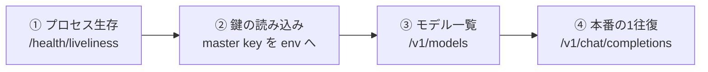

# 07 認証設計 ── プロバイダ非依存の受け口と、GCP疎通の考え方

*個人検討ノートの一般化版（2026-11-18 同期・正は個人 Vault）*

> [!NOTE]
> **このノートの位置づけ**
> [開発環境構築](../01_開発環境/00_環境構築手順.md) のスタックが、LLM プロバイダの資格情報をどう受け取り、つながったことをどう確かめるか——その設計の「なぜ」をまとめた解説（2026-11-18 新設）。実際に打つコマンド列は各キットの手順書.md（[環境構築キット](../01_開発環境/kit/README.md)）にあり、ここは判断の背景だけを受け持つ。旧「GCP疎通確認（1台版）」の解説部分も本ノートへ統合した。

## 1. 認証をプロバイダ非依存にする

このプロジェクトのゲートウェイは、LLM を論理名で呼び、実モデルへの結びつけは LiteLLM の設定だけが知る——という差し替え設計を柱にしてきた。ところが認証だけは、放っておくとプロバイダ固有の形が本体へ染み込みやすい。Vertex AI なら gcloud CLI と ADC、OpenAI なら API キー、というように**資格情報の作り方・渡し方がプロバイダごとに違う**からだ。そこで、資格情報の「作り方」はプロバイダ側の事情として切り離し、スタック本体には**受け口だけ**を固定した。

### 1.1 スタックが知るのは `.env` と `secrets/` の2つだけ

受け口は2つに絞った。ひとつは **`.env` の環境変数**で、API キーやプロジェクト ID のような「値そのもの」を入れる。もうひとつは **`secrets/` フォルダに置くファイル**で、認証JSONのような「ファイルでしか渡せない資格情報」を入れる。compose は `.env` を `env_file` で各サービスへ流し、`secrets/` を litellm コンテナへ読み取り専用でマウントするだけで、その中身がどのプロバイダのものかを知らない。コードも同様である。秘密を環境に出してコードから切り離す発想は The Twelve-Factor App の「設定」の原則そのままで[^12f-config]、この2つの受け口はそれをファイルにも広げた形になる。

### 1.2 Vertex AI の場合 ── 認証JSONを置いて環境変数で指す

Vertex AI を使うときは、認証JSONを `secrets/` に置き、`.env` の `GOOGLE_APPLICATION_CREDENTIALS=/secrets/<ファイル名>` でそのパスを指す。Google のクライアントライブラリは ADC（Application Default Credentials）という資格情報の探索の仕組みを持ち、環境変数 `GOOGLE_APPLICATION_CREDENTIALS` が指すファイルを優先して使う[^adc]。LiteLLM の Vertex 呼び出しもこの経路に乗るので、`litellm_config.yaml` に `vertex_credentials` を書く必要がない[^litellm-vertex]。

置くファイルは2種類のどちらでもよい。職場で配布されがちな**サービスアカウント鍵**でも、ログインで作る **ADC のファイル**でも、置き場所と指し方は同じになる。この「どちらでも同じ形」が効く——鍵の配布事情が変わっても、スタック側は何も変わらない。

### 1.3 プロバイダの入れ替えは設定の差し替えだけ

OpenAI 等へ乗り換えるときにやることは2つで終わる。`.env` のプロバイダ節のキーを差し替え、`litellm_config.yaml` の `model_list` を書き替える。compose にもゲートウェイのコードにも手を入れない。論理名による差し替え（モデルの入れ替え）と、この認証の受け口（資格情報の入れ替え）が対になって、「プロバイダ非依存」が設定レベルで完結する。

### 1.4 gcloud ワンショット ── ホストに CLI を入れないための任意の補助

残る問題は「ADC を作る手段」だった。ADC は `gcloud auth application-default login` で作るのが普通だが、それにはホストに gcloud CLI が要り、職場ではホストへのツール導入自体が難しい。そこで compose に、Google Cloud CLI の公式イメージ `gcr.io/google.com/cloudsdktool/google-cloud-cli:stable` を使うワンショットサービス `gcloud` を同梱した。公式ユーザーガイド自身が、コンテナから `gcloud auth login` を実行し、ADC が要るなら `--update-adc` を渡し、できた資格情報をボリューム経由で他コンテナと共有する使い方を示している[^gcloud-docker]。同梱サービスはこれを compose の形に写し、書き出し先を `secrets/` に向けただけである。

このサービスには `profiles: ["auth"]` を付けた。Compose の profiles は、プロファイル未割り当てのサービスだけを既定で起動し、割り当て済みのサービスはそのプロファイルが有効なときだけ動かす仕組みで、`docker compose run` のようにコマンドラインで直接指名した場合はプロファイルを有効化しなくても実行される[^compose-profiles]。だから通常の `up` では一切起動せず、必要なときだけ `docker compose run --rm gcloud` と指名して使う。位置づけは**任意の補助**である。鍵JSONが配布されるなら使う場面はなく、compose から丸ごと削除しても本体は動く。

## 2. GCP疎通の考え方 ── 内側から外側へ4段階

認証がつながったかを確かめるとき、いきなり実プロバイダへ投げると、失敗したときに原因が「鍵・設定・ネットワーク・モデル名」のどれなのか分からない。そこで疎通は**内側から外側へ**、確認範囲を1段ずつ広げる。各段の失敗はその段で増えた要素だけを疑えばよく、切り分けが一本道になる。

### 2.1 ① プロセス生存 ── 認証不要の窓で起動だけを見る

最初の段は「LiteLLM のプロセスが起きているか」だけを見る。LiteLLM は認証不要の生存確認エンドポイント `/health/liveliness` を持ち、プロセスが起動していれば "I'm alive!" を 200 で返す[^litellm-health]。鍵も設定も関係しないので、ここで失敗したら起動そのもの（compose・ポート・ヘルスチェック）を疑う。

### 2.2 ② 鍵の読み込み ── master key を画面に出さない作法

次の段からは認証が要る。ここで効くのが**秘密の値を画面に出さない作法**である。master key をコマンドへ直打ちすると、ターミナルの履歴・画面・ログに平文で残る。代わりに `.env` から環境変数へ読み込み（例 `export LITELLM_MASTER_KEY=$(grep '^LITELLM_MASTER_KEY=' .env | cut -d= -f2-)`）、以後は `$LITELLM_MASTER_KEY` の形で参照する。値そのものはどこにも表示されないまま、ヘッダに載って飛ぶ。

### 2.3 ③ モデル一覧 ── 設定が読めているかを見る

鍵を持って `/v1/models` を叩き、`litellm_config.yaml` に定義した論理名が一覧に見えるかを確かめる。ここで失敗したら、①②で切り分け済みの起動・鍵ではなく、設定ファイル（マウント・`model_list` の中身）を疑えばよい。

### 2.4 ④ 本番の1往復 ── 200 と usage で鎖の右端まで

最後に `/v1/chat/completions` へ論理名で1発投げる。投げるのはダミー文だけにし、`max_tokens` も小さく絞る。200 で本文と `usage`（消費トークン）が返れば、litellm → 認証JSON → プロバイダの鎖が右端まで通っている。`usage` まで見るのは、課金の数え方（spend）がこの値から始まるからである。

### 2.5 失敗したときの切り分け

④で失敗したときは、増えた要素の順に疑う。401 なら鍵（②の読み込みと `.env` の値）を見直す。404 の model not found なら論理名の不一致（config の `model_name` とリクエストの `model`）を見る。プロバイダ側の認証エラーなら `secrets/` のファイルと `.env` の `GOOGLE_APPLICATION_CREDENTIALS`、それでも駄目なら GCP 側の API 有効化（[GCP/Vertex AI 準備](../01_開発環境/01_GCPとVertexAI準備.md) §3）へさかのぼる。実モデル名のエラーなら鮮度切れ＝同 §3.7.1 のとおり公式のモデル一覧で現行名を確かめて config を直す。

なお、認証ファイルを置く前にこの4段階を回すと、④はプロバイダ段の「認証ファイルが見つからない」で止まる。これは欠陥ではなく「鎖はそこまで通っている」ことの確認として使える（2026-11-18 の実機確認でもこの性質を利用した＝[20261118/](../20261118/README.md)）。

## 3. spend の観察 ── バッチ書き込みは「すぐには増えない」

④が通ったあと、支出ログが台帳（Postgres）に載るのを見ると、利用管理の論点が実地につながる。ここで1つ、知らないと戸惑う挙動がある——`LiteLLM_SpendLogs` の件数は、リクエストの直後には増えない。LiteLLM は spend の書き込みをリクエストごとではなくインターバル実行のバッチで行うためで、少し待ってから数えると増えている（筆者の実機観察・2026-11-18）。[解説01 利用管理](./01_利用管理（使用制限・記録DB・仮想キー）.md) が扱う spend の鮮度論点（§1.2）を、自分の目で確かめられる最初の素材である。

## 4. 関連

- [開発環境構築](../01_開発環境/00_環境構築手順.md) §5.4 ── この受け口（`secrets/`・ワンショット gcloud）を compose にどう書いたか。
- [GCP/Vertex AI 準備](../01_開発環境/01_GCPとVertexAI準備.md) ── GCP 側の準備（プロジェクト・API・サービスアカウント）と資格情報の系統整理。
- [環境構築キット](../01_開発環境/kit/README.md) ── 実際に打つコマンド列（各キットの手順書.md）。
- [20261118/](../20261118/README.md) ── この設計で動かした実機スナップショット。

## 出典（一次・二次情報）

外部の仕様（ADC の探索・公式コンテナイメージ・compose の profiles・LiteLLM のエンドポイント）は下記の一次情報で裏づけた（URL は 2026-11-18 に生ページを確認し、主要な逐語は `curl`+`grep` で照合）。spend のバッチ書き込みの挙動は筆者の実機観察（2026-11-18）と [解説01](./01_利用管理（使用制限・記録DB・仮想キー）.md) の整理に拠る。

- Google Cloud：[Application Default Credentials（公式）](https://cloud.google.com/docs/authentication/application-default-credentials)
- Google Cloud CLI コンテナ：[cloud-sdk-docker（GoogleCloudPlatform 公式リポジトリ）](https://github.com/GoogleCloudPlatform/cloud-sdk-docker)／[Using Google Cloud CLI Docker Images（同 docs/user_guide.md）](https://github.com/GoogleCloudPlatform/cloud-sdk-docker/blob/master/docs/user_guide.md)
- Docker：[Using profiles with Compose（公式）](https://docs.docker.com/compose/how-tos/profiles/)
- LiteLLM：[Health Checks（公式）](https://docs.litellm.ai/docs/proxy/health)／[VertexAI（公式）](https://docs.litellm.ai/docs/providers/vertex)
- 原則：[The Twelve-Factor App III. 設定（日本語訳）](https://12factor.net/ja/config)

## 脚注

[^12f-config]: アプリの設定（認証情報を含む）はデプロイごとに異なりうるので、コードから切り離して環境変数に格納する。設定を正しく分離できているかの簡単なテストは、認証情報を漏らさずに今すぐコードベースをオープンソースにできるかどうか。 — [The Twelve-Factor App III. 設定（日本語訳・公式サイト）](https://12factor.net/ja/config)

[^adc]: ADC のドキュメントは、クライアントライブラリが定められた複数の場所から資格情報を探すとし、環境変数 `GOOGLE_APPLICATION_CREDENTIALS` が指す資格情報ファイルをその探索先の先頭に挙げる。あわせて、サービスアカウント鍵はセキュリティリスクを生むため推奨されない、とも明言する（2026-11-18 ページ確認）。 — [Application Default Credentials（Google Cloud 公式）](https://cloud.google.com/docs/authentication/application-default-credentials)

[^litellm-vertex]: LiteLLM で Vertex AI を使うとき、資格情報は `litellm_params` の `vertex_credentials` にパスを書く方法のほか、ADC（`gcloud auth application-default login`）や環境変数 `GOOGLE_APPLICATION_CREDENTIALS` に任せる方法があり、後者なら `vertex_credentials` は省ける。 — [VertexAI（LiteLLM 公式）](https://docs.litellm.ai/docs/providers/vertex)

[^gcloud-docker]: Google Cloud CLI の公式コンテナイメージは `gcr.io/google.com/cloudsdktool/google-cloud-cli` で、最小構成の `:stable` タグが推奨される（README）。公式ユーザーガイドは、コンテナから認証する形を原文「docker run -ti --name gcloud-config gcr.io/google.com/cloudsdktool/google-cloud-cli:stable gcloud auth login」で示し、アプリケーション用の認証情報（ADC）が要る場合は原文「If you need to authenticate applications that use the Google Cloud APIs, pass the `--update-adc` option」（Google Cloud API を使うアプリケーションの認証が必要なら、`--update-adc` オプションを渡す）とする。できた資格情報はコンテナのボリュームに保存され、`--volumes-from` で別コンテナから使い回す例も同ガイドにある（2026-11-18 取得・`curl`+`grep` 照合）。 — [cloud-sdk-docker（GoogleCloudPlatform 公式リポジトリ）](https://github.com/GoogleCloudPlatform/cloud-sdk-docker)／[Using Google Cloud CLI Docker Images（同 docs/user_guide.md）](https://github.com/GoogleCloudPlatform/cloud-sdk-docker/blob/master/docs/user_guide.md)

[^compose-profiles]: 原文「Services can be assigned to one or more profiles; unassigned services start/stop by default, while assigned ones only start/stop when their profile is active.」（サービスは1つ以上のプロファイルに割り当てられる。未割り当てのサービスは既定で起動・停止するが、割り当てられたサービスはそのプロファイルが有効なときだけ起動・停止する）。また、プロファイル付きのサービスをコマンドラインで明示的に指名した場合（`docker compose run` 等）は、プロファイルを手動で有効化しなくても実行される、と明記される（2026-11-18 取得・`curl`+`grep` 照合）。 — [Using profiles with Compose（Docker 公式）](https://docs.docker.com/compose/how-tos/profiles/)

[^litellm-health]: LiteLLM 公式の Health Checks ページの表より。原文「`GET /health/liveliness` — none — `"I'm alive!"` (200)」（`/health/liveliness` は認証不要で、プロセスが起動していれば "I'm alive!" を 200 で返す。依存先の確認はしない）。Kubernetes 綴りの `/health/liveness` という別名もあり、どちらも実在のルート。 — [Health Checks（LiteLLM 公式）](https://docs.litellm.ai/docs/proxy/health)
