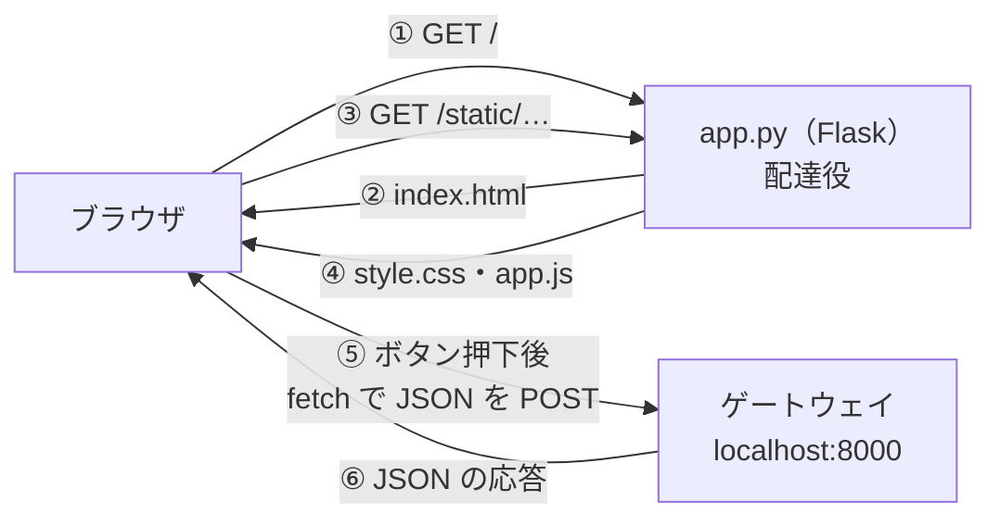

# 08 テスト画面の中身 ── HTML・CSS・JS・JSON の入門

*個人検討ノートの一般化版（2026-11-19 同期・正は個人 Vault）*

> [!NOTE]
> **この解説の位置づけ**
> ゲートウェイの動作確認に使うテスト画面は、`web/` 配下の4ファイル（`app.py`・`templates/index.html`・`static/style.css`・`static/app.js`）でできた小さな Web アプリである（画面の位置づけ＝[構成図v4](../02_構成図/v4_複数インスタンス詳細とテスト画面.md)）。この4ファイルは HTML・CSS・JavaScript・JSON の入門素材としてちょうどよい大きさなので、実物の行に対応づけながら基礎から読めるようにする（2026-11-18 新設）。

## 1. 導入 ── 1画面は「構造・見た目・挙動」の3層でできている

ブラウザに映る1枚の画面は、ひとつのファイルで作るのではなく、役割の違う3つの層に分けて作るのが Web の定石である。何がどこに置かれるかという**構造**を HTML が受け持ち、色や幅といった**見た目**を CSS が受け持ち、ボタンを押したら何が起きるかという**挙動**を JavaScript が受け持つ[^mdn-3layers]。分ける理由は変更の局所化で、見た目だけ直したいときは CSS だけ触ればよく、構造や挙動を壊す心配がない。

テスト画面もこの定石どおりに作ってある。対応は次の表のとおりで、3層に入らない `app.py` は「3つのファイルをブラウザへ届ける配達役」である。

| ファイル | 層 | 受け持ち |
|---|---|---|
| `web/templates/index.html` | 構造 | 入力欄・ボタン・計測表・出力欄をどこに置くか |
| `web/static/style.css` | 見た目 | 幅・余白・背景色・枠線 |
| `web/static/app.js` | 挙動 | ボタンが押されたら送る・計る・表示する |
| `web/app.py` | （層の外） | 上の3つをブラウザへ届ける配達役（Flask） |

動くときの流れも、先に一枚で見ておく。ブラウザが画面を開くと、まず配達役から HTML が届き、HTML に書かれた指示にしたがって CSS と JS を追加で取りに行く。ここまでが「画面が出る」まで。ボタンが押されてからは、JS がゲートウェイへ JSON を送る別の往復が始まる。



以下、配達役 → 構造 → 見た目 → 挙動 → 運ばれる中身（JSON）→ 最後に CORS の順で、ファイルごとに実物を読んでいく。

## 2. app.py ── 3ファイルをブラウザへ届ける配達役（Flask）

### 2.1 ルートと `render_template` ── 「/ が来たら index.html を返す」

Flask は Python の Web フレームワークで、この画面では「どの URL が来たら何を返すか」を決める受付だけを担う。実物は実質3行しかない。

```python
app = Flask(__name__)

@app.get("/")
def index() -> str:
    return render_template("index.html")
```

`@app.get("/")` は「URL `/` への GET が来たら、この下の関数を呼ぶ」という紐づけ（ルート）である。関数の中身は `render_template("index.html")` の1行で、Flask 公式もテンプレートの描画にはこのメソッドを使うとしている[^flask-render]。`render_template` は `templates/` フォルダから指定した名前のファイルを探して返すので、ブラウザには index.html の中身が届く。

### 2.2 static 配信 ── CSS と JS は Flask が自動で配る

app.py には style.css も app.js も一度も出てこない。それでもブラウザに届くのは、Flask が `static` という名前のフォルダを特別扱いし、URL `/static` でそのまま配信するからである[^flask-static]。index.html が `/static/style.css` を取りに来たら、Flask が `web/static/style.css` を探して返す。配達役は本紙（HTML）だけを手渡しし、付録（CSS・JS）は決まった棚から各自取ってもらう、という分担になっている。

## 3. index.html ── 画面の構造（何がどこに置かれるか）

### 3.1 骨組み ── doctype と html・head・body

HTML ファイルの外枠は、どのページでもほぼ同じ形をしている。

```html
<!doctype html>
<html lang="ja">
<head> … </head>
<body> … </body>
</html>
```

先頭の `<!doctype html>` は文書型宣言といい、MDN は「すべての文書の先頭に見られる必須の前置き」と定義する[^mdn-doctype]。これがあることで、ブラウザは互換用の古い描画モードではなく現行の標準仕様で描画する。その下の `<html lang="ja">` が文書全体の根で、中身は2部屋に分かれる。`<head>` が画面に出ない準備の部屋、`<body>` が画面に出る中身の部屋である。

### 3.2 head ── 画面に出ない準備（文字コード・CSS・JS の読み込み）

実物の head には4行入っている。

```html
<meta charset="utf-8">
<title>web (stub)</title>
<link rel="stylesheet" href="/static/style.css">
<script src="/static/app.js" defer></script>
```

#### 3.2.1 meta charset と title

`<meta charset="utf-8">` は文書の文字コードの宣言で、日本語の文字化けを防ぐ基本の1行である。`<title>` はブラウザのタブに出る見出しで、画面の中には出ない。

#### 3.2.2 `<link rel="stylesheet">` ── CSS をここから取る

`<link>` は「現在の文書と外部のリソースとの関係を指定する」要素で[^mdn-link]、`rel="stylesheet"`（rel＝relationship・関係）によって「`href` の先はこの文書のスタイルシートだ」と伝える。ブラウザはこの行を見て、§2.2 の static 配信へ style.css を取りに行く。

#### 3.2.3 `<script defer>` ── JS は「構造が組み上がってから」動かす

`<script src="…" defer></script>` が app.js の読み込みで、ポイントは `defer` 属性にある。MDN の定義どおり、defer は「文書の構文解析完了後かつ DOMContentLoaded イベントが発生する前に実行する」指示である[^mdn-defer]。app.js は後述のとおり「send ボタンを探して、クリック時の動きを登録する」ことから始まるので、head を読んでいる時点（ボタンがまだ無い）で実行されると探し物が見つからず失敗する。defer によって「body まで読み終わってから実行」が保証されるため、head に置いたまま安全に動く。

### 3.3 body ── 画面に出る部品と id という名札

body には画面の部品が上から順に並ぶ。見出し `<h1>`、説明の段落 `<p>`、入力欄 `<textarea>`（開始タグと終了タグの間に挟んだ文がそのまま初期値になる）、同時リクエスト数の `<input type="number">` と送信ボタン `<button>`、計測結果の表 `<table>`（`<tr>`＝行・`<th>`＝見出しセル・`<td>`＝値セル）、応答の出力欄 `<pre>`（書いたとおりの改行・空白で表示する領域）である。

部品のいくつかには `id="…"` が付いている。id はグローバル属性で「文書全体で一意でなければならない識別子」と定義され[^mdn-id]、あとから CSS や JavaScript がその部品を名指しするための名札になる。この画面では7枚の名札——`msg`（入力欄）・`conc`（件数）・`send`（ボタン）・`t-sent`・`t-recv`・`t-dur`（計測表の3セル）・`out`（出力欄）——が使われ、すべて app.js が「書き換える相手」を特定するためにある。たとえば `<td id="t-sent">−</td>` の `−` は仮の表示で、送信のたびに JS が実際の時刻へ書き換える。

## 4. style.css ── 見た目（セレクタと宣言）

### 4.1 規則の形 ── 「どれに」＋「何をどうする」

CSS はスタイルシート言語で、HTML などで記述された文書の体裁や見栄えを表現するために用いられる[^mdn-css]。書き方はどの行も同じ形で、**セレクタ**（どの部品に）のあとの `{ }` に**宣言**（`プロパティ: 値;`）を並べる。実物の1行目がそのまま教科書になる。

```css
body { font-family: sans-serif; max-width: 640px; margin: 2rem auto; }
```

セレクタ `body` は「body 要素に」。宣言は3つで、フォントをゴシック系（sans-serif）にし、幅を最大 640px に抑え、余白（margin）を上下 2rem・左右 auto にする。左右 auto は残り幅を左右で均等に割る指定なので、幅を制限した本文が画面中央に寄る。この3つだけで「中央の読みやすい列」ができる。なお rem は文字サイズを基準にした相対単位である。

### 4.2 残り7行の読み下し ── 各行が何を変えているか

残りも1行＝1規則で、順に見ると画面のどこを変えているかの対応が取れる。

- `textarea { width: 100%; height: 6rem; }` ── 入力欄を親の幅いっぱいに広げ、高さを数行ぶん確保する。
- `pre { background: #f4f4f4; padding: 1rem; white-space: pre-wrap; }` ── 出力欄に薄い灰色の背景と内側余白を付ける。`white-space: pre-wrap` は「改行は書いたとおり保ちつつ、長い行は折り返す」指定で、既定の pre（折り返さず横にはみ出す）を読みやすくしている。
- `table { border-collapse: collapse; margin: 0.5rem 0; }` ── 隣り合うセルの枠線を1本に重ねる（collapse しないと二重線に見える）。
- `th, td { border: 1px solid #ccc; padding: 0.3rem 0.8rem; font-size: 0.9rem; }` ── カンマ区切りは「複数のセレクタに同じ宣言」の意味。見出しセルと値セルの両方に、灰色の枠線・内側余白・少し小さめの字を与える。
- `th { background: #f0f0f0; font-weight: normal; }` ── 見出しセルだけ薄灰色の背景にし、既定の太字を普通の太さへ戻す。
- `input[type="number"] { width: 5rem; }` ── 角括弧は属性セレクタで、input のうち `type="number"` のものだけに効く。件数欄の幅を数字向けに狭める。

## 5. app.js ── 挙動（押されたら送る・計る・表示する）

### 5.1 全体の流れ ── 上から1本の筋で読む

app.js のやることは1本の筋にまとまる。①send ボタンに「押されたときの動き」を登録しておく。押されたら、②入力欄と件数欄の値を読み、③送信時刻を表に書き、④指定件数ぶんのリクエストを並列で送って全部待ち、⑤受信時刻と全体所要時間を表に書き、⑥各リクエストの結果一覧と1件目の応答本文を出力欄に流し込む。以下、この筋に出てくる道具を順に拾う。

### 5.2 部品をつかむ・押されたら動かす ── DOM とイベントハンドラ

```js
document.getElementById("send").onclick = async () => { … };
```

`document` は、ブラウザが HTML を読み込んで組み立てた部品ツリー（DOM＝Document Object Model）への入口である。`getElementById("send")` は §3.3 の名札で部品を探す道具で、ここでは send ボタンをつかむ。その `onclick` に関数を代入しておくと、クリックのたびにその関数が呼ばれる。これがイベントハンドラ——「出来事（イベント）が起きたらこれを実行して」という予約——である。`() => { … }` は関数を短く書くアロー関数の記法で、頭に付いた `async` は §5.4 で効いてくる。

### 5.3 fetch ── JS から HTTP リクエストを送る

送信の本体は `sendOne` 関数の中の fetch である。

```js
const res = await fetch("http://localhost:8000/api/chat", {
  method: "POST",
  headers: { "Content-Type": "application/json" },
  body: JSON.stringify({ message: message }),
});
```

`fetch()` は「ネットワークからリソースを取得するプロセスを開始し、レスポンスが利用できるようになったら履行されるプロミスを返す」メソッドである[^mdn-fetch]。第1引数が宛先 URL（ゲートウェイの `/api/chat`）、第2引数が送り方の指定で、メソッドを POST にし、ヘッダ `Content-Type: application/json` で「ボディは JSON です」と名乗り、ボディに JSON 文字列を載せる（何をヘッダに・何をボディに置くかの考え方は[ヘッダとボディ（IDを入れない）](../90_基礎知識/05_ヘッダとボディ（IDを入れない）.md)）。つまり画面のボタン1つの裏で、curl で打つのと同じ HTTP の1往復が起きている。

### 5.4 Promise と async/await ── 「あとで届く結果」の待ち方

fetch の戻り値はレスポンスそのものではなく**プロミス（Promise）**——「結果はまだ無いが、いずれ届く」ことを表す予約券——である。ネットワークの往復には時間がかかるので、JS は待っている間ブラウザを固めない代わりに、まず予約券を渡してくる。この予約券から結果を取り出す書き方が async/await で、MDN は「プロミスベースの非同期の動作を、プロミスチェーンを明示的に構成する必要なく、よりすっきりとした方法で書ける」仕組みと説明する[^mdn-async]。`await fetch(…)` は「応答が届くまでここで待ち、届いたら `res` に入れて次の行へ進む」と読めばよい。await を使う関数には `async` を付ける決まりがあり、`sendOne` と §5.2 のクリック関数が async なのはこのためである。あわせて `sendOne` は try/catch で失敗（ゲートウェイが落ちている等）も受け止め、成功と同じ形 `{ i, label, ms, body }` で返すので、後段の表示は成否を気にせず同じ道を通れる。

### 5.5 Promise.all ── n 件を同時に送って全員を待つ

```js
const results = await Promise.all(
  Array.from({ length: n }, (_, i) => sendOne(i + 1, message))
);
```

`Array.from({ length: n }, …)` は長さ n の配列を作り、各要素を2番目の関数で埋める書き方で、ここでは `sendOne(1, …)` から `sendOne(n, …)` までを呼び出す。async 関数は呼んだ瞬間にプロミスを返すので、この時点で n 件のリクエストが**同時に**飛び始めている。それを束ねるのが `Promise.all()` で、「入力としてプロミスの集合の反復可能オブジェクトを取り、単一の Promise を返す」静的メソッドである[^mdn-promise-all]。返ってくる単一のプロミスは、入力のすべてが履行されたとき、履行された値の配列で履行される[^mdn-promise-all-fulfill]。ひらたく言えば「全員が帰ってくるまで待ち、帰着順ではなく出発順に並んだ配列で受け取る」。同時リクエスト数を変えてゲートウェイの並列挙動を観察する、というテスト画面の目的はこの1行に乗っている。

### 5.6 performance.now ── 所要時間の計測

時間の計測には `performance.now()` を使っている。「高解像度のタイムスタンプをミリ秒で返す」メソッドで[^mdn-perf-now]、送信直前に `t0` を取り、全員を待ち終えた直後の値から引き算して全体所要時間を出す。`sendOne` の中でも1件ごとに同じ計測をしているので、結果一覧には各リクエストの個別所要時間も並ぶ。一方、画面に出す「送信時刻・受信時刻」は時計の時刻なので `new Date()` から作る。経過時間は `performance.now()`、時刻の表示は Date、という使い分けである。

### 5.7 画面への書き戻し ── textContent で DOM を書き換える

結果の表示は、つかんだ部品の `textContent`（その部品の中の文字）への代入で行う。

```js
document.getElementById("t-dur").textContent =
  Math.round(total) + " ms（" + (total / 1000).toFixed(2) + " 秒）";
```

代入した瞬間に画面の文字が変わる。HTML が配達されるのは最初の1回だけで、以後の画面更新はすべて「JS が DOM を書き換える」ことで起きている——これが §1 の「挙動」の層の正体である。時刻の表示に使う `fmtTime` は Date を `HH:MM:SS.ミリ秒` 形式に整える小さな整形係で、`toLocaleTimeString("ja-JP", …)` の24時間表記にミリ秒3桁（`padStart` で0埋め）を足している。結果一覧は `results.map(…)` で1件を1行の文字列にし、`join("\n")` で改行区切りにつないで `out` へ流し込む。`\n` が改行として見えるのは、出力欄が §3.3 の `<pre>`（書いたとおり表示）だからである。

## 6. JSON ── 画面とゲートウェイの間を運ぶ「テキストの封筒」

### 6.1 JSON とは ── JavaScript のオブジェクト構文に従ったテキスト

リクエストとレスポンスのボディに載っているのが JSON である。MDN の定義では「JavaScript オブジェクトの構文に従ったテキストベースのデータ形式」[^mdn-json]。`{"message": "こんにちは"}` のように `"キー": 値` の組を `{ }` で包んだ**ただの文字列**であり、プログラムの中のオブジェクトと見た目が似ているからこそ、行き来の変換が素直にできる。ゲートウェイの共通フォーマットとして JSON を選ぶ話は[解説03 共通フォーマット](./03_共通フォーマット（JSONという選択）.md)が正典で、ここでは画面側での「行き」と「帰り」の変換だけを押さえる。

### 6.2 行き ── JSON.stringify でオブジェクトを文字列にする

JS の中の `{ message: message }` はメモリ上のオブジェクトで、そのままネットワークには流せない。そこで `JSON.stringify()`——「JavaScript のオブジェクトや値を JSON 文字列に変換する」メソッド[^mdn-stringify]——で文字列化する。§5.3 の `body: JSON.stringify({ message: message })` は、まさに封筒に詰める作業である。

### 6.3 帰り ── res.json() で文字列をオブジェクトに戻す

応答のボディも JSON 文字列で届く。`res.json()` は Response のストリームを読み切り、「本体のテキストを JSON として解釈した結果で解決するプロミスを返す」[^mdn-res-json]。読み取りにも時間がかかり得るので、ここにも await が付く。戻ったあとは普通のオブジェクトとして `body.choices` のようにたどれる。なお出力欄へ表示するときは `JSON.stringify(first.body, null, 2)` でもう一度文字列に戻している。第3引数の 2 は字下げ幅で、人が読みやすい整形付きの文字列になる。

### 6.4 封筒の中身 ── ゲートウェイとの契約

この画面が送る封筒は `{"message": …}` の1項目だけで、これはゲートウェイが決めた共通フォーマットである。帰ってくる封筒は choices や usage を持つ OpenAI 互換の形で、ゲートウェイが LiteLLM 経由の応答を運んでくる（封筒の設計＝[解説03 共通フォーマット](./03_共通フォーマット（JSONという選択）.md)・[構成図v1](../02_構成図/v1_見直し反映.md)）。つまりこのテスト画面は、共通フォーマットの「書き手」と OpenAI 互換封筒の「読み手」を1枚でやる、いちばん小さなクライアントである。

## 7. CORS ひとこと ── 別オリジンへの fetch はゲートウェイ側の許可が要る

最後に、この画面が動く裏でもう1つ効いている仕組みに触れておく。画面を配るのは web（Flask）で、fetch の宛先はゲートウェイ（`localhost:8000`）——つまりポートが違う。ブラウザはスキーム・ホスト・ポートの組を**オリジン**として区別し、別オリジンへのアクセスを無条件には許さない。これを越える取り決めが CORS（オリジン間リソース共有）で、「HTTP ヘッダーベースの仕組みを使用して、あるオリジンで動作しているウェブアプリケーションに、異なるオリジンにある選択されたリソースへのアクセス権を与えるようブラウザーに指示する」仕組みである[^mdn-cors]。許可を名乗るのは呼ばれる側＝ゲートウェイで、応答に許可のヘッダーを載せて初めて、この画面の JS は応答を読める。テスト画面からの fetch が通っているなら、ゲートウェイ側に CORS の許可設定が効いている、ということでもある。深掘りは出典の MDN の CORS ガイドが詳しい。

## 8. 深掘りの入口

- [03_共通フォーマット（JSONという選択）](./03_共通フォーマット（JSONという選択）.md) ── 共通フォーマットに JSON を選んだ理由・封筒・版の論点。
- [ヘッダとボディ（IDを入れない）](../90_基礎知識/05_ヘッダとボディ（IDを入れない）.md) ── `Content-Type` はなぜヘッダか、何をボディに置くか。
- [HTTPメッセージの実体](../90_基礎知識/06_HTTPメッセージの実体.md) ── fetch が送っている HTTP の生の形（ヘッダ・ボディの実物）。
- [構成図v4](../02_構成図/v4_複数インスタンス詳細とテスト画面.md) ── テスト画面がスタック全体のどこに居るか。

## 出典（一次情報）

いずれも 2026-11-19 取得・逐語は実ページで機械照合済み（`curl` 生取得→タグ除去→`grep` 照合）。MDN の各ページは MDN Web Docs（Mozilla）の日本語版（英語版からの公式サイト上の翻訳ページ）。

- [What is JavaScript?（MDN）](https://developer.mozilla.org/ja/docs/Learn_web_development/Core/Scripting/What_is_JavaScript) ── HTML・CSS・JS の3層の分担
- [Doctype（MDN 用語集）](https://developer.mozilla.org/ja/docs/Glossary/Doctype) ── 文書型宣言
- [script 要素（MDN）](https://developer.mozilla.org/ja/docs/Web/HTML/Reference/Elements/script) ── defer 属性
- [link 要素（MDN）](https://developer.mozilla.org/ja/docs/Web/HTML/Reference/Elements/link) ── 外部リソースとの関係の指定
- [id グローバル属性（MDN）](https://developer.mozilla.org/ja/docs/Web/HTML/Reference/Global_attributes/id)
- [CSS: カスケーディングスタイルシート（MDN）](https://developer.mozilla.org/ja/docs/Web/CSS)
- [Window: fetch() メソッド（MDN）](https://developer.mozilla.org/ja/docs/Web/API/Window/fetch)
- [Promise.all()（MDN）](https://developer.mozilla.org/ja/docs/Web/JavaScript/Reference/Global_Objects/Promise/all)
- [async function（MDN）](https://developer.mozilla.org/ja/docs/Web/JavaScript/Reference/Statements/async_function)
- [Performance: now() メソッド（MDN）](https://developer.mozilla.org/ja/docs/Web/API/Performance/now)
- [JSON の操作（MDN）](https://developer.mozilla.org/ja/docs/Learn_web_development/Core/Scripting/JSON)
- [JSON.stringify()（MDN）](https://developer.mozilla.org/ja/docs/Web/JavaScript/Reference/Global_Objects/JSON/stringify)
- [Response: json() メソッド（MDN）](https://developer.mozilla.org/ja/docs/Web/API/Response/json)
- [オリジン間リソース共有（CORS）（MDN）](https://developer.mozilla.org/ja/docs/Web/HTTP/Guides/CORS)
- [Quickstart（Flask 公式）](https://flask.palletsprojects.com/en/stable/quickstart/) ── Rendering Templates・Static Files

## 脚注

[^mdn-3layers]: 原文「HTML はマークアップ言語で、これを使ってウェブコンテンツに構造と意味を与えます」「CSS は HTML コンテンツに適用するスタイリング規則の言語です」「JavaScript はスクリプト言語で、動的に更新されるコンテンツを作成したり、マルチメディアを制御したり、画像をアニメーションさせたり、その他ほとんどすべてを可能にします」。— [What is JavaScript?（MDN）](https://developer.mozilla.org/ja/docs/Learn_web_development/Core/Scripting/What_is_JavaScript)
[^flask-render]: 原文「To render a template you can use the render_template() method.」（テンプレートを描画するには render_template() メソッドを使えばよい）。— [Quickstart（Flask 公式）](https://flask.palletsprojects.com/en/stable/quickstart/)
[^flask-static]: 原文「Just create a folder called static in your package or next to your module and it will be available at /static on the application.」（パッケージの中か、モジュールの隣に static という名前のフォルダーを作るだけで、アプリケーションの /static で利用できるようになる）。同節の冒頭には「Dynamic web applications also need static files.」（動的な Web アプリケーションにも静的ファイルは必要で、ふつう CSS や JavaScript がそれにあたる）ともある。— [Quickstart（Flask 公式）](https://flask.palletsprojects.com/en/stable/quickstart/)
[^mdn-doctype]: 原文「HTML において文書型宣言 (doctype) とは、すべての文書の先頭に見られる `<!doctype html>` という必須の前置きです。」— [Doctype（MDN 用語集）](https://developer.mozilla.org/ja/docs/Glossary/Doctype)
[^mdn-link]: 原文「`<link>` は HTML の要素で、現在の文書と外部のリソースとの関係を指定します。」— [link 要素（MDN）](https://developer.mozilla.org/ja/docs/Web/HTML/Reference/Elements/link)
[^mdn-defer]: defer 属性の定義。原文「この論理属性は、文書の構文解析完了後かつ DOMContentLoaded イベントが発生する前に、このスクリプトを実行することをブラウザーに示します。」— [script 要素（MDN）](https://developer.mozilla.org/ja/docs/Web/HTML/Reference/Elements/script)
[^mdn-id]: 原文「id グローバル属性は、文書全体で一意でなければならない識別子 (ID) を定義します。」— [id グローバル属性（MDN）](https://developer.mozilla.org/ja/docs/Web/HTML/Reference/Global_attributes/id)
[^mdn-css]: 原文「カスケーディングスタイルシート (Cascading Style Sheets、CSS) はスタイルシート言語であり、HTML や XML（派生言語である SVG、MathML、XHTML などを含む）で記述された文書の体裁や見栄えを表現するために用いられます。」— [CSS: カスケーディングスタイルシート（MDN）](https://developer.mozilla.org/ja/docs/Web/CSS)
[^mdn-fetch]: 原文「fetch() は Window インターフェイスのメソッドで、ネットワークからリソースを取得するプロセスを開始し、レスポンスが利用できるようになったら履行されるプロミスを返します。」— [Window: fetch() メソッド（MDN）](https://developer.mozilla.org/ja/docs/Web/API/Window/fetch)
[^mdn-async]: 原文「async および await キーワードを使用することで、プロミスベースの非同期の動作を、プロミスチェーンを明示的に構成する必要なく、よりすっきりとした方法で書くことができます。」— [async function（MDN）](https://developer.mozilla.org/ja/docs/Web/JavaScript/Reference/Statements/async_function)
[^mdn-promise-all]: 原文「Promise.all() は静的メソッドで、入力としてプロミスの集合の反復可能オブジェクトを取り、単一の Promise を返します。」— [Promise.all()（MDN）](https://developer.mozilla.org/ja/docs/Web/JavaScript/Reference/Global_Objects/Promise/all)
[^mdn-promise-all-fulfill]: 原文「この返却されたプロミスは、入力されたプロミスがすべて履行されたとき（空のイテレーターが渡されたときを含む）、その履行された値の配列で、履行されます。」— [Promise.all()（MDN）](https://developer.mozilla.org/ja/docs/Web/JavaScript/Reference/Global_Objects/Promise/all)
[^mdn-perf-now]: 原文「performance.now() メソッドは高解像度のタイムスタンプをミリ秒で返します。」— [Performance: now() メソッド（MDN）](https://developer.mozilla.org/ja/docs/Web/API/Performance/now)
[^mdn-json]: 原文「JSON は JavaScript オブジェクトの構文に従ったテキストベースのデータ形式です。」— [JSON の操作（MDN）](https://developer.mozilla.org/ja/docs/Learn_web_development/Core/Scripting/JSON)
[^mdn-stringify]: 原文「JSON.stringify() メソッドは、ある JavaScript のオブジェクトや値を JSON 文字列に変換します。」— [JSON.stringify()（MDN）](https://developer.mozilla.org/ja/docs/Web/JavaScript/Reference/Global_Objects/JSON/stringify)
[^mdn-res-json]: 原文「json() は Response インターフェイスのメソッドで、Response のストリームを取得して完全に読み取ります。本体のテキストを JSON として解釈した結果で解決するプロミスを返します。」— [Response: json() メソッド（MDN）](https://developer.mozilla.org/ja/docs/Web/API/Response/json)
[^mdn-cors]: 原文「オリジン間リソース共有 (Cross-Origin Resource Sharing, CORS) は、HTTP ヘッダーベースの仕組みを使用して、あるオリジンで動作しているウェブアプリケーションに、異なるオリジンにある選択されたリソースへのアクセス権を与えるようブラウザーに指示するための仕組みです。」— [オリジン間リソース共有（CORS）（MDN）](https://developer.mozilla.org/ja/docs/Web/HTTP/Guides/CORS)
