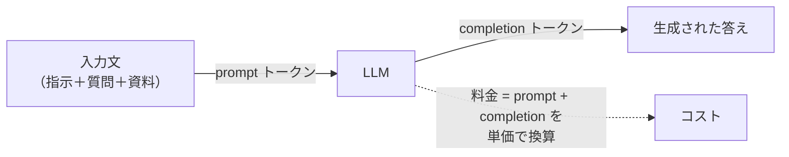

# 04 usageとトークン ── 「いくら使ったか」を封筒で常に返す

*個人検討ノートの一般化版（2026-11-16 同期・正は個人 Vault）*

> [!NOTE]
> **この節のねらい**
> 封筒には `usage`（使用量）という席がありました。ここに何を・なぜ入れるのかを掘り下げます。LLMの料金は「トークン」という単位で決まり、`usage` はその消費量の記録です。これが**予算管理・利用状況ダッシュボード・ヘビーユーザー制限**といった要望すべての土台になります。本節ではまず「トークンとは何か」を言葉にし、次に「`usage` を常に返す（失敗時も途中まで）」という一手の意味を説明し、最後に裏のLiteLLMが持つ「spend（支出）」との関係を整理します。

三段で進みます。**① トークンとは**——LLMが文章を数える単位で、入力分（prompt）と出力分（completion）がある。料金はこの数で決まる。**② usageを常に返す**——成功時はもちろん、失敗時も「途中まで使った分」を返す。これが予算機能の生データになる。**③ LiteLLMのspendとの関係**——GWが返す `usage` と、LiteLLMが集計する累計支出は、同じトークンを別の粒度で見たもの。

## 4-1. トークンとは ── LLMが文章を数える単位

**トークン（token）** は、LLMが文章を処理するときの最小のかたまりです。日本語だとおおよそ「1文字〜数文字で1トークン」、英語だと「1単語前後で1トークン」くらいの感覚（正確な区切りはモデルごとに違います）。大事なのは、**LLMの料金が「使ったトークン数」で決まる**こと。長い文章を入れれば入れるほど、長い答えを返させるほど、トークンが増えて料金が上がります。

トークンは2種類に分かれます。

- **prompt（プロンプト）トークン**＝**入力側**。GWがLLMに送り込んだ文章（システム指示＋利用者の入力＋前処理で足した資料など）の分量。
- **completion（コンプリーション）トークン**＝**出力側**。LLMが生成して返した文章の分量。completion は「補完・生成された続き」の意味。



だから封筒の `usage` は、最低でもこの2つ（と、どのモデルで処理したか）を持ちます。

```jsonc
{
  "usage": {
    "model_alias": "default-llm",   // どのモデル（別名）で処理したか
    "prompt_tokens": 1200,          // 入力に使ったトークン
    "completion_tokens": 340        // 出力に使ったトークン
  }
}
```

> [!NOTE]
> **なぜ `model_alias`（モデルの別名）も持つのか**
> トークン単価は**モデルによって違う**ので、同じトークン数でも料金が変わります。だから「何トークン」だけでなく「どのモデルで」も記録する。別名（alias）で持つのは、裏のモデルを差し替えても（Gemini → 別モデル）フロントやログの見え方を壊さないため——実モデル名に直結させず、GW内で付けた安定した呼び名を返します（差し替え前提の考え方は「生成AI APIの使い方（Geminiと差し替え前提）」の章で扱っている）。

## 4-2. `usage` を「常に」返す ── 失敗時も途中まで

ここが設計のコツです。**`usage` は成功時だけでなく、失敗時にも返す**。しかも「**途中まで使った分**」を返します。

なぜか。LLMは「最初の数百トークンを処理してから、途中でタイムアウトやフィルタ遮断で失敗する」ことがあります。そして**その途中までの処理にも、トークン消費＝課金が発生し得る**。ここで `usage` を失敗時に空っぽで返してしまうと、「失敗したのにお金は減っている」という**帳簿の穴**が開く。利用者からは「失敗したのに予算が減った、なぜ？」というクレームになり、運用側は原因を追えません。

だから、たとえ `status: "error"` でも、封筒には「そこまでに消費したトークン」を入れて返す。こうすると、予算の集計が**成功・失敗にかかわらず実消費に一致**し、ダッシュボードや予算アラートが正確になります。

```jsonc
{
  "status": "error",
  "result": null,
  "usage": { "model_alias": "default-llm", "prompt_tokens": 1200, "completion_tokens": 0 },
  "error": { "code": "upstream_timeout", "message": "...", "retriable": true }
}
```

> [!IMPORTANT]
> **usage は「予算機能の生データ」**
> 「予算アラートを出したい」「チームごとに使用量を見たい」「ヘビーユーザーを制限したい」——これらの要望は、すべて **`usage` という生データが各リクエストで正確に取れている**ことが前提です。逆に言えば、封筒に `usage` を常設し、失敗時も途中まで返すよう決めておけば、予算まわりの機能は**あとから集計・可視化を足すだけ**で実現できる。「今決めておく共通仕様」に `usage` を含める理由がこれです。

## 4-3. LiteLLM の「spend（支出）」との関係

裏側で複数LLMをまとめている **LiteLLM**（→ [03 LiteLLM Proxyと代替](./01_LiteLLM_Proxyと代替.md)）は、**spend（スペンド＝支出）** という概念を持ちます。これは「トークン数に単価を掛けて金額に換算し、キー（利用者・チーム・案件）ごとに**累計**したもの」。GWの `usage` と LiteLLM の spend の関係はこう整理できます。

| | GWが返す `usage` | LiteLLM の spend |
|---|---|---|
| 粒度 | **1リクエスト単位**のトークン数 | キー（利用者・チーム）ごとの**累計金額** |
| 単位 | トークン（prompt / completion） | 金額（単価×トークンの合計） |
| 使い所 | フロントにその場で見せる・ログに残す | 予算上限・レート制限・請求の根拠 |
| 結び目 | 封筒の `context`（業務識別子）をキーに渡す | その キー ごとに spend を積む |

つまり、封筒の `context`（`user_id`・`team`・`matter_id`）をLiteLLMへキー／タグとして渡しておけば、**各リクエストのトークンが、自動的に「誰の・どのチームの」支出として累計される**。GWは「1件ぶんの使用量」を返し、LiteLLMは「累計の支出」を管理する——この二段構えで、予算アラートや制限（`quota_exceeded`）が成り立ちます。`quota_exceeded` のエラー語彙は「統一エラーモデル」の章を参照。

> [!NOTE]
> **補足：トークンは「送る前」にもざっくり数えられる**
> 多くのLLMには、文章を実際に送る前に「これは何トークンか」を数える道具（トークナイザ）があります。これを使うと、**送信前に `payload_too_large`（長すぎ）を自前で検知**して、LLMを呼ばずに弾けます（無駄な課金とタイムアウトを避けられる）。入力の受け取り・前処理の段で数えておくと、エラーを早い段階で出せて親切です（長文で起きやすい `payload_too_large` は「統一エラーモデル」の章、入力の受け取りは「入力の受け取り方（PDFとBase64とmultipartと前処理）」の章で扱う）。

## この項目のチェックリスト

- [ ] トークンがLLMの課金単位であり、prompt（入力）とcompletion（出力）に分かれると説明できる
- [ ] 料金がモデル×トークン数で決まるため `model_alias` も持つ理由を言える
- [ ] `usage` を失敗時も「途中まで」返す理由（帳簿の穴を開けない）を説明できる
- [ ] `usage` が予算アラート・ダッシュボード・制限の生データだと言える
- [ ] GWの `usage`（1件のトークン）と LiteLLM の spend（累計金額）の違いと結び目（context をキーに渡す）を説明できる
