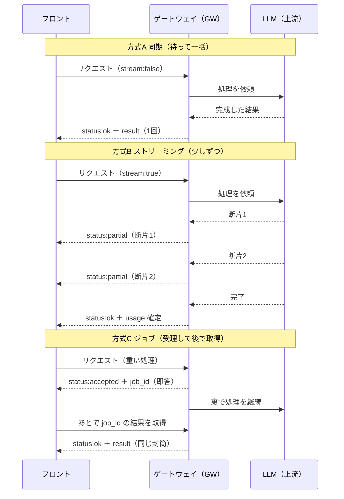

# 06 同期・ストリーミング・ジョブ ── 「返し方」を封筒より先に握る

*個人検討ノートの一般化版（2026-11-16 同期・正は個人 Vault）*

> [!NOTE]
> **この節のねらい**
> LLMは遅い。要約なら数秒、長文の検索＋再ランクなら数十秒かかることもある。ここで厄介なのは、**「どのタイミングで・どういう形で返事を返すか（＝返し方）」を先に決めておかないと、封筒そのものを作り直す羽目になる**こと。本節は返し方の3方式——**同期・ストリーミング・ジョブ**——を、それぞれ「どんな処理に向くか」「封筒でどう表すか」で解説し、最後にシーケンス図で3方式の違いを一枚にします。結論は「返し方は封筒を確定する前に握る」。封筒の `status` と `options.stream` は、そのための予約席でした。

三段で進みます。**① なぜ先に決めるか**——返し方は封筒の形（`status` の値・`job_id` の有無）を左右するので、後から足すと作り直しになる。**② 3方式**——同期（待って一括）／ストリーミング（少しずつ）／ジョブ（受理だけ返して後で取りに行く）。**③ 使い分け**——短く即答できるものは同期・ストリーミング、長く重いものはジョブ。

## 6-1. なぜ「返し方」を封筒より先に決めるのか

ありがちな失敗はこうです。最初は「要約を数秒で返すだけ」と考え、**同期（送って、待って、一括で受け取る）前提**で封筒を固めてしまう。ところが後から「途中経過を画面に出したい（ストリーミング）」「長い検索は待てないので一旦受理だけ返したい（ジョブ）」という要望が出る。すると封筒に `status: "partial"` や `job_id` を**後付け**することになり、フロントもGWも作り直し——という手戻りが起きます。

だから**返し方は、封筒を確定する前に握る**。具体的には、封筒にあらかじめ `status`（`ok` / `partial` / `accepted` / `error`）という席と、`options.stream`（ストリーミングを使うか）という席を用意しておく。これらは「返し方のための予約席」でした。3方式すべてを**同じ封筒**で表せるようにしておけば、後から別方式を足しても作り直しになりません。

## 6-2. 3つの返し方

### 方式A：同期（synchronous）── 待って、一括で受け取る
もっとも素朴。フロントがリクエストを送り、GWがLLMの処理を待ち、**完成した結果を一括で1回だけ返す**。封筒は `status: "ok"`、`result` に完成品が入る。短時間で終わる処理に向きます。欠点は「結果が出るまで画面が無反応」になること——長い処理では利用者が不安になります。

### 方式B：ストリーミング（streaming）── 少しずつ流す
結果を**細切れ（断片）にして、できたそばから逐次送る**方式。要約が1文ずつ画面に浮かび上がる、あの体験です。技術的には **SSE（Server-Sent Events＝サーバから継続的に小さなメッセージを送り続ける仕組み）** などを使います。封筒では、途中の断片を `status: "partial"`（部分・途中）で何通も送り、**最後の1通で `status: "ok"` と `usage`（使用量）を確定**して閉じます。「待たされ感」を消せるので、要約の途中表示に向きます。

### 方式C：ジョブ（job）── 受理だけ返し、あとで取りに行く
重くて長い処理向け。GWはリクエストを受け取ると、**すぐには結果を返さず「受け付けました」とだけ即答**する。封筒は `status: "accepted"`（受理）＋ `job_id`（この処理の整理番号）。フロントは後で「`job_id` の結果ある？」と**取りに行き**、できていれば**同じ封筒**で `status: "ok"` ＋ `result` を受け取る。「送って即・受付票だけもらい、後で引き取る」クリーニング店のイメージ。文献探索のような重い処理に向きます。

> [!NOTE]
> **「同じ封筒を返す」のがジョブの勘所**
> ジョブ方式で結果を取りに行ったとき、返ってくるのは**最初と同じ封筒の形**（`api_version` / `request_id` / `status` / `result` / `usage` / `error`）です。受理のときは `status: "accepted"`、完成後は `status: "ok"`。封筒が同じだから、フロントの受け取り処理は同期・ストリーミングと**共通のコードで書ける**。3方式を同じ封筒に乗せた狙いがここに出ます。

## 6-3. 3方式をシーケンス図で見比べる

誰が・いつ・どんな封筒を送り合うかを一枚にします。

## 6-4. 使い分けの目安

| 返し方 | 向く処理 | 封筒での表現 | 利用者の体感 |
|---|---|---|---|
| 同期 | 短時間で終わる（短い要約など） | `status: "ok"` を1回 | 数秒待って結果が出る |
| ストリーミング | 生成を逐次見せたい（要約の途中表示） | `status: "partial"` を複数＋最後に `ok` | 文章が少しずつ現れる |
| ジョブ | 重い／長い（文献探索・バッチ） | `status: "accepted"` ＋ `job_id` → 後で `ok` | 受付票が出て、後で結果を確認 |

> [!IMPORTANT]
> **まず「第一弾機能は何方式で返すか」を握る**
> このトピックの出発点は「機能が未定でも共通仕様を決める」ことでした。返し方だけは、**第一弾の機能が決まった時点で、どの方式で返すかをフロントと握っておく**のが安全です。同期前提で固めてから後でストリーミングやジョブを足すと作り直しになる——逆に、3方式を同じ封筒で表せる形にしておけば、機能が増えても返し方が増えても、封筒は作り直さずに済みます。関連して、重いジョブの入力（PDF等）をどう受け取るか、エラー時に `status: "error"` をどう表すか（統一エラーモデル）も、同じ封筒の上で決めておく論点です。

## この項目のチェックリスト

- [ ] 返し方を先に決めないと封筒を作り直す羽目になる理由を説明できる
- [ ] 同期・ストリーミング・ジョブの3方式を、それぞれどんな処理に向くかで言える
- [ ] 各方式が封筒の `status`（ok / partial / accepted / error）でどう表されるか説明できる
- [ ] ストリーミングが `partial` の断片＋最後に `usage` 確定で閉じると言える
- [ ] ジョブが `accepted` ＋ `job_id` を即答し、後で「同じ封筒」で `ok` を返すと説明できる
- [ ] 第一弾機能の返し方を封筒確定より先に握るべき理由を言える
