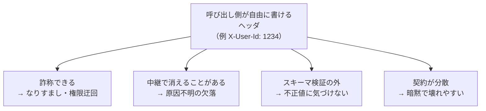

# 03 ヘッダとボディ ── 何をどこに置くか、なぜ「ヘッダにIDを入れない」のか

*個人検討ノートの一般化版（2026-11-16 同期・正は個人 Vault）*

リクエストやレスポンス1通の中身を、ここで解剖します。HTTPメッセージは実はきれいな層構造を持っていて、その形を押さえると「情報をどこに書くか」が自然に見えてきます。とくに設計の議論でよく出る「**ヘッダにIDを入れない**」という原則は、この形さえ分かれば当たり前に聞こえてきます。

核心は、1通のメッセージが「**開始行 → ヘッダ → 空行 → ボディ**」という順に並ぶこと。ヘッダは**メッセージについてのメタ情報**（封筒の表書き）、ボディは**実際の業務データ**（中の手紙）です。そして「ヘッダにIDを入れない」とは、身元や業務の識別子を、呼び出し側が自由に書けるヘッダで渡さない、という話。理由は4つあり、とくに**なりすまし（セキュリティ）**が本丸です。

まとめると、この節では「メッセージの解剖」「ヘッダとボディの住み分け」「IDをどこに置くのが正解か」を押さえます。これは設計ノート（共通仕様の封筒・横断機能）の土台そのもので、本節はその前知識編です。

## 3.1 HTTPメッセージの解剖 ── 封筒のたとえ

1通のリクエストは、次のような層でできています。上から「何をする・どこへ」「メタ情報の行たち」「区切りの空行」「中身」の順です。

```
POST /v1/summarize HTTP/1.1      ← 開始行（何を・どこへ・HTTP版）
Content-Type: application/json   ┐
Authorization: Bearer eyJ...     │ ← ヘッダ（「キー: 値」が複数行）
X-Request-Id: 2b1f...            ┘
                                 ← 空行（ここまでがヘッダ、の区切り）
{ "feature": "summarize",        ┐
  "input": { "text": "..." } }   ┘ ← ボディ（実際の中身）
```

これは**封筒のたとえ**がそのまま効きます。

- **ヘッダ ＝ 封筒の表書き**：宛先・差出人・切手・「割れ物注意」・言語指定。つまり**メッセージ“について”のメタ情報**。中身そのものではなく、中身の扱い方や属性を書く場所。
- **ボディ ＝ 中の手紙**：実際に伝えたい**業務データ本体**。要約してほしい文章、送信するフォームの値、アップロードするファイルなど。

開始行とヘッダの間ではなく、**ヘッダとボディの間に空行**が入るのがポイント。受け手は「空行が来たらヘッダ終わり、ここからが中身」と機械的に判断できます。

## 3.2 何をどこに置くか

住み分けの基準は単純です。「**このやり取りの属性**（伝送・横断のメタ）」はヘッダ、「**やり取りの中身**（業務データ）」はボディ。代表例を表にします。

| 置き場所 | 置くもの | 例 |
|---|---|---|
| **ヘッダ** | 伝送・横断のメタ情報 | `Content-Type`（中身の種類）／`Content-Length`（長さ）／`Authorization`（認証トークン）／`Accept`（欲しい形式）／`X-Request-Id`（追跡用の相関ID） |
| **ボディ** | 業務データ本体 | 入力データ（要約対象の文章・フォーム値）／アップロードするファイル（Base64 や multipart） |

認証トークンや相関IDのような「このやり取りの属性」はヘッダ、要約してほしい文章やファイルのような「やり取りの中身」はボディ、という住み分けです。GETのように本文を持たないリクエストもあります（取得は「何を取るか」をURLで指定すれば済むため）。

## 3.3 「ヘッダにIDを入れない」とは

ここでの **ID ＝ 識別子**（利用者ID・案件ID・テナントIDなど、業務上の「誰・何」を表す値）です。原則を一言でいうと——

> **身元や業務の識別子を、呼び出し側が自由に書けるヘッダで渡さない。身元は“検証済みトークン”から導き、業務IDは“検証されるボディ（やURLパス）”に置く。**

なぜそうするのか。理由は4つ、とくに1つめが本丸です。

1. **なりすまし＝セキュリティ事故（本丸）**：`X-User-Id: 1234` のような**ただのヘッダは、呼び出し側が好きな値に詐称できる**。ヘッダは送り手が自由に書ける欄なので、それを信じて「この人は1234番の人だ」と扱うと、**他人へのなりすまし・権限の迂回**が起きる。だから**身元は必ず“検証済みの認証トークン（JWTなど）”から取り出す**。トークンは署名されていて改ざんを検知できるので、詐称が効きません。
2. **中継で消える**：独自ヘッダ（`X-...`）は、間に入る**プロキシやロードバランサが転送しないことがある**。IDが黙って欠落し、原因不明の不具合につながる。
3. **スキーマ検証を素通りする**：ボディは（Pydantic などで）**スキーマ検証**されるのが普通ですが、場当たりのヘッダIDは**検証網の外**。不正値や欠落に気づけません。
4. **契約が分散する**：リクエストの意味が「ヘッダのID＋ボディ」に**散らばる**と、暗黙的で壊れやすい契約になる。業務IDも**ボディの1か所**にまとめるほうが堅牢。



> [!TIP]
> **IDは“どこに置く”のが正解か**
> - **身元（誰か）** → ヘッダのIDではなく、**検証済みトークン（`Authorization`）から導く**。
> - **リソースの識別（どれ）** → **URLパス**（REST流。例 `/matters/{id}`）。
> - **その他の業務ID（案件・機能など）** → **検証されるボディ**。
> 要するに「呼び出し側が書いた値をそのまま信じない」。身元は検証できる形で、識別はURL、業務値は検証されるボディへ。

## 3.4 例外 ── 追跡用の相関IDはヘッダでよい

「IDは全部ダメ」ではありません。**`X-Request-Id` のような“追跡用の相関ID”は、むしろヘッダが定石**です。これは身元でも認可でもない**インフラのメタ情報**で、万一消えても正しさやセキュリティには響かず、「ログを突き合わせて追跡しづらくなる」だけだから。区別はこうです——**身元ID・業務IDはヘッダに入れない／追跡IDはヘッダでよい**。

> [!NOTE]
> **大きなデータ本体もヘッダに置かない**
> 要約文やファイルのような**大きなデータ本体**も、サイズ上限・ログ・エンコードの都合で、ヘッダではなくボディに置くのが鉄則です。ヘッダは短いメタ情報のための場所、ボディは中身のための場所、という役割分担を守ります。「ヘッダにIDを入れない」が具体的に何（身元ID？業務ID？追跡ID？）を指すかは、現場で一度確認しておくと誤解がありません。

さらに深掘りするなら、ヘッダ設計の原著寄りの解説やREST全体の原則（6つの制約）は、API設計の専門書（『API Management』など）が入口になります。

---

## この項目のチェックリスト

- [ ] HTTPメッセージが「開始行→ヘッダ→空行→ボディ」の層でできていると説明できる
- [ ] ヘッダ＝メタ情報（封筒の表書き）／ボディ＝業務データ（中の手紙）を住み分けられる
- [ ] 「ヘッダにIDを入れない」の意味（詐称できるヘッダで身元・業務IDを渡さない）を言える
- [ ] 理由4つ（なりすまし・中継で消える・検証を素通り・契約の分散）のうち、本丸がなりすましだと言える
- [ ] IDの置き場所（身元→トークン／識別→URLパス／業務ID→検証されるボディ／追跡ID→ヘッダでOK）を仕分けできる
