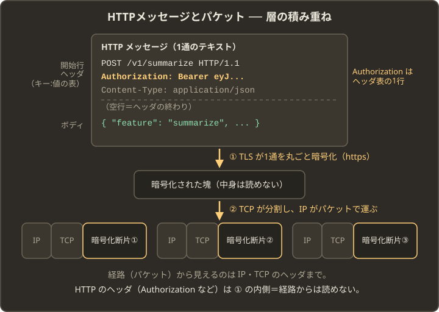

# 07 HTTPメッセージの実体 ── パケットとの関係と、ヘッダを「書く」方法

*個人検討ノートの一般化版（2026-11-16 同期・正は個人 Vault）*

[03 ヘッダとボディ](./05_ヘッダとボディ（IDを入れない）.md) では1通のメッセージを解剖し、「開始行 → ヘッダ → 空行 → ボディ」という形を見ました。そこで自然に湧くのが次の疑問です。「その1通は、パケットのようにヘッダのテーブルを持っているのか？」「`Authorization` のようなヘッダは、プログラムからどうやって書き込むのか？」——この節はその2つに正面から答えます。

核心は2つです。第一に、HTTPメッセージの実体は**ただのテキスト**で、ヘッダ部は「キー: 値」を1行ずつ並べた**表のようなもの**。`Authorization` はそこに書ける標準のキーの1つにすぎません。第二に、「ヘッダ」と呼ばれるものは**層ごとに別にあります**。IPにもTCPにもヘッダがあり、HTTPのヘッダはそれらとは**別の層の別物**です。パケットの直観は半分正しく、残り半分は「どの層の話か」を分ければ正確になります。

まとめると、この節では「メッセージの実体（テキストとヘッダ表）」「パケットとの層の関係」「ヘッダをコードで書く方法」「実物を目で確かめる方法」の順に進みます。読み終えると、`curl -H` の1行が「1通のテキストのヘッダ表に1行足している」のだと、層の絵ごと思い描けるようになります。

## 7.1 ヘッダは「キー: 値の表」── メッセージの実体はテキスト

「ヘッダテーブルがあって、その中に Authorization がある？」という直観は、HTTP/1.1 ではそのまま正しい形をしています。HTTP/1.1 のメッセージは、開始行のあとに**0行以上のヘッダ行（まとめて「ヘッダ」または「ヘッダセクション」と呼ぶ）**が続き、空行でヘッダの終わりを示し、その後に任意のボディが来る——という構造だと、仕様（RFC 9112）自身が定義しています[^rfc-msg]。

```
POST /v1/summarize HTTP/1.1      ← 開始行
Authorization: Bearer eyJ...     ← ヘッダ表の1行（キー: 値）
Content-Type: application/json   ← 同じく1行
                                 ← 空行（ここでヘッダ終わり）
{ "feature": "summarize", ... }  ← ボディ
```

つまりヘッダ部は、`キー: 値` という行を必要なだけ重ねた**表**です。バイナリの固定フォーマットではなく、人間がそのまま読めるテキストの表である、という点だけがパケットのヘッダと違います。そして `Authorization` は、この表に書ける**標準のキー名の1つ**です。仕様（RFC 9110）は「クライアント（ユーザーエージェント）が自分の身元をサーバーに証明するためのヘッダ」と定義しています[^rfc-auth]。[AIゲートウェイの解説01](../05_論点解説/01_利用管理（使用制限・記録DB・仮想キー）.md) で出てきた「トークンを Authorization に載せる」は、この表に1行書くことを指していました。

> [!NOTE]
> **豆知識：HTTP/2 には"本物のヘッダテーブル"がある**
> 新しい版の HTTP/2 では、ヘッダをテキストのまま毎回送ると無駄が多いため、**HPACK** という圧縮方式が使われる。HPACK は「HTTP ヘッダフィールドを効率よく表現するための圧縮形式」で[^hpack]、よく使うヘッダを番号で引ける**静的テーブル／動的テーブル**という仕組みを持つ。つまり「ヘッダテーブル」という言葉が文字どおり登場する。ただし**意味のモデルは HTTP/1.1 と同じ**（キー: 値の集まり）で、変わるのは運び方の効率だけ。学ぶ順序としては、まずこの節のテキストモデルで理解すれば十分である。

## 7.2 パケットとの関係 ── 層の積み重ね

では、この1通のテキストとパケットはどうつながるのか。HTTP は**アプリケーション層**のプロトコルであり[^rfc-app]、自分ではデータを運びません。仕様も「HTTP は、リクエストとレスポンスを順序どおり届ける**信頼できる輸送路**を前提にする」と明言しています[^rfc-transport]。その輸送路の実体が TCP です。https の場合はさらに TLS が間に入ります。流れを一枚にすると、次の図になります。



見どころは「ヘッダ」が**2か所に別々に現れる**ことです。上の箱（HTTP メッセージ）の中のヘッダ表と、下のパケット列の IP・TCP ヘッダは、名前が同じだけの**別の層の別物**。そして https では、①の時点で1通が**丸ごと暗号化**されるため、`Authorization` を含む HTTP ヘッダは**経路（パケットを覗ける場所）からは読めません**。経路から見えるのは、配達に必要な IP・TCP のヘッダ（宛先アドレスやポート番号）までです。暗号化の仕組みそのもの（HTTPS・TLS と証明書）や、TCP/IP とパケットの基礎は、それぞれ独立した深掘りテーマです。

受け側では逆のことが起きます。パケットが組み立て直されて TCP の流れに戻り、TLS が復号して、元の1通のテキストが現れる。アプリケーション（FastAPI など）が見るのは、常にこの**組み立て直された1通**です。パケットの分割を意識する必要はありません。

## 7.3 ヘッダを「書く」方法 ── 道具にキー: 値の表を渡す

もう1つの疑問、「メソッドか何かで記載できる？」に答えます。言葉を1つだけ整理すると、HTTP の世界で「メソッド」は GET/POST を指すので、ここでは「**HTTP クライアントの機能でヘッダを渡す**」と言うのが正確です。そして実際の書き方は、どの道具でも同じ発想です。**自分で改行区切りのテキストを組み立てることはなく、「キー: 値の表」を道具に渡すと、道具が1通のテキストに組み立てて送ってくれます**。

### 7.3.1 curl ── `-H` で表に1行足す

コマンドラインの curl では、`-H`（`--header`）オプションが「送る情報に追加するヘッダ」を指定します[^curl-h]。1回書くたびに、ヘッダ表に1行足されるイメージです。

```
curl -H "Authorization: Bearer xxx" https://gw.example/v1/summarize
```

### 7.3.2 ブラウザの JS（fetch）── `headers` に辞書で渡す

ブラウザから呼ぶ場合は、`fetch` の `headers` オプションに「キー: 値」の組をまとめて渡します。書いているものが**そのまま表**です。

```js
fetch("https://gw.example/v1/summarize", {
  method: "POST",
  headers: {
    "Authorization": "Bearer xxx",
    "Content-Type": "application/json",
  },
  body: JSON.stringify({ feature: "summarize", input: { text: "..." } }),
});
```

### 7.3.3 Python（httpx）── `headers=` に辞書で渡す

Python の httpx も同じで、公式ドキュメントが「送信するリクエストに追加のヘッダを含めるには、`headers` キーワード引数を使う」と案内しています[^httpx-h]。AIゲートウェイの `apigw_if` がやる「載せる処理」の実体は、この1引数です。

```python
import httpx

r = httpx.post(
    "https://gw.example/v1/summarize",
    headers={"Authorization": f"Bearer {token}"},
    json={"feature": "summarize", "input": {"text": "..."}},
)
```

### 7.3.4 値はどこから来るか ── 「もらう」コードと補給線

ここまでの例に出てきた `xxx` や `{token}` は、毎回同じ文字ではない。実際のコードでは**変数**で埋める。では、その変数の中身はどこから来るのか。値ごとに**補給線**——どこで生まれ、どこに保管され、いつ読み出すか——が違うので、代表の3系統を「もらうコード」つきで見る。

**① 利用者のトークン ── ログインで「もらう」**

トークンは、ログイン処理の**応答としてもらう**。ID とパスワードをボディで送り（ここが身元を「確認」する唯一の場面）、サーバーが発行したトークンを受け取って保管する。以後のリクエストでは、保管した値を Authorization に埋める。

```js
// ログイン：ID・パスワードを送り、応答でトークンを「もらう」
const res = await fetch("https://system.example/login", {
  method: "POST",
  headers: { "Content-Type": "application/json" },
  body: JSON.stringify({ user: "taro", password: "********" }),
});
// 応答の例: { "token": "eyJ..." } ← この辞書が丸ごと返ってくる
const { token } = await res.json();   // 分割代入＝辞書から token キーの値だけを取り出す

// 以後の呼び出し：もらった値を Authorization に埋める
await fetch("https://gw.example/v1/summarize", {
  method: "POST",
  headers: {
    "Authorization": `Bearer ${token}`,
    "Content-Type": "application/json",
  },
  body: JSON.stringify({ feature: "summarize", input: { text: "..." } }),
});
```

取り出した `token` 変数の中身は、**文字列1本**である。辞書そのものは `res.json()` の戻り値のほうで、`const { token } = ...` は**分割代入**（辞書から指定したキーの値だけを同名の変数に取り出す省略記法）にすぎない。他の要素も欲しければ `const { token, expires_in } = ...` のように並べる。

ただし面白いのはここからで、その文字列の**中に**もう一つの辞書が畳み込まれている。`eyJ...` で始まる値は JWT の典型的な見た目で、JWT は「2者間で受け渡すクレーム（名前と値の組）をコンパクトに表す形式」である[^jwt]。`ヘッダ.ペイロード.署名` の3部をドットでつないだ文字列で、ペイロード部に「誰か・所属・期限」といったクレームの辞書が Base64URL で畳まれている。中身は暗号化ではなく**エンコード**なので誰でも開いて読めるが、署名があるため**改ざんは検知される**。だから受け取った側（GW）は、署名を検証したうえで、この中の辞書からユーザー ID を取り出せる（→ [06_横断機能](./02_横断機能とデータの持ち方.md) の「JWT をかんたんに」）。

ブラウザにトークンを出さないセッション型のシステムでは、同じことをサーバー側がやる。ログイン時に発行した値をセッションに保管しておき、呼ぶ直前に読み出す。

```python
# セッション型の例：ログイン時に保管しておいた値を、呼ぶ直前に読み出す
token = session["gw_token"]
r = httpx.post(url, headers={"Authorization": f"Bearer {token}"}, json=payload)
```

どちらの形でも、この系統の特徴は「ログインのたびに変わる・利用者ごとに違う・期限で切れる」である。保管場所（メモリ・Cookie・セッションストア）の選び方は、それ自体が設計の論点になる。

**② 設定として配られた鍵 ── 環境変数から「もらう」**

GW→LiteLLM の `api_key` のような鍵は、ログインではなく**発行時に一度だけもらい、設定として保管**する。LiteLLM の管理画面や API でキーを発行し、値を `.env` に書き、コンテナ起動時に環境変数として注入する。コードが「もらう」のは、その環境変数からである（直書きしない＝git にもイメージにも入れない）。

```python
import os

# .env から注入された環境変数を読む（コードに鍵を書かない）
api_key = os.environ["LITELLM_API_KEY"]
r = httpx.post(litellm_url, headers={"Authorization": f"Bearer {api_key}"}, json=body)
```

こちらは「滅多に変わらない・システムに1つ」。利用者のトークンとは寿命も持ち主も違うから、保管場所も別になる。

**③ その場で決まる値 ── もらわずに、自分で決める・作る**

`Content-Type` はどこかからもらう値ではなく、**送る中身に合わせて送信側が宣言**する（道具によっては、渡した中身からライブラリが自動で足してくれる）。`X-Request-Id` のような追跡 ID は、送信のたびにその場で生成する（例：`crypto.randomUUID()`）。ボディの中身は、画面の入力や選択中の記事から来る。

> [!TIP]
> **補給線で整理すると迷わない**
> 「発行（どこで生まれる）→ 保管（どこに置く）→ 読み出し（いつ埋める）」を値ごとに言えれば、ヘッダの設計はほぼ終わっている。AIゲートウェイでの実例は [解説01](../05_論点解説/01_利用管理（使用制限・記録DB・仮想キー）.md) §1.3 の追補（トークンの流れ）と、[論点台帳](../03_論点台帳.md) §1「トークンの形式と検証の取り決め」。

### 7.3.5 受け取る側 ── フレームワークが表にして渡してくれる

サーバー側（FastAPI など）では、届いた1通が解析済みの形で手に入り、ヘッダは辞書のように読めます。送る側が表で渡し、受け取る側も表で読む——間のテキスト化と復元は、全部ライブラリの仕事です。

## 7.4 目で確かめる ── 開発者ツールと curl -v

ここまでの話は、実物を1回見ると一気に腑に落ちます。確かめ方は2つあります。ブラウザなら**開発者ツールの Network タブ**で任意のリクエストを選ぶと、Headers 欄に送受のヘッダ表がそのまま一覧されます。コマンドラインなら `curl -v` を付けると、送ったヘッダ（`>` の行）と受け取ったヘッダ（`<` の行）が表示されます。本プロジェクトが「各スライスで実際の HTTP を観察する」を学習目標にしているのは、まさにこの確かめ方を習慣にするためです。

---

## この項目のチェックリスト

- [ ] HTTP/1.1 のメッセージが「開始行→ヘッダ行の並び→空行→ボディ」のテキストだと説明できる
- [ ] ヘッダ部が「キー: 値」の表で、`Authorization` はその標準キーの1つだと言える
- [ ] 「ヘッダ」が IP・TCP・HTTP の各層に別々にあり、同名の別物だと区別できる
- [ ] https では HTTP ヘッダが暗号化され、経路から見えるのは IP・TCP ヘッダまでだと説明できる
- [ ] curl（-H）・fetch（headers）・httpx（headers=）が「表を渡す」同じ発想だと言える
- [ ] ヘッダに埋める値の補給線を3系統（ログインでもらう・環境変数から読む・その場で決める）で区別できる
- [ ] 開発者ツールの Network タブや curl -v で実物のヘッダを確かめられる

## 出典（一次情報）

いずれも 2026-11-16 取得・逐語は実ページで機械照合済み。

- [RFC 9112: HTTP/1.1（IETF）](https://www.rfc-editor.org/rfc/rfc9112.html) ── メッセージの構造（開始行・ヘッダセクション・空行・ボディ）と輸送路の前提
- [RFC 9110: HTTP Semantics（IETF）](https://www.rfc-editor.org/rfc/rfc9110.html) ── HTTP の位置づけと Authorization ヘッダの定義
- [RFC 7541: HPACK（IETF）](https://www.rfc-editor.org/rfc/rfc7541.html) ── HTTP/2 のヘッダ圧縮（ヘッダテーブル）
- [curl.1 the man page（curl 公式）](https://curl.se/docs/manpage.html) ── `-H, --header` の意味
- [QuickStart（HTTPX 公式）](https://www.python-httpx.org/quickstart/) ── `headers` キーワード引数
- [RFC 7519: JSON Web Token (JWT)（IETF）](https://www.rfc-editor.org/rfc/rfc7519.html) ── JWT＝クレームをコンパクトに表す形式

## 脚注

[^rfc-msg]: 原文「An HTTP/1.1 message consists of a start-line followed by a CRLF and a sequence of octets in a format similar to the Internet Message Format [RFC5322]: zero or more header field lines (collectively referred to as the "headers" or the "header section"), an empty line indicating the end of the header section, and an optional message body.」（HTTP/1.1 のメッセージは、開始行と CRLF に続く一連のオクテットから成り、形式はインターネットメッセージ形式に似る。すなわち、0行以上のヘッダフィールド行〔まとめて「ヘッダ」または「ヘッダセクション」と呼ぶ〕、ヘッダセクションの終わりを示す空行、そして任意のメッセージボディである）。— [RFC 9112: HTTP/1.1（IETF）](https://www.rfc-editor.org/rfc/rfc9112.html)
[^rfc-auth]: 原文「The "Authorization" header field allows a user agent to authenticate itself with an origin server -- usually, but not necessarily, after receiving a 401 (Unauthorized) response.」（Authorization ヘッダフィールドは、ユーザーエージェントがオリジンサーバーに対して自分を認証することを可能にする——通常は 401（Unauthorized）応答を受けた後だが、必ずしもそうとは限らない）。— [RFC 9110: HTTP Semantics（IETF）](https://www.rfc-editor.org/rfc/rfc9110.html)
[^rfc-app]: 原文「The Hypertext Transfer Protocol (HTTP) is a stateless application-level protocol for distributed, collaborative, hypertext information systems.」（HTTP は、分散・協調型のハイパーテキスト情報システムのための、ステートレスなアプリケーションレベルのプロトコルである）。— [RFC 9110: HTTP Semantics（IETF）](https://www.rfc-editor.org/rfc/rfc9110.html)
[^rfc-transport]: 原文「HTTP only presumes a reliable transport with in-order delivery of requests and the corresponding in-order delivery of responses.」（HTTP が前提とするのは、リクエストを順序どおりに届け、対応するレスポンスを順序どおりに届ける、信頼できる輸送路だけである）。— [RFC 9112: HTTP/1.1（IETF）](https://www.rfc-editor.org/rfc/rfc9112.html)
[^hpack]: 原文「This specification defines HPACK, a compression format for efficiently representing HTTP header fields, to be used in HTTP/2.」（本仕様は、HTTP/2 で用いる、HTTP ヘッダフィールドを効率よく表現するための圧縮形式 HPACK を定義する）。— [RFC 7541: HPACK（IETF）](https://www.rfc-editor.org/rfc/rfc7541.html)
[^curl-h]: 原文「Extra header to include in information sent. When used within an HTTP request, it is added to the regular request headers.」（送る情報に追加するヘッダ。HTTP リクエストで使うと、通常のリクエストヘッダに追加される）。`-H, --header` の説明。— [curl.1 the man page（curl 公式）](https://curl.se/docs/manpage.html)
[^httpx-h]: 原文「To include additional headers in the outgoing request, use the headers keyword argument:」（送信するリクエストに追加のヘッダを含めるには、headers キーワード引数を使う）。— [QuickStart（HTTPX 公式）](https://www.python-httpx.org/quickstart/)
[^jwt]: 原文「JSON Web Token (JWT) is a compact, URL-safe means of representing claims to be transferred between two parties.」（JSON Web Token〔JWT〕は、2者間で受け渡すクレームを表現する、コンパクトで URL セーフな手段である）。クレームは名前と値の組（Claim Name / Claim Value）として表される。— [RFC 7519: JSON Web Token (JWT)（IETF）](https://www.rfc-editor.org/rfc/rfc7519.html)
