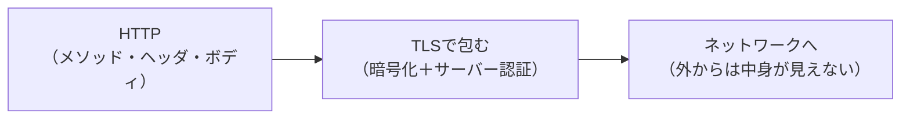
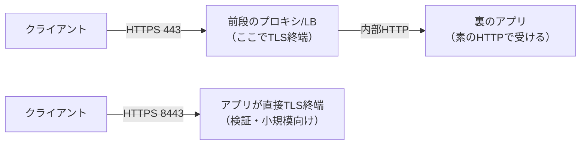

# 05 HTTPSとTLS ── HTTPを安全な封筒で包む

*個人検討ノートの一般化版（2026-11-16 同期・正は個人 Vault）*

ここまでのHTTPは、実は**平文（そのまま読める状態）**で流れていました。途中の経路で盗み見られたら中身は丸見えです。これを守るのが **HTTPS**。やっていることは単純で、**HTTPを TLS という安全な封筒で包んでいるだけ**です。HTTPそのものの文法（メソッド・ヘッダ・ボディ）は何も変わりません。

核心は、TLSが2つの仕事をすること。1つは**暗号化**（通信路を盗み見されない）、もう1つは**サーバー認証**（相手が本当に正しいサーバーかを確かめる）。この「正しいサーバーか」を保証するのが**証明書**で、証明書を発行する信頼できる第三者が**CA（認証局）**です。そして、暗号を解く場所を**どこにするか**（TLS終端）が、実務では重要な設計判断になります。

まとめると、この節で「HTTPSはHTTPをTLSで包んだもの」「TLSの2役（暗号化＋認証）」「証明書とCA」「TLS終端」を押さえます。デプロイ時の具体（ポート・証明書の発行・前段のプロキシ）は独立した実務テーマにゆずり、本節はその前知識編です。

## 5.1 HTTPSはHTTPをTLSで包んだもの

HTTPS の「S」は Secure（安全）。中身のHTTPは同じで、その外側を **TLS**（Transport Layer Security）という暗号の層でくるんだものが HTTPS です。郵便でいえば、ハガキ（平文HTTP）を、中身の見えない封筒（TLS）に入れて送るイメージ。封を開けられるのは正しい宛先だけ、という状態を作ります。

ブラウザのアドレス欄が `https://` で鍵マークが付くのは、「この往復はTLSで包まれている」というサイン。`http://`（鍵なし）は平文なので、ログインや個人情報を扱うサイトでは避けるべき、という判断がここから出てきます。

## 5.2 TLSの2つの仕事

TLSが担うのは、大きく2つです。片方だけでは安全になりません。

- **暗号化（盗み見防止）**：通信路を流れる中身を、第三者が読めない形にする。途中の機器に覗かれても意味のある情報を取り出せない。
- **サーバー認証（なりすまし防止）**：クライアントが「いま話している相手は、本当に名乗っているとおりのサーバーか」を**証明書**で確かめる。偽サイトに暗号化して送っても意味がない（相手が泥棒なら暗号化しても泥棒に届く）ので、**暗号化と認証はセット**で初めて効きます。

> [!NOTE]
> **認証が無いと暗号化は意味を失う**
> 「暗号化だけ」だと、偽のサーバーと安全に（＝暗号化して）会話してしまう恐れがあります。だからTLSは、通信を暗号で守ると同時に「相手が本物か」を確認します。この“本物確認”の土台が、次の証明書です。

## 5.3 証明書とCA ── 誰が「本物」を保証するか

**証明書**は、「このドメイン名（例 `example.com`）の持ち主は、この公開鍵の持ち主です」という**署名入りの身分証**です。サーバーは「証明書＋秘密鍵」のペアを持ち、クライアントは接続時に証明書を受け取って検証します。

ここで肝心なのは、**その身分証を誰が発行したか**。自分で「私は本物です」と書いた紙（自己署名）は、知らない相手には信用されません。そこで、社会的に信頼された第三者＝**CA（Certificate Authority＝認証局）**が発行し、署名します。ブラウザは最初から「信頼できるCAの一覧」を内蔵しているので、CAが署名した証明書なら「信頼の連鎖」でたどって本物だと判断できます。

| 発行主体 | 性質 | 向く場面 |
|---|---|---|
| **公開CA**（Let's Encrypt 等） | 広く信頼される。外部公開サイト向け | 一般公開のWebサイト |
| **社内（組織内）CA** | 閉じたネットワーク内で信頼。CSR（署名要求）を出して発行 | 社内・庁内限定のシステム |
| **自己署名** | 自分で署名。既定では信頼されない | 練習・検証のみ |

> [!NOTE]
> **文系向け・証明書の最小像**
> 証明書は運転免許証のようなもの。「この顔（公開鍵）の人は、確かにこの名前（ドメイン）の持ち主です」と、信頼できる発行機関（CA＝役所）が保証した身分証です。偽造できないように発行機関が署名しているので、提示された側は「本物の役所が出した免許証か」を確かめるだけで相手を信用できます。詳しい発行の段取り（社内CAへのCSRの出し方など）は、デプロイ実務の解説にゆずります。

## 5.4 TLS終端 ── 暗号をどこで解くか

HTTPSの暗号を解く場所を **TLS終端（TLS termination）** と呼びます。「どこで封筒を開けるか」を決める、という設計判断です。これが決まらないと「どのポートをどう開けるか」「証明書を誰が持つか」も決まりません。典型は次の2パターン。

- **前段（ロードバランサ／リバースプロキシ）で終端**：入口の設備がHTTPSを解き、裏のアプリへは**内部のHTTP**で渡す。大きな組織や既存基盤に相乗りするとき、いちばんよくある形。アプリ自身は証明書を持たなくてよい。
- **アプリが直接終端**：アプリ自身がTLSを解く。検証や小規模向け。

> [!IMPORTANT]
> **前段で終端すると、アプリは「自分はHTTPで受けた」と誤解しがち**
> 前段でTLSを解いて内部HTTPで渡すと、裏のアプリからは「平文HTTPで来た」ように見えます。実際はクライアントとの間はHTTPSだったのに。この食い違いは、前段が付ける **`X-Forwarded-Proto`** のようなヘッダで「元は https だった」と伝えて埋めます。この具体は、デプロイの練習で実際に手を動かして確かめます。

深掘りの入口：デプロイ（ポート開放・firewalld・SELinux・証明書発行）の実務や、ネットワーク全般の基礎は、それぞれ独立した深掘りテーマです。

---

## この項目のチェックリスト

- [ ] HTTPS＝HTTPをTLSで包んだもの、HTTP自体の文法は変わらない、を説明できる
- [ ] TLSの2つの仕事（暗号化＋サーバー認証）を言え、なぜ両方要るか（認証なしの暗号化は無意味）を説明できる
- [ ] 証明書＝ドメインの持ち主を保証する署名入り身分証、発行するのがCA、を説明できる
- [ ] 公開CA／社内CA／自己署名の違いと向く場面を言える
- [ ] TLS終端＝暗号を解く場所、前段で終端する形が多い、X-Forwarded-Protoで元のスキームを伝える、を説明できる
